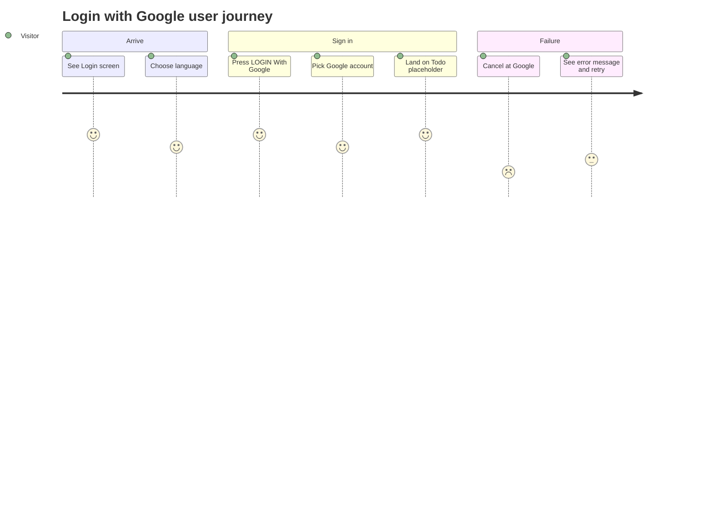

## Screen List

SCR### codes are allocated at promote (`TBD (draft)`). Only the Login screen has a screen spec draft (`screens/SCR-login/spec.md`).

| Screen Name | SCR### | What User Sees | What User Can Do |
|-------------|--------|----------------|------------------|
| Login (owned, atomic) | TBD (draft) | Top bar with the Sun* Annual Awards 2025 logo (left) and the language selector (right); a colorful wave artwork background; the "ROOT FURTHER" title with the lines "Bắt đầu hành trình của bạn cùng SAA 2025." and "Đăng nhập để khám phá!"; the "LOGIN With Google" button; a copyright footer "Bản quyền thuộc về Sun* © 2025" | Switch language between VN and EN; start Google sign-in; see an error message after a cancelled or failed attempt |
| Todo placeholder (owned, atomic, minimal; no screen spec drafted) | TBD (draft) | The signed-in user's account details and a sign-out control | Sign out |

## User Journey

1. Visitor arrives at the Login screen and sees the introduction, the language selector set to VN, and the Google sign-in button.
2. Visitor may open the language selector and pick EN — all Login screen text switches to English and the choice is remembered.
3. Visitor presses "LOGIN With Google" — the button becomes disabled with a loading indicator and the visitor is taken to Google to choose an account.
4. After a successful sign-in the visitor is taken to the Todo placeholder screen, where their account details and a sign-out control are shown.
5. If the visitor cancels or the sign-in fails, they return to the Login screen with the message "Đăng nhập không thành công. Vui lòng thử lại." and the button is usable again.
6. A signed-in user who tries to open the Login screen is taken straight to the Todo placeholder screen.
7. The user signs out from the Todo placeholder screen and is taken back to the Login screen.

