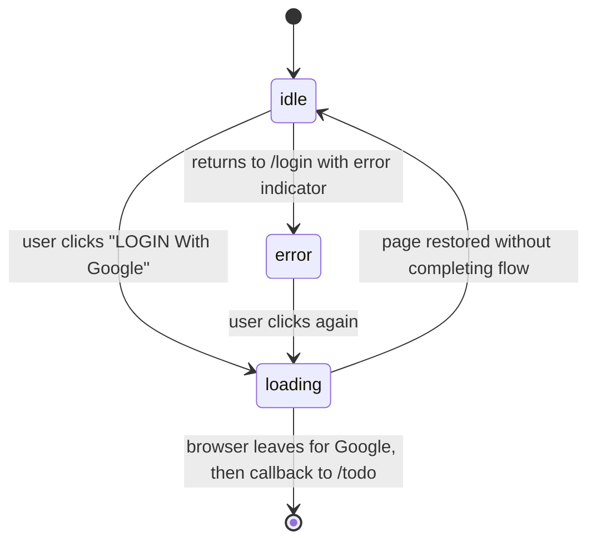

# F001_LoginWithGoogle

**Priority**: P0
**Type**: ui
**Generated**: 2026-10-19

## Overview

A visitor signs in to the SAA 2025 app with a Google account from the Login screen (`/login`). The browser calls Supabase Auth `signInWithOAuth` (provider `google`) and follows a same-tab redirect to Google, then returns through an app callback route that exchanges the authorization code for a Supabase session (cookie-based, `@supabase/ssr`) and sends the user to `/todo`. A Next.js `proxy` guard (`src/proxy.ts`) keeps `/login` for unauthenticated visitors only (authenticated users are redirected to `/todo`) and keeps `/todo` for authenticated users only. Any Google account is allowed. On cancel/failure the Login screen shows "Đăng nhập không thành công. Vui lòng thử lại." The Login screen carries a VN/EN language selector persisted in the `NEXT_LOCALE` cookie, backed by a lightweight dictionary (login screen scope only, no i18n library). A minimal protected `/todo` placeholder (user info + logout) is the post-login landing target. Stack: Next.js 16 App Router + TypeScript + Tailwind, Supabase local (supabase CLI), Google provider wired via env vars (`GOOGLE_CLIENT_ID`, `GOOGLE_CLIENT_SECRET` filled by the user later).


**Test coverage delta (2026-10-20):** full automated verification is required for this feature — unit tests covering every UT row and Playwright E2E covering the IT/UAT rows of `test-cases.md` (TC001–TC041), except externally-blocked scenarios (real Google consent UI) which remain manual.

## Polymorphic Behavior

N/A — no discriminator fields in Key Entities.

## Cross-Cutting Logic

### Requirements

| Code | Description | Endpoint/Handler | Verifiable |
|------|-------------|------------------|------------|
| FR-001 | Route-guard proxy runs on page requests, refreshes the Supabase session cookies, resolves the current user, and applies the redirect rules: authenticated on `/login` → `/todo`; unauthenticated on `/todo` → `/login`. Static assets and the auth callback route are excluded from the matcher. Spans US001, US002, US004. | `src/proxy.ts` (Next 16 proxy, successor to middleware) | yes |
| FR-002 | Supabase client config is driven by env vars (Supabase URL + public key, names TBD (draft); `GOOGLE_CLIENT_ID`, `GOOGLE_CLIENT_SECRET`). The Google provider is enabled in the local Supabase config and reads credentials from env; the app callback URL is listed as an allowed redirect URL. No secret is committed; an `.env` example documents the setup steps. Spans US001 and all environments. | Supabase local config + `.env` (paths TBD (draft)) | yes |

### Business Rules

None.

### Decision Logic

#### DEC-001_GuardRedirectRouting
**subtype:** flow
**Triggers in:** Login screen (`SCR-login` draft) and Todo placeholder page request
**Involved entities:** Supabase session (authenticated vs not), request path
**user_visible_outcome:** the visitor lands on the screen matching their sign-in state without seeing a flash of the wrong page.
**Source:** TBD (draft)

```pseudo
if path == '/login' AND session exists  → redirect '/todo'
if path == '/todo'  AND no session      → redirect '/login'
if path == '/login' AND no session      → show Login
if path == '/todo'  AND session exists  → show Todo
```

---

#### DEC-002_OAuthCallbackOutcomeRouting
**subtype:** flow
**Triggers in:** Login screen (`SCR-login` draft) after returning from Google (callback route)
**Involved entities:** OAuth authorization code, Supabase session, provider error/cancel indicator
**user_visible_outcome:** a successful sign-in lands on `/todo`; a cancelled or failed sign-in returns to `/login` with the error message.
**Source:** TBD (draft)

```pseudo
if provider error/cancel OR code missing → redirect '/login' with error indicator
else exchange code for session:
  if exchange fails → redirect '/login' with error indicator
  else              → redirect '/todo'
```

### State Machines

None.

### Algorithms

None.

### External Integrations

None.

### Verification

None.

**Client behavior:** see behavior-logic.md, permissions.md, screen-flow.md

## User Stories

### US001_LoginWithGoogle — Sign in with Google (Priority: P1)

**What happens:** A visitor on the Login screen clicks "LOGIN With Google". The button becomes disabled with a loading indicator, the browser redirects (same tab) to Google, the user picks any Google account, and returns via the callback route. A session is created and the user lands on `/todo`. If the user cancels or authentication fails, they return to `/login` and see "Đăng nhập không thành công. Vui lòng thử lại."
**Why this priority:** It is the only entry into the app; nothing else is reachable without it.
**Independent Test:** With Google credentials configured, click the button, authenticate with any Google account, and confirm landing on `/todo` with a valid session; repeat with cancel and confirm the error message on `/login`.

**Acceptance Scenarios:**

1. **Given** an unauthenticated visitor on the Login screen, **When** they click "LOGIN With Google", **Then** the button is disabled with a loader and the browser navigates (same tab) to Google sign-in.
2. **Given** the visitor completes Google authentication with any Google account, **When** the callback completes, **Then** user information is available in the session and the visitor is redirected to `/todo`.
3. **Given** the visitor cancels on Google or authentication fails, **When** they return to the app, **Then** the Login screen shows "Đăng nhập không thành công. Vui lòng thử lại." and the button is enabled again.
4. **Given** the visitor hovers the button, **When** the pointer is over it, **Then** a shadow/elevated effect shows.

**Requirements fulfilled:**
- **FR-003** The login button calls Supabase `signInWithOAuth` with provider `google` and `redirectTo` set to the app callback URL; same-tab redirect (no popup, no new tab). — client-side call from the Login screen
- **FR-004** The callback route exchanges the authorization code for a session (cookies set) and redirects to `/todo`. — callback route handler (path TBD (draft))
- **FR-005** On provider error, user cancel, missing code, or failed exchange, the callback redirects to `/login` with an error indicator; the Login screen shows the localized error message "Đăng nhập không thành công. Vui lòng thử lại." — callback route + Login screen
- **FR-006** While sign-in is in progress the button is disabled and shows a loading indicator; it is reset when the page is restored without completing the flow (e.g., browser back from Google). — Login screen

**Rules enforced:**

### BR-001_AnyGoogleAccountAllowed
**Linked FR:** FR-004
**Applies to:** OAuth callback
**Rule:** No allow-list, domain restriction, or pre-registration check; every Google account that authenticates successfully receives a session.

**Pseudocode:**
```text
on callback success: create session for authenticated Google identity (no domain/email check)
```

**State transitions:**

### SM-001_LoginButtonStatus
**kind:** ui
**Linked FR:** FR-006
**States:** idle, loading, error



| From | To | Guard | Side effect |
|------|----|-------|-------------|
| idle | loading | click | button disabled, loader shown |
| loading | idle | page restored (back navigation) | button re-enabled |
| idle | error | error indicator present on load | error message shown |
| error | loading | click | error message cleared, loader shown |

**External integrations:**

### INT-001_SupabaseGoogleSignIn
**Linked FR:** FR-003
**Type:** api-call
**Target:** Supabase Auth (local, supabase CLI) → Google OAuth provider
**Trigger:** click on the login button
**Payload:** provider `google`, `redirectTo` = app callback URL (no secrets sent from the browser)
**Failure handling:** SDK error or missing provider config → return to idle with the error message; no retry loop.

**Pseudocode:**
```ts
const { error } = await supabase.auth.signInWithOAuth({
  provider: 'google',
  options: { redirectTo: `${origin}/auth/callback` },
});
if (error) showLoginError();
```

### INT-002_SupabaseCodeExchange
**Linked FR:** FR-004
**Type:** api-call
**Target:** Supabase Auth session exchange (PKCE code → session)
**Trigger:** request to the callback route with an authorization code
**Payload:** authorization code (query param); session cookies written on success
**Failure handling:** any failure redirects to `/login` with the error indicator.

**Pseudocode:**
```ts
const code = url.searchParams.get('code');
if (!code) return redirect('/login?error');
const { error } = await supabase.auth.exchangeCodeForSession(code);
return redirect(error ? '/login?error' : '/todo');
```

**Verification:**
- **SC-001** Clicking the button with valid credentials ends on `/todo` with a session cookie set (covers FR-003, FR-004, BR-001).
- **SC-002** Cancelling at Google ends on `/login` with the error message and an enabled button (covers FR-005, FR-006, SM-001).
- **SC-003** The button is disabled and shows a loader between click and redirect (covers FR-006, SM-001).

---

### US002_RedirectAuthenticatedFromLogin — Skip the Login screen when signed in (Priority: P1)

**What happens:** An authenticated user who opens `/login` is redirected to `/todo`. An unauthenticated user (including after logout) sees the Login screen.
**Why this priority:** Prevents signed-in users from re-running sign-in and satisfies the access-control test cases.
**Independent Test:** Sign in, navigate to `/login`, and confirm the redirect to `/todo`; sign out and confirm `/login` renders.

**Acceptance Scenarios:**

1. **Given** an authenticated user, **When** they open `/login`, **Then** they are redirected to `/todo`.
2. **Given** an unauthenticated visitor, **When** they open `/login`, **Then** the Login screen is displayed.
3. **Given** a user who has just logged out, **When** the app navigates, **Then** the Login screen is displayed.

**Requirements fulfilled:**
- **FR-007** Authenticated requests to `/login` are redirected to `/todo` by the proxy guard (mechanism: FR-001). — proxy

**Rules enforced:**

### BR-002_LoginIsPublicOnlyForVisitors
**Linked FR:** FR-007
**Applies to:** page request to `/login`
**Rule:** `/login` is reachable without a session; with a session it is never rendered.

**Pseudocode:**
```text
if session then redirect('/todo') else allow('/login')
```

**Verification:**
- **SC-004** Opening `/login` while authenticated lands on `/todo` without showing the Login screen (covers FR-007, BR-002).

---

### US003_SelectLoginLanguage — Choose VN or EN on the Login screen (Priority: P2)

**What happens:** The header shows a language selector (Vietnam flag, "VN", chevron). Clicking it opens a dropdown with VN and EN. Choosing a language stores the choice in the `NEXT_LOCALE` cookie and updates all Login screen text to that language.
**Why this priority:** Required by the design but does not block sign-in.
**Independent Test:** Open `/login`, switch to EN, confirm text changes and the `NEXT_LOCALE` cookie is `en`; reload and confirm EN persists.

**Acceptance Scenarios:**

1. **Given** no `NEXT_LOCALE` cookie, **When** the Login screen loads, **Then** the selector shows "VN" and text is Vietnamese.
2. **Given** the dropdown is closed, **When** the user clicks the selector, **Then** the dropdown with VN and EN opens; hover shows a highlight and pointer cursor.
3. **Given** the dropdown is open, **When** the user picks EN, **Then** the cookie is set and all Login screen text switches to English.
4. **Given** the cookie holds an unsupported value, **When** the screen loads, **Then** Vietnamese is used.

**Requirements fulfilled:**
- **FR-008** The selector shows the current locale (default VN) with flag and chevron, and opens a VN/EN dropdown on click. — Login screen header
- **FR-009** Selecting a language writes `NEXT_LOCALE` (`vi` | `en`) and refreshes the screen so all texts use the chosen language. — Login screen
- **FR-010** Text is resolved from a lightweight in-repo vi/en dictionary keyed by the cookie value; fallback is `vi`. No i18n library; scope is the Login screen only. — Login screen

**Rules enforced:**

### BR-003_LocaleCookieFallback
**Linked FR:** FR-010
**Applies to:** Login screen text resolution
**Rule:** Only `vi` and `en` are valid cookie values; anything else or absence resolves to `vi`.

**Pseudocode:**
```text
locale = cookie in ['vi','en'] ? cookie : 'vi'
```

**Verification:**
- **SC-005** Switching to EN updates every Login screen text and persists across reload (covers FR-008, FR-009, FR-010, BR-003).

---

### US004_ViewProtectedTodoAndLogout — Land on /todo and sign out (Priority: P2)

**What happens:** After sign-in the user sees a minimal `/todo` placeholder showing their user info and a logout action. Visiting `/todo` without a session redirects to `/login`. Logout ends the session and returns the user to `/login`.
**Why this priority:** Gives the sign-in a real landing target and closes the session loop; it is deliberately minimal.
**Independent Test:** Sign in and confirm user info plus logout on `/todo`; click logout and confirm `/login`; open `/todo` directly and confirm the redirect.

**Acceptance Scenarios:**

1. **Given** an authenticated user, **When** `/todo` loads, **Then** their user info (fields TBD (draft)) and a logout control are shown.
2. **Given** an unauthenticated visitor, **When** they open `/todo`, **Then** they are redirected to `/login`.
3. **Given** an authenticated user on `/todo`, **When** they click logout, **Then** the session ends and the Login screen is displayed.

**Requirements fulfilled:**
- **FR-011** `/todo` requires a session; without one the proxy redirects to `/login` (mechanism: FR-001). — proxy
- **FR-012** `/todo` shows the signed-in user's info from the Supabase session and a logout control. — Todo page
- **FR-013** Logout calls Supabase `signOut`, clears session cookies, and redirects to `/login`. — logout action (path TBD (draft))

**Rules enforced:**

### BR-004_TodoRequiresSession
**Linked FR:** FR-011
**Applies to:** page request to `/todo`
**Rule:** `/todo` content is never served without a valid session; enforced server-side in the proxy, not only in the UI.

**Pseudocode:**
```text
if !session then redirect('/login') else allow('/todo')
```

**Verification:**
- **SC-006** Direct access to `/todo` without a session lands on `/login`; after logout, `/todo` is unreachable (covers FR-011, FR-013, BR-004).

---

### Edge Cases

See edge-cases.md.

## Key Entities

MODEL### codes are allocated at promote: `TBD (draft)` for all rows.

| Entity | Table | Key Columns | Purpose |
|--------|-------|-------------|---------|
| User (MODEL### TBD (draft)) | `auth.users` (Supabase-managed) | id, email, raw_user_meta_data (name, avatar), last_sign_in_at | Created/updated by Supabase Auth on first/each Google sign-in; app reads user info for `/todo` only |
| Session (MODEL### TBD (draft)) | `auth.sessions` / refresh tokens (Supabase-managed) + session cookies | session id, expiry, refresh token | Created on code exchange; refreshed by the proxy; removed on logout |
| Locale preference (MODEL### TBD (draft)) | N/A — browser cookie `NEXT_LOCALE` | value: `vi` \| `en` | Remembers the Login screen language |

## Artifact References

| Artifact | File | Codes Used | Reviewed |
|----------|------|------------|----------|
| System Overview | TBD (draft) | — | [ ] |
| Architecture | [architecture.md](../system/architecture.md) | — | [ ] |
| Permissions | [permissions.md](../system/permissions.md) | — | [ ] |
| Feature List | TBD (draft) | TBD (draft) | [ ] |
| API Map | TBD (draft) | TBD (draft) | [ ] |
| Entities | TBD (draft) | TBD (draft) | [ ] |
| Screens | [screens.md](screens.md) | TBD (draft) | [ ] |
| Behavior Logic | TBD (draft) | TBD (draft) | [ ] |
| Permissions Matrix | TBD (draft) | TBD (draft) | [ ] |
| User Stories | TBD (draft) | TBD (draft) | [ ] |

## Assumptions

- The OAuth round trip is same-tab (per clarification); the design test case that mentions "a new tab or popup" is superseded by that decision.
- The app callback route is proposed as `/auth/callback` (final path TBD (draft)); error state is passed to `/login` via a query indicator (name TBD (draft)).
- Session storage is cookie-based via `@supabase/ssr`; the proxy uses a verified user lookup (not an unverified cookie read) for guard decisions.
- Logo and footer are non-interactive (per test cases; the design note on logo click is unresolved in the CSV but the test case says no interaction).
- Language dictionary covers only Login screen strings (hero title/subtitle/tagline, button label, error message, footer); `/todo` stays single-language.
- Google credentials are blank until the user fills `GOOGLE_CLIENT_ID`/`GOOGLE_CLIENT_SECRET`; until then sign-in fails with the generic error.
- No post-login return-to-original-URL; the landing target is always `/todo`.

## Source Code References

No source code written yet — see `## User Stories` for planned behavior.

## Unresolved Questions

1. **English copy**: The CSV supplies Vietnamese text only; English strings for subtitle, tagline, button label, error message, and footer need approval.
2. **Error display pattern**: The design specifies the error text but not its placement (inline banner vs toast vs under button).
3. **Todo user info**: Which user fields (name, email, avatar) the placeholder shows is undecided.
4. **First-visit locale**: Default is VN per the design; whether browser language detection should apply on first visit is undecided.

## Source Walkthrough

Implemented. Reading order: Supabase config and env → proxy guard → callback route → Login screen → Todo placeholder.

1. **File:** `supabase/config.toml`, `.env.example` — Supabase local config and env example: defines the Google provider and redirect URLs.
2. **File:** `src/proxy.ts`: the guard that decides `/login` vs `/todo`.
3. **File:** `src/app/auth/callback/route.ts` — callback route: code exchange and outcome routing.
4. **File:** `src/app/login/page.tsx`, `src/lib/i18n/login-dictionary.ts` — Login screen and its dictionary: the UI the visitor sees.

### Call Hierarchy

```text
Login button click -> signInWithOAuth -> Google -> /auth/callback (exchangeCodeForSession) -> /todo
Any page request   -> proxy (session refresh + guard) -> allow | redirect
```

**Related files:** see `## Source Code References` above (Order column added there — F15 DRY, one table not two).

## DB Impact per Event

Application code performs no direct table writes; rows below are written by Supabase Auth itself.

| Event/Endpoint | Table | Columns | Operation | Value Derivation | Source |
|-----------------|-------|---------|-----------|-------------------|--------|
| OAuth callback (code exchange) | `auth.users` | email, raw_user_meta_data, last_sign_in_at | INSERT (first sign-in) / UPDATE | Derived by Supabase Auth from the Google identity | `[INFERRED]` — Supabase-managed, not app code |
| OAuth callback (code exchange) | `auth.sessions` | id, user_id, created_at | INSERT | Created by Supabase Auth per session | `[INFERRED]` — Supabase-managed, not app code |
| Logout | `auth.sessions` | id | DELETE | Session revoked by Supabase `signOut` | `[INFERRED]` — Supabase-managed, not app code |
