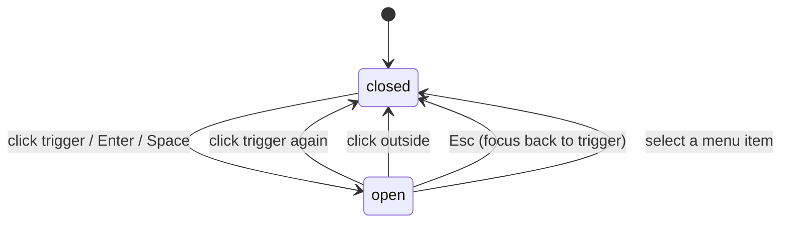
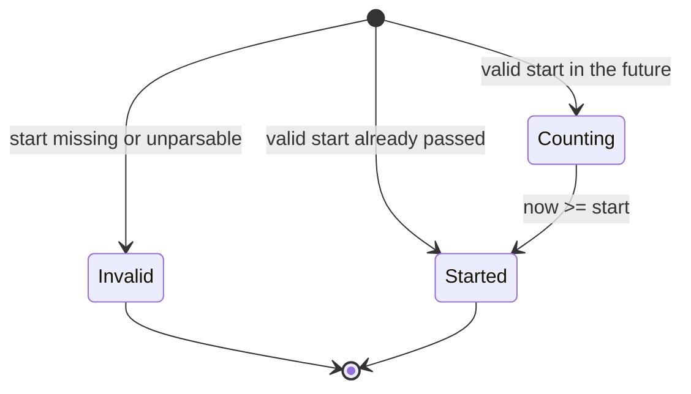

# F003_HomepageSaa

**Priority**: P1
**Type**: ui
**Generated**: 2026-10-20

## Overview

A visitor opens `/` (public) and browses the SAA 2025 homepage: hero "ROOT FURTHER" with a live countdown to a configured event start, event info, calls to action, the Root Further story, six award cards, a Kudos promo, a floating widget button and a footer. A sticky header carries the logo, three nav links, VN/EN language menu, and (signed-in only) a notification bell and an account menu. The page is static-content-first; the only dynamic inputs are the configured event start, the active locale cookie and the Supabase session (signed-in state and admin role). It replaces the starter boilerplate at `/` and adds two placeholder pages (`/awards`, `/kudos`) so navigation and hash anchors work now. It touches the existing lite i18n layer, the existing sign-out action and the Supabase session read; no new service or data store.

## Polymorphic Behavior

N/A — no discriminator fields in Key Entities.

## Cross-Cutting Logic

### Requirements

| Code | Description | Endpoint/Handler | Verifiable |
|------|-------------|------------------|------------|
| FR-001 | `/` is public: an unauthenticated visitor sees the full homepage with no redirect; a signed-in user also stays on `/` | PAGE `/` | yes |
| FR-002 | Header is fixed at the top with semi-transparent dark background on every scroll position and lists, in order: logo, 3 nav links, bell (signed-in only), language button, account icon (signed-in only) | PAGE `/` (header region) | yes |
| FR-003 | Every localized string on the homepage (header, hero, sections, footer, menus, empty states) comes from a home dictionary on the shared locale mechanism: Vietnamese is the exact design copy, English is a dev draft pending PM review; default locale follows the existing NEXT_LOCALE cookie rule | PAGE `/` + locale cookie | yes |
| FR-004 | Dropdown menus (language, notification panel, account menu, widget menu) share one behavior: click on trigger toggles; click outside closes; Enter or Space on a focused trigger opens; Esc closes and returns focus to the trigger | PAGE `/` (all 4 menus) | yes |
| FR-005 | Layout is responsive: sections shrink or stack on small screens, awards grid is 3 columns on desktop and 2 columns on tablet and mobile, text wraps without horizontal scroll | PAGE `/` | yes |
| FR-006 | Post-login redirect is unchanged: successful sign-in still lands on `/todo`; the homepage is independent of the auth flow | existing auth callback | yes |

**Source:** TBD (draft)

### Business Rules

None. Rules are placed inline under the owning user story (BR-001 to BR-004).

### Decision Logic

#### DEC-001_HeaderAuthRender
**subtype:** render
**Triggers in:** SCR### TBD (draft) header on page load
**Involved entities:** Supabase session user, user app_metadata role
**user_visible_outcome:** decides whether the visitor sees bell, account icon and the Admin Dashboard item
**Source:** TBD (draft)

```pseudo
if no session → header shows logo, nav, language only (visitor slot: see Unresolved Questions)
else if session → add bell + account icon (items: Profile, Sign out)
  and if app_metadata.role === 'admin' → add item Admin Dashboard
else (role missing or any other value) → no Admin Dashboard
```

### State Machines

#### SM-002_DropdownMenu
**kind:** ui
**Linked FR:** FR-004
**Source:** TBD (draft)
**States:** closed, open



| From | To | Guard | Side effect |
|------|----|-------|-------------|
| closed | open | trigger enabled | close any other open menu |
| open | closed | trigger / outside click / Esc / item select | focus returns to trigger on Esc |

### Algorithms

None. Countdown computation is ALG-001 under US002.

### External Integrations

#### INT-001_SupabaseSessionRead
**Linked FR:** FR-001
**Source:** TBD (draft)
**Type:** api-call
**Target:** Supabase Auth session (existing server client)
**Trigger:** each request to `/` that needs signed-in state or role
**Payload:** session cookies only; reads user id, app_metadata role
**Failure handling:** treat as signed out (consistent with the existing guard); homepage still renders

```pseudo
user = supabase.auth.getUser() (or claims)
if error or no user → visitor
else → signed-in, role = user.app_metadata.role
```

### Verification

- **SC-001** — `/` returns the full page for a visitor and for a signed-in user, with no redirect (covers FR-001)
- **SC-002** — All four menus open and close per the shared behavior with mouse and keyboard (covers FR-004, SM-002)
- **SC-003** — Switching VN/EN changes every homepage string and survives reload (covers FR-003)
- **SC-004** — Layout matches 3-col / 2-col awards grid at desktop / tablet / mobile widths (covers FR-005)
- **SC-005** — Completing login still lands on `/todo` (covers FR-006)

---

**Client behavior:** see behavior-logic.md, permissions.md, screen-flow.md

## User Stories

### US001_ViewHomepage — Visitor browses the homepage (Priority: P1)

**What happens:** A visitor opens `/` and scrolls through hero, event info, Root Further story, six award cards, the Kudos promo and the footer, with no sign-in.
**Why this priority:** It is the public entry to the event campaign; every other story hangs off it.
**Independent Test:** Open `/` in a signed-out browser; every section is present with design copy.

**Acceptance Scenarios:**

1. **Given** a signed-out visitor, **When** they open `/`, **Then** the full homepage shows without a redirect.
2. **Given** the hero is visible, **When** the visitor reads event info, **Then** it shows "Thời gian: 26/12/2025", "Địa điểm: Âu Cơ Art Center" and "Tường thuật trực tiếp qua sóng Livestream" (Figma frame is authoritative).
3. **Given** the Root Further block, **When** the visitor reads it, **Then** the theme text and the quote "A tree with deep roots fears no storm" show in white on dark background.

**Requirements fulfilled:**
- **FR-007** Hero shows title "ROOT FURTHER", subtitle "Coming soon", countdown, event info and the two CTAs over a dark root-pattern background with overlay
- **FR-008** Event info block (time, place, broadcast note) is static design copy and wraps responsively
- **FR-009** Root Further block shows decorative "ROOT"/"FURTHER" typography, theme paragraphs and the English quote
- **FR-010** Kudos promo shows label "Phong trào ghi nhận", title "Sun* Kudos", short description and illustration; its "Chi tiết" button goes to `/kudos`
- **FR-011** Footer shows logo (links to `/` top), three links (same states as header) and the copyright line exactly as designed

**Rules enforced:** none beyond cross-cutting FR-001, FR-003, FR-005.

**Verification:**
- **SC-006** — Each homepage section is present with design text (covers FR-007 to FR-011)

---

### US002_SeeEventCountdown — Visitor sees time left to the event (Priority: P1)

**What happens:** The hero shows DAYS / HOURS / MINUTES tiles counting down to the configured event start; "Coming soon" is visible until the start passes.
**Why this priority:** It is the hero's main hook and carries the most testable logic.
**Independent Test:** Set the event start to a known future instant; tiles equal the difference, zero-padded, and drop per minute.

**Acceptance Scenarios:**

1. **Given** a future start, **When** the page loads, **Then** three 2-digit zero-padded groups (e.g. 05, 09) with labels DAYS, HOURS, MINUTES show and "Coming soon" is visible.
2. **Given** the page stays open, **When** a minute passes, **Then** the MINUTES value decreases by one (rolling over hours and days).
3. **Given** the start time is reached or passed, **When** the next update runs, **Then** tiles show 00 00 00 and "Coming soon" is hidden.
4. **Given** the event start setting is missing or not a valid ISO-8601 date, **When** the page loads, **Then** tiles show 00 00 00, "Coming soon" is hidden and the page does not crash.

**Requirements fulfilled:**
- **FR-012** Countdown target is read from the configured event start (ISO-8601 with offset, e.g. 2026-12-31T18:30:00+07:00)
- **FR-013** Tiles show days, hours, minutes as two-digit zero-padded values and refresh at least once per minute while the page is open
- **FR-014** "Coming soon" label is hidden once the start time has passed, and when the configured value is missing or invalid

**Rules enforced:**

### BR-002_InvalidEventDateFallback
**Linked FR:** FR-014
**Source:** TBD (draft)
**Applies to:** hero countdown on load
**Rule:** A missing, empty or unparsable event start never throws: show 00 00 00, hide "Coming soon".

**Pseudocode:**
```text
t = parse(EVENT_START_AT)
if t is invalid → values = 00/00/00, showComingSoon = false
```

**Algorithms:**

### ALG-001_CountdownRemaining
**Linked FR:** FR-013
**Source:** TBD (draft)
**Input:** event start instant, current time
**Output:** days, hours, minutes (zero-padded strings), showComingSoon boolean
**File Schema**: N/A — not a file-exchange type
**Complexity:** O(1)
**Description:** Floors remaining milliseconds to whole minutes, splits into days/hours/minutes, clamps at zero. Uses the absolute instant so the client time zone does not change the result.

**Pseudocode:**
```text
diff = max(0, start - now)
mins = floor(diff / 60000)
days = floor(mins / 1440); hours = floor(mins % 1440 / 60); minutes = mins % 60
showComingSoon = start is valid AND now < start
return pad2(days), pad2(hours), pad2(minutes), showComingSoon
```

**State transitions:**

### SM-001_CountdownPhase
**kind:** ui
**Linked FR:** FR-014
**Source:** TBD (draft)
**States:** Invalid, Counting, Started



| From | To | Guard | Side effect |
|------|----|-------|-------------|
| Counting | Started | now >= start | tiles 00 00 00, hide "Coming soon", stop timer |
| initial | Invalid | start invalid | tiles 00 00 00, hide "Coming soon", no timer |

**Verification:**
- **SC-007** — Known future start yields exact zero-padded values and a per-minute decrease (covers FR-012, FR-013, ALG-001)
- **SC-008** — Start in the past, start equal to now, and invalid/missing value all show 00 00 00 with "Coming soon" hidden and no error (covers FR-014, BR-002, SM-001)

---

### US003_NavigateToSections — Visitor moves to Awards and Kudos pages (Priority: P1)

**What happens:** The visitor uses header nav, footer links, hero CTAs, award cards or the Kudos promo to reach `/awards`, `/kudos` or the homepage top; award cards deep-link to a section.
**Why this priority:** Navigation is the homepage's purpose: it routes interest to detail pages.
**Independent Test:** Click each link/card and check URL and scroll position.

**Acceptance Scenarios:**

1. **Given** the homepage, **When** the visitor clicks the logo (header or footer) or "About SAA 2025" while already selected, **Then** the page scrolls to the top.
2. **Given** any page, **When** the visitor clicks the logo, **Then** they land on the homepage top.
3. **Given** the nav, **When** the visitor hovers a link, **Then** a bright background highlight shows; the current page link is yellow with underline.
4. **Given** hero CTAs, **When** the visitor clicks "ABOUT AWARDS" or "ABOUT KUDOS", **Then** `/awards` or `/kudos` opens.
5. **Given** an award card, **When** the visitor clicks its image, title or "Chi tiết", **Then** `/awards#<slug>` opens and the browser scrolls to that section.
6. **Given** a card without a slug, **When** clicked, **Then** `/awards` opens with no auto-scroll.

**Requirements fulfilled:**
- **FR-015** Logo (header 64x60, footer 69x64) links to `/` and scrolls to top when already on `/`
- **FR-016** Nav links "About SAA 2025", "Awards Information", "Sun* Kudos" share three states (selected = yellow + underline, hover = bright highlight, normal); the same links appear in header and footer
- **FR-017** CTAs "ABOUT AWARDS" (yellow) and "ABOUT KUDOS" (outlined) share state styles and go to `/awards` and `/kudos`
- **FR-018** Awards section shows caption "Sun* annual awards 2025", title "Hệ thống giải thưởng", sub-text, and six cards (Top Talent, Top Project, Top Project Leader, Best Manager, Signature 2025 - Creator, MVP (Most Valuable Person)), each with square thumbnail, title, description (max 2 lines with ellipsis) and "Chi tiết" link; hover lifts the card and strengthens border/glow
- **FR-019** Each card (image, title, "Chi tiết") links to `/awards#<category-slug>`
- **FR-020** Minimal placeholder pages `/awards` and `/kudos` exist (title + under-construction message) so links never 404; the `/awards` page carries section anchors matching card slugs

**Rules enforced:**

### BR-004_CardWithoutSlug
**Linked FR:** FR-019
**Source:** TBD (draft)
**Applies to:** award card link building
**Rule:** A card with no slug links to `/awards` without a hash; no error, no auto-scroll.

**Pseudocode:**
```text
href = slug ? "/awards#" + slug : "/awards"
```

**Verification:**
- **SC-009** — Every nav/CTA/footer/card link resolves with no broken link; each card deep-links to its own anchor (covers FR-015 to FR-020, BR-004)

---

### US004_SwitchLanguage — Visitor switches between VN and EN (Priority: P2)

**What happens:** The visitor opens the language button (shows "VN"), picks VN or EN, and every homepage string changes.
**Why this priority:** Needed for the bilingual audience but the page works in the default locale without it.
**Independent Test:** Pick EN; all strings switch; pick VN; back to design copy.

**Acceptance Scenarios:**

1. **Given** the homepage in VN, **When** the visitor opens the language menu, **Then** it lists exactly VN and EN.
2. **Given** the menu is open, **When** the visitor selects EN, **Then** the whole UI switches to English and the button shows the new code.
3. **Given** EN is active, **When** the visitor selects VN, **Then** the UI returns to the exact design copy.

**Requirements fulfilled:**
- **FR-021** Language button shows the active code and opens a VN/EN menu; selection stores the locale in the shared NEXT_LOCALE cookie via the existing locale action and refreshes the page copy

**Rules enforced:** FR-003 and FR-004 apply (see Cross-Cutting Logic).

**Verification:**
- **SC-010** — VN/EN switch changes the whole UI both ways and persists on reload (covers FR-021)

---

### US005_OpenNotificationPanel — Signed-in user opens the notification bell (Priority: P2)

**What happens:** A signed-in user clicks the bell and sees an empty panel with "Chưa có thông báo"; no unread badge is shown because there is no data source yet.
**Why this priority:** Ships the UI shell; notification backend is a future feature.
**Independent Test:** Sign in, click bell, panel opens with the empty message; signed out, bell is absent.

**Acceptance Scenarios:**

1. **Given** a signed-in user, **When** the page loads, **Then** the bell (40x40) shows with no badge.
2. **Given** the bell, **When** clicked, **Then** the panel opens with "Chưa có thông báo" (EN draft equivalent in English locale).
3. **Given** a visitor, **When** the page loads, **Then** no bell is shown.

**Requirements fulfilled:**
- **FR-022** Bell is shown only for signed-in users; opens a notification panel in empty state; the unread badge is hidden until a data source exists

**Rules enforced:**

### BR-003_BellSignedInOnly
**Linked FR:** FR-022
**Source:** TBD (draft)
**Applies to:** header bell
**Rule:** Bell and panel are hidden when there is no session; the badge shows only when unread count > 0, which is always 0 in this release.

**Pseudocode:**
```text
showBell = isSignedIn
showBadge = showBell AND unreadCount > 0   # unreadCount = 0 (no source)
```

**Verification:**
- **SC-011** — Bell absent for visitors; present with empty panel and no badge for signed-in users (covers FR-022, BR-003)

---

### US006_UseAccountMenu — Signed-in user uses the account menu (Priority: P1)

**What happens:** A signed-in user clicks the account icon and sees Profile and Sign out; an admin additionally sees Admin Dashboard. Sign out ends the session.
**Why this priority:** It is the only sign-out entry on the homepage and the admin gate.
**Independent Test:** Open the menu as user and as admin and compare items.

**Acceptance Scenarios:**

1. **Given** a regular signed-in user, **When** they open the account menu, **Then** it lists Profile and Sign out only.
2. **Given** a user whose Supabase app_metadata role is admin, **When** they open it, **Then** Admin Dashboard also appears.
3. **Given** the menu, **When** the user picks Sign out, **Then** the existing sign-out action runs and the user is signed out.
4. **Given** Profile or Admin Dashboard, **When** picked, **Then** a placeholder page opens.

**Requirements fulfilled:**
- **FR-023** Account icon (40x40) opens a menu with Profile and Sign out for any signed-in user, plus Admin Dashboard only for admins
- **FR-024** Sign out reuses the existing signOutAction; Profile and Admin Dashboard open placeholder routes (paths TBD)

**Rules enforced:**

### BR-001_AdminDashboardAdminOnly
**Linked FR:** FR-023
**Source:** TBD (draft)
**Applies to:** account menu items
**Rule:** Admin Dashboard is offered only when the Supabase user's app_metadata role equals the string admin; a missing or different value means regular user. Role is set manually (Studio/admin API); users cannot edit app_metadata.

**Pseudocode:**
```text
items = [Profile, Sign out]
if user.app_metadata.role === 'admin' → items.push(Admin Dashboard)
```

**Verification:**
- **SC-012** — Admin sees 3 items, regular user sees 2, Sign out ends the session (covers FR-023, FR-024, BR-001)

---

### US007_OpenWidgetMenu — Visitor opens the floating widget menu (Priority: P3)

**What happens:** The visitor clicks the fixed bottom-right pill (105x64, pencil / SAA icon) and sees a small menu of quick actions.
**Why this priority:** Design shows the button but the menu content is unspecified.
**Independent Test:** Click the pill; a 2-item menu opens; items act.

**Acceptance Scenarios:**

1. **Given** the homepage, **When** the visitor clicks the widget, **Then** a menu opens with "Gửi Kudos" and "Về đầu trang" (temporary, TBD).
2. **Given** the menu, **When** "Về đầu trang" is picked, **Then** the page scrolls to top.

**Requirements fulfilled:**
- **FR-025** Floating widget button stays fixed bottom-right and opens a stub quick-action menu (Gửi Kudos goes to `/kudos`, Về đầu trang scrolls to top); items are marked TBD pending designer/PM

**Rules enforced:** FR-004 applies.

**Verification:**
- **SC-013** — Widget opens the 2-item stub menu and both items work (covers FR-025)

---

### Edge Cases

See edge-cases.md.

## Key Entities

No database tables are read or written by this feature (draft intent).

| Entity | Table | Key Columns | Purpose |
|--------|-------|-------------|---------|
| Supabase session user | N/A (managed by Supabase Auth) | user id, app_metadata role | read-only: signed-in state and admin gate |
| Event start setting | N/A (deploy-time env value) | ISO-8601 start instant | read-only: countdown target |
| Locale preference | N/A (cookie) | NEXT_LOCALE | read/write: VN or EN |
| Award category | N/A (static constant in UI) | title, description, thumbnail, slug | read-only: six card definitions |

## Artifact References

| Artifact | File | Codes Used | Reviewed |
|----------|------|------------|----------|
| System Overview | [system-overview.md](../../docs/system/system-overview.md) | — | [ ] |
| Architecture | [architecture.md](../../docs/system/architecture.md) | — | [ ] |
| Feature List | [feature-list.md](../../docs/generated/feature-list.md) | TBD (draft) | [ ] |
| API Map | [api-map.md](../../docs/generated/api-map.md) | TBD (draft) | [ ] |
| Entities | [entities.md](../../docs/generated/entities.md) | TBD (draft) | [ ] |
| Screens | [screens.md](../../docs/features/TBD/screens.md) | TBD (draft) | [ ] |
| Behavior Logic | [behavior-logic.md](../../docs/system/behavior-logic.md) | TBD (draft) | [ ] |
| Permissions Matrix | [permissions-matrix.md](../../docs/generated/permissions-matrix.md) | TBD (draft) | [ ] |
| User Stories | [user-stories.md](../../docs/generated/user-stories.md) | TBD (draft) | [ ] |

Forward-drafted narrative: `spec/system/permissions.md` in this plan (Visitor / Signed-in / Admin).

## Assumptions

- This feature SUPERSEDES F002_StarterHomePage (the create-next-app boilerplate shown at `/`, screen SCR001_Home): `/` becomes the real homepage. No existing code is renumbered here; reconciliation of the old feature and screen is left to promote.
- Homepage is independent of the F001 auth flow; post-login redirect stays `/todo` (F001 spec sealed and tested).
- Role comes only from Supabase app_metadata (not user-editable), read server-side; hiding Admin Dashboard is a UX control, not a security boundary.
- Notification data source does not exist; badge hidden and panel empty by design.
- English copy is a dev draft; Vietnamese is exact design copy. Widget menu items are temporary.
- Event info follows the Figma frame (26/12/2025, Âu Cơ Art Center, Livestream note); the spec CSV values (18h30, Nhà hát nghệ thuật quân đội, Group Facebook note) are superseded.
- Targets "Awards Information" and "Sun* Kudos" are real navigation to placeholder routes `/awards` and `/kudos`; hash anchors are slugs of the six categories.

## Source Code References

Implemented on branch `feature/homepage`: routes in `src/app/(site)/`, components in `src/components/home/`, logic in `src/lib/countdown/`, `src/lib/site/` and `src/lib/auth/` (`is-admin-user`, `get-current-viewer`, `build-account-menu`, `decide-admin-access`), copy in `src/lib/i18n/home-dictionary*.ts`.

## Unresolved Questions

1. **Visitor header slot**: with bell and account menu signed-in only, what does a visitor see in that slot (nothing or a Login link)?
2. **Placeholder routes** (built: `/profile` redirects visitors to `/login`; `/admin` is server-guarded, non-admins redirect to `/`): exact paths for Profile and Admin Dashboard, and whether the admin route is server-guarded.
3. **Header/footer on placeholder pages** (built: shared `(site)` layout renders them on all site pages): do `/awards` and `/kudos` reuse the homepage header and footer (selected-state follows the page)?
4. **Event config**: production value of the event start vs displayed date 26/12/2025, and whether the time (18h30 in CSV) should show.
5. **Slugs** (built in `src/lib/site/award-categories.ts`): confirm the six category slugs used for `/awards#<slug>`.
6. **Copy**: copyright line contains the design typo "thuộc vè"; reproduce or correct.

## Source Walkthrough

TBD (draft) — no source code written yet for the behavior logic; reading order is set at reconcile.

### Call Hierarchy

TBD (draft)

**Related files:** see `## Source Code References` above.

## DB Impact per Event

N/A — read-only feature, no DB writes.
