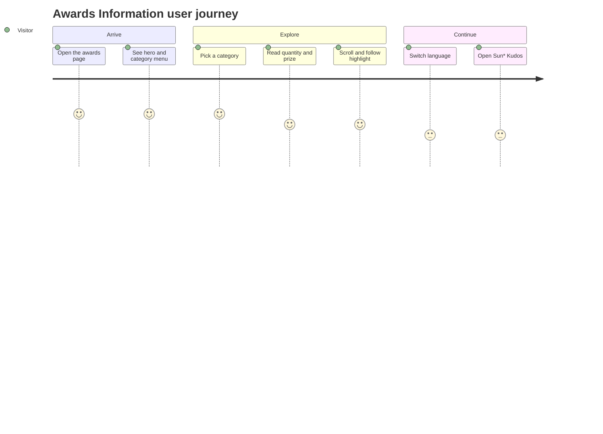

# Screens — AwardsInformation

## Screen List

| Screen Name | SCR### | What User Sees | What User Can Do |
|-------------|--------|----------------|------------------|
| Awards Information (Hệ thống giải) | TBD (draft) | Shared header; keyvisual hero with "ROOT FURTHER" logo; caption "Sun* Annual Awards 2025" over the gold heading "Hệ thống giải thưởng SAA 2025"; left menu with six categories; six award cards (image, title, description, quantity, prize value); Sun* Kudos promo; shared footer | Pick a category in the menu to jump to its card; scroll and watch the highlighted category follow; read quantities and prizes; switch language from the header; press "Chi tiết" to open the Kudos page; arrive from a homepage card straight at a category |

The Sun* Kudos page it links to is a separate placeholder screen, not specified here. This screen replaces the Awards placeholder screen listed under the Homepage SAA feature.

## User Journey

1. A visitor arrives at the Awards Information screen (from the header, a homepage award card or a direct link) and sees the hero, the gold title and the category menu.
2. The visitor picks a category in the menu — the screen glides to that award and the picked category turns gold with an underline.
3. The visitor reads the award card — image, description, number of prizes and prize value.
4. The visitor keeps scrolling — the highlighted category in the menu moves to match the card being read.
5. The visitor switches language from the header — all wording changes between Vietnamese and English.
6. The visitor reaches the Sun* Kudos block and presses "Chi tiết" — is taken to the Sun* Kudos screen.
7. A visitor who came from a homepage award card — starts at step 3 for that award, already highlighted.

