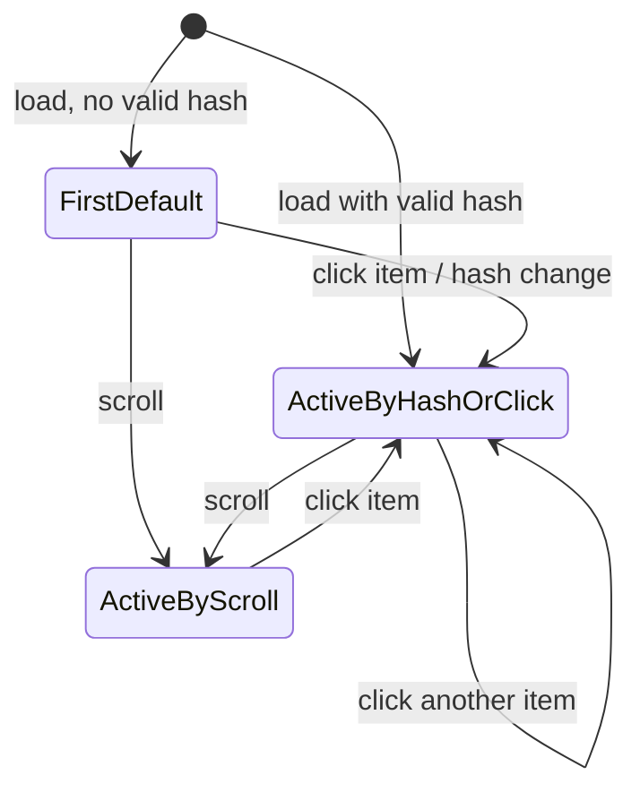

# F004_AwardsInformation

**Priority**: P1
**Type**: ui
**Generated**: 2026-10-20

## Overview

A visitor opens `/awards` (public, no sign-in) and reads the SAA 2025 award system: a keyvisual hero, a gold section title, a left category menu listing the six categories, six award detail cards (image 336x336, description, quantity line, prize-value line) and a Sun* Kudos promo that leads to `/kudos`. Clicking a menu item smooth-scrolls to its card and marks it active (gold text, underline); a scroll-spy keeps the active item in sync while the visitor scrolls. All wording follows the VN/EN switcher through a new awards dictionary on the existing lite i18n layer (Vietnamese is the exact design copy, English a dev draft pending PM). The page replaces the `/awards` placeholder created under F003 and keeps the six card section ids so homepage deep-links `/awards#<slug>` still work. No service, data store or auth rule is added: content is static and the only dynamic input is the `NEXT_LOCALE` cookie. Build status: built — presentational UI, scroll-spy and the awards dictionary are all in code.

## Polymorphic Behavior

N/A — no discriminator fields in Key Entities.

Per-award variation (one versus two prize values, justified versus left-aligned text, alternating image side) is data-driven by `AwardDetail` fields, not by a code branch on the slug.

## Cross-Cutting Logic

### Requirements

| Code | Description | Endpoint/Handler | Verifiable |
|------|-------------|------------------|------------|
| FR-001 | `/awards` is public: a visitor with no session sees the full page with no redirect to login; a signed-in user also stays on the page | PAGE `/awards` | yes |
| FR-002 | The six card sections carry ids equal to the canonical slugs `top-talent`, `top-project`, `top-project-leader`, `best-manager`, `signature-2025-creator`, `mvp`; menu links, scroll-spy and homepage deep-links all resolve through these ids | PAGE `/awards` (card sections) | yes |

**Source:** `src/components/awards/award-detail-card.tsx:31`

### Business Rules

Rules spanning more than one story (BR-001, BR-002) are below; the others sit inline under their owning user story (BR-003 to BR-006).

#### BR-001_AwardsPagePublic
**Linked FR:** FR-001
**Source:** `src/app/(site)/awards/page.tsx:28-41`
**Applies to:** PAGE `/awards`
**Rule:** The page renders without any session check and the proxy redirect rules only cover `/login` and `/todo`, so visitors always get the page. Recorded deviation from the MoMorph test case that assumes authenticated-only access (see clarifications).

**Pseudocode:**
```text
on request /awards:
  render page (no auth gate, no redirect)
```

#### BR-002_SectionIdIsCanonicalSlug
**Linked FR:** FR-002
**Source:** `src/lib/site/award-categories.ts:3-12`
**Applies to:** all six card sections, menu items, homepage award cards
**Rule:** Section id, menu item slug and homepage deep-link fragment are the same value drawn from one canonical slug list. A change to any slug breaks homepage links and the F003 end-to-end tests, so slugs are fixed.

**Pseudocode:**
```text
slugs = [top-talent, top-project, top-project-leader,
         best-manager, signature-2025-creator, mvp]
section.id = slug; menuItem.href = "#" + slug; homeCard.href = "/awards#" + slug
```

### Decision Logic

#### DEC-001_ActiveCategoryResolution
**subtype:** render, interaction
**Triggers in:** `SCR-awards-information` (draft) on mount, on menu click, on hash change, and on scroll
**Involved entities:** AwardCategory.slug, location hash, in-view section
**user_visible_outcome:** decides which single menu item is shown in gold with an underline.
**Source:** `src/components/awards/use-active-category.ts`, `src/components/awards/select-active-section.ts`

```pseudo
if hash matches a menu slug → active = hash
else → active = first menu item          // no/unknown hash never breaks
on scroll: active = last section covering the spy line (34% of viewport height), else keep previous
click on item: scroll to its section, set hash, active = that slug (scroll-spy paused until scroll settles)
```

### State Machines

#### SM-001_CategoryMenuActive
**kind:** ui
**Linked FR:** FR-007
**Source:** `src/components/awards/use-active-category.ts`
**States:** FirstDefault, ActiveByHashOrClick, ActiveByScroll



| From | To | Guard | Side effect |
|------|----|-------|-------------|
| FirstDefault | ActiveByHashOrClick | item target exists | smooth scroll (instant if reduced motion), URL fragment updated |
| any | ActiveByScroll | section covers the spy line (34% of viewport height) | active item changes without a jump |
| any | FirstDefault | hash empty or not a menu slug | first item shown active |

### Algorithms

#### ALG-001_ScrollSpySelection
**Linked FR:** FR-010
**Source:** `src/components/awards/select-active-section.ts`, `src/components/awards/use-active-category.ts`
**Input:** the six section elements, their viewport intersection
**Output:** the slug to mark active
**File Schema**: N/A — not a file-exchange type
**Complexity:** O(n), n = 6
**Description:** An IntersectionObserver over the six sections acts only as a trigger; the pure function `selectActiveSection` picks the active slug (the last section covering the spy line at 34% of the viewport height, else the previous one). Observer is disconnected on unmount. Scrolling never writes the URL fragment.

**Pseudocode:**
```text
observe(sections, rootMargin = bottom -66%)   // top 34% band
on intersect change:
  active = last section whose [top,bottom) covers 0.34 * viewportHeight, else keep previous
on unmount: observer.disconnect()
```

### External Integrations

None.

### Verification

- **SC-001** — `/awards` loads with no session and no redirect, and all six section ids exist in the document (covers FR-001, FR-002, BR-001, BR-002)

---

**Client behavior:** see
[`behavior-logic.md`](../../docs/system/behavior-logic.md) (client-side patterns — debounce, optimistic UI, polling, upload, realtime),
[`permissions.md`](../../docs/system/permissions.md) (feature flags / experiments / env / locale gates; Visitor may view, unchanged),
[`architecture.md`](../../docs/system/architecture.md) (guards / deep-link state restoration / unsaved-changes protection).

## User Stories

### US001_ViewAwardSystem — Visitor reads the SAA 2025 award system (Priority: P1)

**What happens:** The visitor opens `/awards` and sees the keyvisual hero, the caption "Sun* Annual Awards 2025" over the gold heading "Hệ thống giải thưởng SAA 2025", the left menu with six items in fixed order (Top Talent, Top Project, Top Project Leader, Best Manager, Signature 2025 - Creator, MVP), and six cards stacked in the same order, image side alternating. Each card shows a 336x336 image, title, description, "Số lượng giải thưởng" with count and unit, and "Giá trị giải thưởng" with amount and note.
**Why this priority:** Core purpose of the page; every other story builds on it.
**Independent Test:** Open `/awards` signed out; compare each card's quantity and prize text with the table below.
**Endpoints**: PAGE `/awards`

**Acceptance Scenarios:**

1. **Given** a visitor with no session, **When** they open `/awards`, **Then** hero, title, six menu items and six cards render in order with no redirect.
2. **Given** the page is loaded, **When** the visitor reads each card, **Then** its image is 336x336 and quantity and prize values equal the Figma frame values below.
3. **Given** the Signature card, **When** it renders, **Then** it shows two prize values separated by "Hoặc".

| Award | Quantity | Prize value |
|-------|----------|-------------|
| Top Talent | 10 Cá nhân | 7.000.000 VNĐ cho mỗi giải thưởng |
| Top Project | 02 Tập thể | 15.000.000 VNĐ cho mỗi giải thưởng |
| Top Project Leader | 03 Cá nhân | 7.000.000 VNĐ cho mỗi giải thưởng |
| Best Manager | 01 Cá nhân | 10.000.000 VNĐ |
| Signature 2025 - Creator | 01 Cá nhân hoặc tập thể | 5.000.000 VNĐ cho giải cá nhân, Hoặc 8.000.000 VNĐ cho giải tập thể |
| MVP | 01 Cá nhân | 15.000.000 VNĐ |

**Requirements fulfilled:**
- **FR-003** Hero shows keyvisual (alt "Keyvisual Sun* Annual Award 2025"), caption and gold heading — PAGE `/awards` via `AwardsHero`
  **Source:** `src/components/awards/awards-hero.tsx:1-56`
- **FR-004** Menu lists the six categories in fixed order, each with a leading icon — PAGE `/awards` via `CategoryNav`
  **Source:** `src/components/awards/award-detail-list.tsx:7-30`
- **FR-005** Each of the six cards renders image (336x336), title, description paragraphs, quantity line and prize line from frame-verified copy — PAGE `/awards` via `AwardDetailCard`
  **Source:** `src/components/awards/award-detail-card.tsx:18-103`
- **FR-006** A card with more than one prize value renders an "Hoặc" separator between values; an empty note renders nothing — PAGE `/awards` via `AwardDetailCard`
  **Source:** `src/components/awards/award-detail-card.tsx:81-97`

**Rules enforced:**

#### BR-003_FrameWinsOverSpecCsv
**Linked FR:** FR-005
**Source:** `src/components/awards/awards-data.ts:20-85`
**Applies to:** all award quantity and prize copy
**Rule:** Where the MoMorph CSV and the Figma frame differ, the frame is authoritative (example: Top Talent unit is "Cá nhân" in the frame, "Đơn vị" in the CSV). Values live in one typed data list so tests and spec compare against a single source.

**Pseudocode:**
```text
AWARD_DETAILS[slug] = { description[], quantity, quantityUnit, values[], justify? }
render card from AWARD_DETAILS[slug]; frame copy overrides CSV
```

#### BR-004_MultiValueShowsOrSeparator
**Linked FR:** FR-006
**Source:** `src/components/awards/award-detail-card.tsx:80-97`
**Applies to:** award cards whose `values` has more than one entry (Signature)
**Rule:** Every value after the first is preceded by an "Hoặc" divider; a value with an empty note shows only the amount.

**Pseudocode:**
```text
for (i, v) in values:
  if i > 0: show separator("Hoặc")
  show label + v.amount; if v.note: show v.note
```

**Verification:**
- **SC-002** Quantity, unit and prize text of all six cards equal the table above (covers FR-005, FR-006, BR-003, BR-004)
- **SC-003** Hero heading, menu order and 336x336 images match the frame (covers FR-003, FR-004)

---

### US002_JumpToCategory — Visitor jumps to a category from the menu (Priority: P1)

**What happens:** The visitor clicks a menu item; the page smooth-scrolls to that award's card, the item turns gold with an underline and the previously active item reverts. Hovering an item highlights it. If the target section is missing or the URL fragment is unknown, nothing crashes and the first item stays active.
**Why this priority:** Primary navigation inside a long page; covered by several test cases.
**Independent Test:** Click each of the six items in turn; each time exactly one item is active and its card is at the top of the viewport.
**Endpoints**: PAGE `/awards`

**Acceptance Scenarios:**

1. **Given** the page is loaded, **When** the visitor clicks "Best Manager", **Then** the page scrolls to the Best Manager card and only that item is active.
2. **Given** an item is active, **When** the visitor clicks another item, **Then** the first deactivates and the second activates.
3. **Given** the URL fragment matches no category, **When** the page loads or the fragment changes, **Then** no error occurs and the first item is active.
4. **Given** the visitor prefers reduced motion, **When** they click an item, **Then** the page jumps without smooth animation.

**Requirements fulfilled:**
- **FR-007** Click scrolls the target section to the top of the viewport, sets the active item and writes `#<slug>` into the URL without adding a history entry — PAGE `/awards` via `CategoryNav`
  **Source:** `src/components/awards/category-nav.tsx:31-39`
- **FR-008** An unknown or empty fragment, or a missing target element, causes no error; the first item is active and the click falls back to browser default — PAGE `/awards` via `CategoryNav`
  **Source:** `src/components/awards/category-nav.tsx:27-33`
- **FR-009** Items show a hover highlight and a visible keyboard focus ring; the active item is exposed to assistive tech via `aria-current`; motion respects the reduced-motion preference — PAGE `/awards` via `CategoryNav`
  **Source:** `src/components/awards/category-nav.tsx:35-36,52-62`

**Rules enforced:**

#### BR-005_UnknownHashFallsBackToFirst
**Linked FR:** FR-008
**Source:** `src/components/awards/category-nav.tsx:28-29`
**Applies to:** active item resolution on load and on hash change
**Rule:** Any fragment that is not one of the six slugs resolves to the first menu item, so an invalid section never leaves zero or two active items.

**Pseudocode:**
```text
active = slugs.includes(hash) ? hash : slugs[0]
```

#### BR-006_ReducedMotionInstantScroll
**Linked FR:** FR-009
**Source:** `src/components/awards/category-nav.tsx:35-36`
**Applies to:** menu click scroll
**Rule:** When the OS reduced-motion preference is on, scrolling is instant instead of smooth.

**Pseudocode:**
```text
behavior = prefersReducedMotion ? "auto" : "smooth"
target.scrollIntoView({ behavior, block: "start" })
```

**State transitions:** SM-001 (menu active item)

**Verification:**
- **SC-004** After clicking each of six items, exactly one item has the active style and its card is in view (covers FR-007, SM-001)
- **SC-005** Loading `/awards#unknown` raises no console error and shows the first item active (covers FR-008, BR-005)

---

### US003_FollowActiveCategoryOnScroll — Menu follows the visitor while scrolling (Priority: P2)

**What happens:** While the visitor scrolls through the cards, the menu highlight moves to the award currently being read, without any click.
**Why this priority:** Orientation aid agreed in clarification; the page works without it.
**Independent Test:** Scroll slowly from the first card to the last; the active item changes in order and stays exclusive.
**Endpoints**: PAGE `/awards`

**Acceptance Scenarios:**

1. **Given** the first card is in view, **When** the visitor scrolls to the Best Manager card, **Then** the Best Manager item becomes active.
2. **Given** the visitor clicked an item, **When** smooth scrolling passes over other cards, **Then** the final active item is the clicked one.

**Requirements fulfilled:**
- **FR-010** An IntersectionObserver over the six sections keeps the active menu item in sync with scroll position; observer is released on unmount — PAGE `/awards` via `CategoryNav`
  **Source:** `src/components/awards/use-active-category.ts`, `src/components/awards/select-active-section.ts`

**Rules enforced:** DEC-001 (see Cross-Cutting Logic), ALG-001

**State transitions:** SM-001 — transitions into ActiveByScroll

**Verification:**
- **SC-006** Scrolling to each card in turn activates the matching item, one at a time (covers FR-010, ALG-001)

---

### US004_ReadAwardsInOwnLanguage — Content follows the VN/EN switcher (Priority: P2)

**What happens:** When the visitor switches language in the shared header, every awards-page string (caption, heading, menu labels, card descriptions, quantity and prize labels and notes, "Hoặc", menu aria-label) changes language. Award names and currency amounts stay as designed. Vietnamese is the exact design copy; English is a dev draft pending PM.
**Why this priority:** Matches the homepage behavior and the agreed clarification.
**Independent Test:** Set the language cookie to English and reload; all awards-page prose is English; set Vietnamese; it returns.
**Endpoints**: PAGE `/awards`

**Acceptance Scenarios:**

1. **Given** the default locale, **When** the page loads, **Then** copy is Vietnamese.
2. **Given** the visitor switches to English, **When** the page re-renders, **Then** captions, descriptions and labels are English and award names are unchanged.

**Requirements fulfilled:**
- **FR-011** Awards-page strings come from a new awards dictionary keyed by locale, extending the lite dictionary pattern; Vietnamese equals the frame copy, English is a dev draft — PAGE `/awards` via awards dictionary
  **Source:** `src/lib/i18n/awards-dictionary.ts`, `src/lib/i18n/awards-dictionary-vi.ts`, `src/lib/i18n/awards-dictionary-en.ts`
- **FR-012** The active locale is read from the existing `NEXT_LOCALE` cookie on the server inside a Suspense boundary; a missing or invalid value falls back to Vietnamese — PAGE `/awards`
  **Source:** `src/lib/i18n/get-request-locale.ts:1-8`

**Verification:**
- **SC-007** No hard-coded Vietnamese prose remains in the awards components once the dictionary lands, and both locales render every key (covers FR-011, FR-012)

---

### US005_OpenKudosFromAwards — Visitor opens Sun* Kudos from the promo (Priority: P2)

**What happens:** At the bottom the visitor sees the Sun* Kudos promo (label "Phong trào ghi nhận", title "Sun* Kudos", description, illustration) and presses "Chi tiết" to open the Kudos page.
**Why this priority:** Cross-sell to the next feature; not needed to read awards.
**Independent Test:** Press "Chi tiết" on `/awards`; the Kudos page opens.
**Endpoints**: PAGE `/kudos`

**Acceptance Scenarios:**

1. **Given** the page is loaded, **When** the visitor scrolls to the bottom, **Then** the promo shows label, title, description, illustration and the "Chi tiết" button.
2. **Given** the promo is visible, **When** the visitor presses "Chi tiết", **Then** the Kudos page opens.

**Requirements fulfilled:**
- **FR-013** The promo is the shared homepage Kudos component, fed by the home dictionary, and its button links to `/kudos` — PAGE `/awards` via `KudosPromo`
  **Source:** `src/app/(site)/awards/page.tsx:14-26`

**Verification:**
- **SC-008** The "Chi tiết" button navigates to `/kudos` (covers FR-013)

---

### US006_ArriveFromHomepageCard — Visitor lands on a category from a deep-link (Priority: P1)

**What happens:** From a homepage award card (or any link `/awards#<slug>`) the visitor lands on `/awards` already scrolled to that award's card, with its menu item active.
**Why this priority:** Existing F003 behavior and end-to-end tests depend on it.
**Independent Test:** Open `/awards#mvp`; the MVP card is at the top and the MVP item is active.
**Endpoints**: PAGE `/awards`

**Acceptance Scenarios:**

1. **Given** the homepage, **When** the visitor selects the Best Manager card, **Then** `/awards` opens at the Best Manager section.
2. **Given** a valid fragment on first load, **When** the page renders, **Then** the matching item is active.

**Requirements fulfilled:**
- **FR-014** Landing with a valid `#<slug>` scrolls to that section (with offset below the sticky header) and activates its menu item — PAGE `/awards#<slug>`
  **Source:** `src/components/awards/award-detail-card.tsx:31`

**Rules enforced:** BR-002 (see Cross-Cutting Logic), BR-005 (see US002)

**Verification:**
- **SC-009** Each of the six slugs, opened as `/awards#<slug>`, lands on the matching card with its item active (covers FR-014, FR-002)

---

### Edge Cases

See edge-cases.md.

## Key Entities

No database tables are read or written by this feature (draft intent).

| Entity | Table | Key Columns | Purpose |
|--------|-------|-------------|---------|
| Award category | N/A (static constant in code) | slug, title, name image | read-only: six canonical categories, shared with the homepage cards |
| Award detail | N/A (static typed list in code) | slug, description paragraphs, quantity, unit, values (amount, note), justify | read-only: card copy verified against the frame |
| Awards messages | N/A (static dictionary in code, vi and en) | caption, heading, menu labels, quantity/prize labels, "Hoặc", card copy | read-only: locale-driven wording |
| Locale preference | N/A (cookie) | NEXT_LOCALE | read-only here (written by the existing language switcher) |

## Artifact References

| Artifact | File | Codes Used | Reviewed |
|----------|------|------------|----------|
| System Overview | [system-overview.md](../../docs/system/system-overview.md) | — | [ ] |
| Architecture | [architecture.md](../../docs/system/architecture.md) | — | [ ] |
| Feature List | [feature-list.md](../../docs/generated/feature-list.md) | TBD (draft) | [ ] |
| API Map | [api-map.md](../../docs/generated/api-map.md) | TBD (draft) | [ ] |
| Entities | [entities.md](../../docs/generated/entities.md) | TBD (draft) | [ ] |
| Screens | [screens.md](../../docs/features/TBD/screens.md) | TBD (draft) | [ ] |
| Behavior Logic | [behavior-logic.md](../../docs/system/behavior-logic.md) | TBD (draft) | [ ] |
| Permissions Matrix | [permissions-matrix.md](../../docs/generated/permissions-matrix.md) | TBD (draft) | [ ] |
| User Stories | [user-stories.md](../../docs/generated/user-stories.md) | TBD (draft) | [ ] |

No system-doc forward-draft: the page is public and static, touching neither architecture nor auth; `docs/system/permissions.md` is unchanged (Visitor may view).

## Assumptions

- This feature REPLACES the `/awards` placeholder created under F003_HomepageSaa. F003 stays the homepage feature; `/awards` becomes its own feature. Reconciliation of F003's "Awards (placeholder)" screen row is left to promote.
- Route is `/awards`, not `/he-thong-giai` as in the MoMorph test cases (deviation 1, consistent with site routes, homepage links and F003 end-to-end tests).
- Page is PUBLIC; the MoMorph test case expecting unauthenticated visitors to be redirected to login is overridden (deviation 2, pending PM confirmation) because the homepage lets guests open award cards.
- Task wording "login page" was stale copy-paste; the screen built is "Hệ thống giải" (screen id zFYDgyj_pD).
- Quantity and prize values follow the Figma frame; frame wins over the CSV (Top Talent unit "Cá nhân").
- Section ids are the six slugs; they are an inherited contract (homepage deep-links, F003 tests) and not renegotiable here.
- Header and footer come from the shared `(site)` layout; award names stay English in both locales.
- Vietnamese copy is exact design copy; English is a dev draft pending PM review.
- The simulated-network-error Kudos test case is manual; the Kudos route exists, so navigation succeeds.

## Source Code References

Built on branch `feature/awards-information`: UI, scroll-spy and awards dictionary.

| Order | Symbol | Path | Purpose |
|-------|--------|------|---------|
| 1 | AwardCategory list | `src/lib/site/award-categories.ts:3-21` | canonical slugs and titles shared with the homepage |
| 2 | AWARD_DETAILS | `src/components/awards/awards-data.ts:1-85` | frame-verified copy per award |
| 3 | AwardsPage | `src/app/(site)/awards/page.tsx:28-44` | page composition, Kudos section |
| 4 | AwardDetailList | `src/components/awards/award-detail-list.tsx:7-30` | menu + cards layout |
| 5 | CategoryNav | `src/components/awards/category-nav.tsx:26-68` | menu, click scroll, active item |
| 6 | AwardDetailCard | `src/components/awards/award-detail-card.tsx:18-106` | one award card |
| 7 | AwardsHero | `src/components/awards/awards-hero.tsx:1-56` | keyvisual, caption, heading |
| 8 | useActiveCategory | `src/components/awards/use-active-category.ts` | active item: scroll-spy trigger, hash, click lock |
| 9 | selectActiveSection | `src/components/awards/select-active-section.ts` | pure spy-line decision (ALG-001) |
| 10 | getAwardsMessages | `src/lib/i18n/awards-dictionary.ts` | locale-keyed awards copy (vi/en files alongside) |

## Unresolved Questions

1. **Scroll-spy threshold** (resolved in code): the spy line sits at 34% of the viewport height and scrolling does not write the URL fragment; confirm with PM that this matches intent.
2. **Below-desktop menu**: the frame shows the desktop layout only; the built menu becomes a horizontal strip on small screens. Confirm the intended mobile and tablet pattern.
3. **Hero caption casing**: the frame reads "Sun* Annual Awards 2025" while the spec digest reads "Sun* annual awards 2025" — which is final?
4. **Header selected state**: should the "Awards Information" header link show the selected state on `/awards`?
5. **Page title**: the tab title now follows the locale via `generateMetadata` (`meta.title` in the awards dictionary); confirm the wording with PM.

## Source Walkthrough

1. **File:** `src/lib/site/award-categories.ts:3-21` — start here: the six canonical slugs that every other part keys on.
2. **File:** `src/components/awards/awards-data.ts:20-85` — the card copy and prize values per slug.
3. **File:** `src/app/(site)/awards/page.tsx:28-44` — entry point composing hero, list and Kudos promo.
4. **File:** `src/components/awards/award-detail-list.tsx:7-30` — pairs the menu with the cards.
5. **File:** `src/components/awards/category-nav.tsx:26-68` — the menu markup; active state and click scroll come from `use-active-category.ts`.

### Call Hierarchy

```text
AwardsPage -> AwardsHero
           -> AwardDetailList -> CategoryNav (hash subscription, click scroll)
                              -> AwardDetailCard x6 (section id = slug)
           -> Suspense -> KudosSection -> KudosPromo -> /kudos
```

**Related files:** see `## Source Code References` above (the Order column is the reading sequence).

## DB Impact per Event

N/A — read-only feature, no DB writes.
