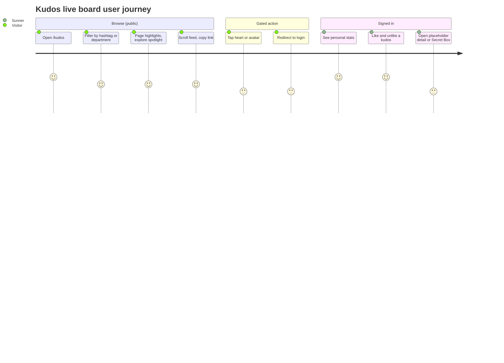

# Screens — KudosLiveBoard

## Screen List

| Screen Name | SCR### | What User Sees | What User Can Do |
|-------------|--------|----------------|------------------|
| Sun* Kudos - Live board | TBD (draft) | Banner "Hệ thống ghi nhận lời cảm ơn"; input pill; HIGHLIGHT KUDOS carousel (top 5) with Hashtag and Phòng ban filters; SPOTLIGHT BOARD word cloud with total kudos count; ALL KUDOS feed; right sidebar with personal stats (signed-in only), "Mở quà" button and the gift list "10 SUNNER NHẬN QUÀ MỚI NHẤT" | Filter by hashtag and department; page the carousel; pan, zoom, search and hover the word cloud; scroll the feed; open images; copy a kudos link; like and unlike (signed-in, not own); sign-in-gated navigation to send dialog, detail, profile and Secret Box |

Detailed layout, states and accessibility: `screens/SCR-kudos-live-board/spec.md`.

Adjacent screens are **stubs in this task** (each has its own Figma frame and its own later screen task). They are not specified here beyond how the live board reaches them:

| Stub | Reached from | Figma frame | Stub behavior |
|------|--------------|-------------|---------------|
| Send kudos dialog ("Viết Kudo") | Input pill | ihQ26W78P2 | Placeholder dialog/route; content TBD (draft) |
| Kudo detail | "Xem chi tiết", spotlight node click | TBD (draft) | Placeholder route `/kudos/[id]` |
| Profile (person) | Avatar or name click on cards, gift-list rows | F008 | Built: `/profile?id=<uuid>` (anonymous senders have no link) |
| Profile hover preview | Hover on avatar or name | TBD (draft) | Not built |
| Secret Box dialog | "Mở quà" | TBD (draft) | Placeholder dialog |

## User Journey

1. A visitor opens `/kudos` and sees the full public board.
2. The visitor narrows it with the hashtag and department filters, browses the highlight carousel, explores the spotlight, scrolls the feed.
3. The visitor tries an action that needs identity (heart, input pill, "Mở quà", avatar, "Xem chi tiết", spotlight node) and is sent to `/login?next=/kudos`.
4. After signing in the Sunner returns to `/kudos` (allow-listed return-to), sees personal stats, and hearts other people's kudos with instant feedback.
5. From a card the Sunner copies the link, or opens the (placeholder) detail or the profile page (F008).

