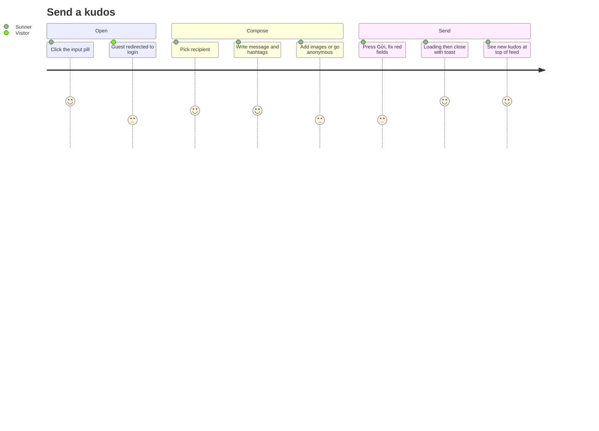

# Screens — KudosSendDialog

## Screen List

| Screen Name | SCR### | What User Sees | What User Can Do |
|-------------|--------|----------------|------------------|
| Viết Kudo (send dialog) | TBD (draft) | Light cream modal over a dark overlay with the title "Gửi lời cám ơn và ghi nhận đến đồng đội"; Người nhận search with dropdown; optional Danh hiệu input; formatting toolbar (bold, italic, strike, numbered list, link, quote, red "Tiêu chuẩn cộng đồng" link) and editor with the "@" helper line; Hashtag chips with "+ Hashtag" dropdown and "Tối đa 5"; Image thumbnails with "+ Image"; anonymous checkbox with an optional name field; footer "Hủy" and "Gửi" | Pick a recipient; write and format a message, mention colleagues; add or remove hashtags and images; toggle anonymous; discard with "Hủy"; submit with "Gửi" (validation on click, loading, close, toast) |

Detailed layout, states and accessibility: `screens/SCR-kudos-send-dialog/spec.md`.

Adjacent screens:

| Screen | Relation | Behavior in this task |
|--------|----------|-----------------------|
| Sun* Kudos - Live board (SCR007, F006) | Hosts the modal; the input pill opens it; shows the new kudos after submit | Pill stub replaced; cards read `content_text`, show the danh hiệu line, and mask anonymous senders |
| Login | Guest click on the pill | Existing `/login?next=%2Fkudos` gating, unchanged |
| Community guidelines ("Tiêu chuẩn cộng đồng") | Red link at the toolbar's right end | Stub target (placeholder route or `#`); separate frame and task |

Design state frames: error state (5c7PkAibyD), Ẩn danh (p9vFVBE_tc), recipient dropdown (QIMJNgFb8K), hashtag dropdown (p9zO-c4a4x).

## User Journey

1. A signed-in Sunner on `/kudos` clicks the input pill; the modal opens empty.
2. They pick a recipient, optionally add a danh hiệu, write the message, add hashtags, optionally add images and anonymity.
3. They press "Gửi". Missing required fields show red errors and the Sunner fixes them; otherwise the dialog shows loading and closes.
4. The board refreshes: the new kudos is the first card in ALL KUDOS and a success toast shows.
5. A guest who clicks the pill is sent to `/login?next=%2Fkudos` and returns to the board after signing in.

