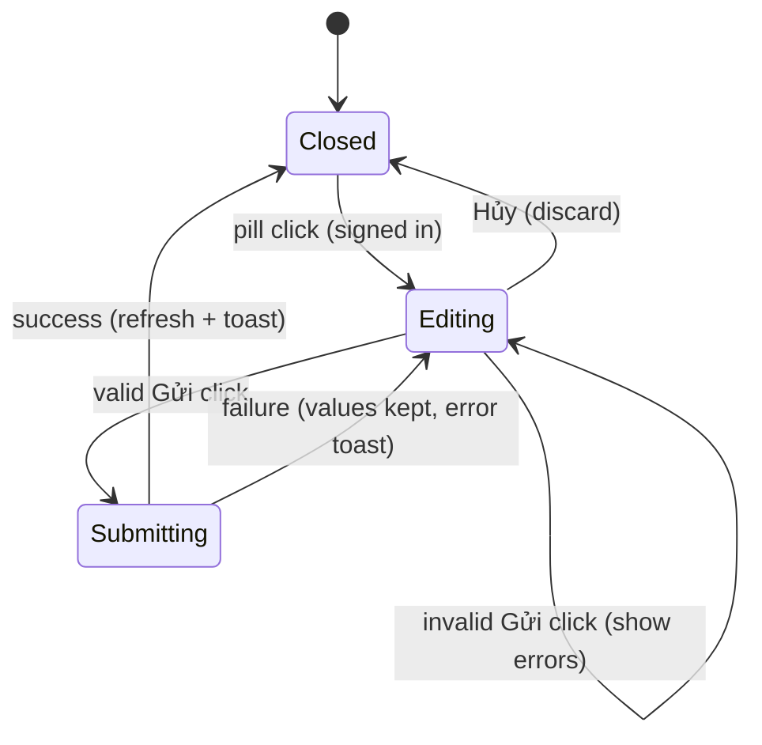

# F007_KudosSendDialog

**Feature code**: F### TBD (draft)
**Priority**: P1
**Type**: ui + api + data
**Generated**: 2026-10-22

## Overview

"Viết Kudo" (MoMorph screen ihQ26W78P2) is the modal a signed-in Sunner uses to send a kudos to a teammate. It mounts on `/kudos` and replaces the placeholder dialog behind the input pill of the live board (F006). Fields: recipient (autocomplete over profiles), an optional "Danh hiệu" (title) input, rich-text message (TipTap: bold, italic, strike, ordered list, link, blockquote, plus `@` mentions and a placeholder), 1 to 5 hashtags (pick existing or create new), up to 5 images (jpg/png, 5 MB each, uploaded to a new Supabase Storage bucket `kudos-images`), and an anonymous checkbox that reveals an optional anonymous-name field (empty means the board alias "Ẩn danh"). "Gửi" is always clickable: a click validates and shows red borders with per-field "Không được để trống" (recorded deviation from the spec-row "disabled" wording). A valid submit shows a loading state, calls the `sendKudos` server action, which re-validates everything, sanitizes the HTML against a server-side allow-list, derives plain `content_text`, and persists the kudos, its hashtags and image URLs in one database function call. On success the modal closes, the board refreshes (the new kudos is first in the feed) and a success toast shows. The board card shows the danh hiệu line again. Anonymous kudos hide the sender on every public surface (alias plus default avatar; no public path to the sender id). Guests keep the existing `/login?next=%2Fkudos` gating. No notifications, milestone events or Realtime. Build status: Track A presentational components exist under `src/components/kudos-compose/` (15 files, props-driven, editor is a ReactNode slot for TipTap) with mock data; schema, Storage, action, editor wiring, mappers and dictionary are planned.

## Polymorphic Behavior

N/A — no discriminator fields. Behavior varies by viewer state (guest or signed-in) and by the boolean `is_anonymous` (a flag, not an enum, see Business Rules).

## Cross-Cutting Logic

### Requirements

| Code | Description | Endpoint/Handler | Verifiable |
|------|-------------|------------------|------------|
| FR-001 | The `/kudos` input pill opens the compose modal for a signed-in viewer; a guest is sent to `/login?next=%2Fkudos` with no modal | PAGE `/kudos` | yes |
| FR-002 | Modal shows, top to bottom: title "Gửi lời cám ơn và ghi nhận đến đồng đội", Người nhận, Danh hiệu (optional), format toolbar plus editor with helper line, Hashtag, Image, anonymous checkbox, footer with "Hủy" and "Gửi" at bottom right | PAGE `/kudos` | yes |
| FR-003 | "Hủy" or the Esc key (a first Esc closes an open dropdown or popup) closes the modal and discards all entered data; an overlay click does nothing; reopening shows an empty form | PAGE `/kudos` | yes |
| FR-004 | Recipient field (required, placeholder "Tìm kiếm") autocompletes profiles: input is trimmed, search starts at 1 character, the list filters by name, special characters give a filtered or empty result, the viewer's own profile is never listed, and picking an entry fills name and avatar and closes the list | ACTION `searchSunners` | yes |
| FR-005 | A recipient is valid only when picked from the list (an existing profile); free text that was not picked counts as empty | PAGE `/kudos` | yes |
| FR-006 | Editor (required) is a TipTap instance with Bold, Italic, Strike, Ordered list, Link and Blockquote, each toggling on the selection or on new content, plus the placeholder "Hãy gửi gắm lời cám ơn và ghi nhận đến đồng đội tại đây nhé!" | PAGE `/kudos` | yes |
| FR-007 | Helper line under the editor is always shown: 'Bạn có thể "@ + tên" để nhắc tới đồng nghiệp khác' | PAGE `/kudos` | yes |
| FR-008 | Typing `@` plus text in the editor suggests profiles (same source as FR-004); picking one inserts a mention rendered as styled text; a mention sends no notification | ACTION `searchSunners` | yes |
| FR-009 | Link button opens a URL dialog and applies a link to the selection; the "open in new tab" option is simplified to the TipTap link default (deviation, see Unresolved Questions) | PAGE `/kudos` | yes |
| FR-010 | Hashtag field (required, 1 to 5): "+ Hashtag" opens a dropdown of existing hashtags from the database; typing a new name and confirming creates a chip; chips carry an x to remove; note "Tối đa 5"; a 6th hashtag is refused with "Tối đa 5 hashtag"; duplicates (case-insensitive) are not added twice | PAGE `/kudos` | yes |
| FR-011 | Image field (optional, max 5): "+ Image" opens the file picker; only jpg and png up to 5 MB are accepted; each accepted file is uploaded to Storage and shown as a thumbnail with an x to remove; at 5 images the add button is hidden and reappears after one is removed; other formats (pdf, mp4, txt) are rejected with a format error | PAGE `/kudos` | yes |
| FR-012 | Anonymous checkbox "Gửi lời cám ơn và ghi nhận ẩn danh" is unchecked by default; checking it reveals the anonymous-name field, unchecking hides it | PAGE `/kudos` | yes |
| FR-013 | "Gửi" is always clickable. On click the form validates; for each empty required field (recipient, content, hashtags) the field gets a red border and the message "Không được để trống"; with any error nothing is submitted | PAGE `/kudos` | yes |
| FR-014 | A valid click shows a loading state on "Gửi" (no double submit) and calls `sendKudos`; on success the modal closes, the board data refreshes so the new kudos is the first feed card, and a success toast shows | ACTION `sendKudos` | yes |
| FR-015 | A failed submit (network or server error) keeps the modal open with all values intact, stops the loading state and shows an error toast | ACTION `sendKudos` | yes |
| FR-016 | `sendKudos` runs only for a verified signed-in user; the sender is derived from the session on the server, never from client input | ACTION `sendKudos` | yes |
| FR-017 | `sendKudos` re-validates everything: recipient exists and is not the sender; content has non-empty text after stripping; 1 to 5 normalized hashtags; at most 5 image URLs, each matching the `kudos-images` URL shape (at most 500 characters; the function additionally verifies origin and that the caller reserved the path); title (max 60) and anonymous name (max 30) are trimmed and length-bounded, content text is at most 5000 characters, each hashtag is at most 30 characters; anonymous name only when anonymous is set | ACTION `sendKudos` | yes |
| FR-018 | Content HTML is sanitized server-side with an allow-list matching the editor (paragraph, br, strong or b, em or i, s, ol, li, blockquote, a with http/https/mailto href and safe rel, mention span); `content_text` is the tag-stripped text of the sanitized HTML | ACTION `sendKudos` | yes |
| FR-019 | The kudos, its hashtag links (creating unknown hashtags) and its image URLs are written in one atomic database function call; partial writes never persist | DB function `send_kudos` | yes |
| FR-020 | Board queries read `content_text` for card text (clamp unchanged) and `title` for the danh hiệu line (the board post model regains a title field); sanitized `kudos.content` HTML is stored for the later detail screen and is not exposed by the board views | PAGE `/kudos` | yes |
| FR-021 | For an anonymous kudos every public surface (feed, highlights, spotlight, stats views, any API or view readable by anon or authenticated) shows the anonymous alias with the default avatar and exposes no sender id, name or avatar; no public path may recover the sender | DB views, grants | yes |
| FR-022 | The anonymous alias is the stored `anonymous_name`, or the dictionary default "Ẩn danh" when it is empty; sender profile links are not rendered for an anonymous card | PAGE `/kudos` | yes |
| FR-023 | The sender viewing their own anonymous kudos still gets a disabled heart (cannot like own kudos), through a viewer-relative flag computed on the server, not through a public sender id | DB views | yes |
| FR-024 | Storage bucket `kudos-images` is public for read, writable only by an authenticated user at a path reserved through `reserve_kudos_image_path` (random `<uuid>/<uuid>.<ext>`, no user identity in the path), accepts only image/jpeg and image/png, 5 MB cap per object | Supabase Storage policies | yes |
| FR-025 | Schema changes ship as a NEW migration: `kudos.content_text`, `kudos.title` (nullable), `kudos.is_anonymous`, `kudos.anonymous_name`, backfill `content_text = content`, bucket and policies, `send_kudos` function, recreated views; merged migrations are never edited and the 45 F006 e2e specs stay green | DB migrations | yes |
| FR-026 | A compose section is added to the kudos dictionary; `vi` carries the exact design copy, `en` is a developer draft | PAGE `/kudos` | yes |
| FR-027 | Sending creates no notification, milestone or gift event | ACTION `sendKudos` | yes |
| FR-031 | The public `kudos_sent` of `profile_kudos_stats` counts non-anonymous kudos only; the signed-in owner's own "Số Kudos bạn đã gửi" counts all kudos they sent (anonymous included) through an owner-only query scoped to their own profile | DB views, PAGE `/kudos` | yes |
| FR-028 | "Danh hiệu" input (placeholder "Dành tặng một danh hiệu cho đồng đội", hint "Ví dụ: Người truyền động lực cho tôi." and "Danh hiệu sẽ hiển thị làm tiêu đề Kudos của bạn.") is OPTIONAL: empty is valid and never shows an error; when filled it is trimmed, stored in `kudos.title` (nullable) and shown as the title line on board cards; empty title renders no title line. Deviation: the frame marks it with an asterisk, the decision is optional | PAGE `/kudos`, ACTION `sendKudos` | yes |
| FR-029 | The anonymous-name field is OPTIONAL: empty gives the board alias "Ẩn danh" with the default avatar; filled uses that name; placeholder "Tên hiển thị ẩn danh" is a developer draft pending PM | PAGE `/kudos`, ACTION `sendKudos` | yes |
| FR-030 | A red "Tiêu chuẩn cộng đồng" link sits at the right end of the format toolbar; it opens a stub target (placeholder route or `#`); the community-guidelines screen is a separate frame | PAGE `/kudos` | yes |

### Business Rules

#### BR-001_NoSelfKudos
**Rule:** a user cannot send a kudos to themselves. The picker hides the own profile; the server rejects it; the existing table check `sender_id <> receiver_id` is the last guard.
**Linked FR:** FR-004, FR-017

#### BR-002_SignInRequired
**Rule:** composing and sending require a signed-in user with a profile. Guests are redirected to login at the pill; the action refuses an unauthenticated caller.
**Linked FR:** FR-001, FR-016

#### BR-003_RequiredFields
**Rule:** recipient, content and 1 to 5 hashtags are required; images and anonymity are optional. Content counts as empty when its stripped text is blank (an empty paragraph is empty).
**Linked FR:** FR-013, FR-017

#### BR-004_HashtagLimits
**Rule:** a kudos has 1 to 5 distinct hashtags; distinct means equal after normalization (ALG-001).
**Linked FR:** FR-010, FR-017

#### BR-005_ImageLimits
**Rule:** at most 5 images, each jpg or png, each up to 5 MB, each stored at a path the sender reserved (registry ownership; the path carries no identity).
**Linked FR:** FR-011, FR-017, FR-024

#### BR-006_AnonymousIdentityProtection
**Rule:** when `is_anonymous` is true the sender identity is never returned by any public read path; the anonymous name is display-only and carries no identity. Public per-person totals also exclude anonymous kudos (see BR-007).
**Linked FR:** FR-021, FR-022, FR-023, FR-031

#### BR-007_AnonymousExcludedFromPublicSentStat
**Rule:** the publicly readable `kudos_sent` count of a person counts only non-anonymous kudos, so a count difference cannot reveal an anonymous send. The signed-in owner's own sidebar stats count all kudos they sent, through an owner-only query.
**Linked FR:** FR-031

### Decision Logic

#### DEC-001_PillClickDecision
**Subtype:** flow
**Linked FR:** FR-001

| Condition | Outcome | user_visible_outcome |
|-----------|---------|----------------------|
| Viewer signed in | Open compose modal | Modal appears |
| Viewer signed out | Navigate `/login?next=%2Fkudos` | Login page |

#### DEC-002_SubmitClickDecision
**Subtype:** interaction
**Linked FR:** FR-013, FR-014

| Condition | Outcome | user_visible_outcome |
|-----------|---------|----------------------|
| Any of recipient, content, hashtags empty | Mark each empty field red; no request | Red borders and "Không được để trống" per field |
| All required valid, not submitting | Start `sendKudos`, enter loading | "Gửi" shows loading |
| Submitting | Ignore click | No change |

### State Machines

#### SM-001_ComposeModal
**kind:** ui
**Linked FR:** FR-001, FR-003, FR-013, FR-014, FR-015
**States:** Closed, Editing, Submitting



| From | To | Guard | Side effect |
|------|----|-------|-------------|
| Closed | Editing | signed in | empty form |
| Editing | Submitting | all required valid | loading on Gửi |
| Submitting | Closed | server ok | router refresh, success toast, form reset |
| Submitting | Editing | server error | stop loading, error toast |

### Algorithms

#### ALG-001_HashtagNormalization
**Linked FR:** FR-010, FR-017
**Steps:** trim; strip a leading `#`; collapse inner whitespace; reject empty; compare case-insensitively against the picked set and against existing hashtags; reuse an existing hashtag when equal ignoring case, otherwise create it with the entered casing. Allowed characters are unicode letters, digits and underscore; maximum length is 30 characters (after trimming and stripping `#`); a name with other characters or too long is refused.

#### ALG-002_SanitizeAndDeriveText
**Linked FR:** FR-018, FR-020
**Steps:** parse the submitted HTML; drop every tag or attribute outside the allow-list; keep only http, https and mailto link targets and force a safe rel; produce `content` (sanitized HTML) and `content_text` (tags removed, entities decoded, whitespace collapsed); reject when `content_text` is blank. The sanitizer is `sanitize-html` configured with an allow-list matching the TipTap marks.

#### ALG-003_AnonymousMasking
**Linked FR:** FR-021, FR-022, FR-023
**Steps:** the board views (definer-executed, with column-level revoke on `kudos.sender_id` for anon and authenticated) return, for `is_anonymous` rows, a null sender id, the alias (`anonymous_name` or dictionary default) as display name, a null avatar so the mapper applies the default avatar, and no sender department or stars; they also return a `viewer_is_sender` flag derived from the session. The public `kudos_sent` counts non-anonymous kudos only. Mappers read these fields and never fall back to a sender lookup.

### External Integrations

#### INT-001_SupabaseStorage
**Linked FR:** FR-011, FR-024
**Provider:** Supabase Storage (first use in this project; local stack already provides it)
**Purpose:** hold uploaded kudos images
**Contract:** bucket `kudos-images`, public read; the browser client first calls `reserve_kudos_image_path` (returns `<uuid>/<uuid>.<jpg|png>`, owner recorded in the definer-only `kudos_image_uploads` registry, 25 reservations per user per hour) and then uploads with the user session to that path; the stored value in `kudos.images` is the public URL. The insert policy calls the definer predicate `is_reserved_kudos_image_path`; the bucket enforces the MIME allow-list and size cap. No service-role key in the app runtime.
**Failure behavior:** an upload failure marks that thumbnail as failed (retry or remove) and never blocks other images; a failed submit never deletes uploaded objects (orphans accepted, no cleanup job).

#### INT-002_TipTapEditor
**Linked FR:** FR-006, FR-008, FR-009
**Provider:** TipTap (new npm dependency, approved in clarifications; `sanitize-html` is the second new dependency, used server-side): StarterKit subset, Strike, OrderedList, Link, Blockquote, Mention, Placeholder
**Purpose:** rich-text authoring with HTML output
**Contract:** client-only component; HTML out, never trusted by the server (ALG-002)
**Failure behavior:** editor failure to load leaves the content field unusable and Gửi validation reports it empty; no crash of the board.

#### INT-003_SupabasePostgres
**Linked FR:** FR-016, FR-019, FR-021
**Provider:** Supabase Postgres (existing)
**Purpose:** persistence and masking
**Contract:** `sendKudos` calls the `send_kudos` function with the user session (same pattern as `set_kudos_like`); the function derives the sender from `auth.uid()`; no direct client writes to kudos tables.
**Failure behavior:** any database error returns a generic error result and the UI keeps the form open.

### Verification

- **SC-001** — Signed-in click on the pill opens the modal with the full field set in design order; guest click goes to `/login?next=%2Fkudos` (covers FR-001, FR-002; TC ID-0, ID-1, ID-2, ID-3)
- **SC-002** — Placeholders "Tìm kiếm" and the editor placeholder show; anonymous checkbox is unchecked by default (covers FR-002, FR-006, FR-012; TC ID-4, ID-5, ID-6)
- **SC-003** — Recipient: required red border, filter by name, trim, special characters, pick fills and closes, self not listed (covers FR-004, FR-005; TC ID-7 to ID-10, ID-25, ID-26, ID-50)
- **SC-004** — Content required message; each of six formats applies; mention suggestion and pick (covers FR-006 to FR-009; TC ID-11 to ID-13, ID-27 to ID-33, ID-51)
- **SC-005** — Hashtags: required, 1 tag submits, 5 max, 6th blocked with "Tối đa 5 hashtag", add by dropdown and by typing, remove chip (covers FR-010; TC ID-14 to ID-17, ID-34 to ID-36, ID-52, ID-53)
- **SC-006** — Images: 3 and 5 accepted, add button hides at 5 and returns after delete, jpg and png accepted, pdf, mp4, txt rejected, remove thumbnail (covers FR-011; TC ID-18 to ID-24, ID-37 to ID-40, ID-54, ID-55)
- **SC-007** — Anonymous toggle shows and hides the name field (covers FR-012; TC ID-41 to ID-44)
- **SC-008** — "Hủy" closes and discards; Esc does the same; an overlay click does nothing (covers FR-003; TC ID-45)
- **SC-009** — Full valid submit shows loading, closes, new kudos first in the feed, toast shown; submit without images works (covers FR-014; TC ID-46, ID-47)
- **SC-010** — **Deviation:** "Gửi" is never disabled; clicking with all three required fields empty shows red borders and "Không được để trống" on each, with no request (covers FR-013; TC ID-56; ID-48 and ID-49 are reinterpreted, see Unresolved Questions)
- **SC-011** — Forged `sendKudos` calls are rejected: unauthenticated, self recipient, 6 hashtags, 6 images, image URL on a foreign host or not reserved by the caller (or over 500 characters), oversized content, script in content (covers FR-016 to FR-018, BR-001)
- **SC-016** — After an anonymous send the sender's public `kudos_sent` is unchanged while their own sidebar "Số Kudos bạn đã gửi" increases by 1 (covers FR-031, BR-007)
- **SC-012** — Anonymous kudos: feed, highlights, spotlight and a direct anon query of the views and tables never reveal the sender; card shows alias and default avatar; the sender's own heart is disabled (covers FR-021 to FR-023, BR-006)
- **SC-013** — Backfilled legacy rows show their original text on the board and the 45 F006 e2e specs pass (covers FR-020, FR-025)
- **SC-014** — Storage: anon cannot upload, authenticated cannot write to an unreserved path (or another user's reserved path) or non-image types or over 5 MB, public read works (covers FR-024)
- **SC-015** — Locale `vi` shows exact compose copy; `en` shows the draft (covers FR-026)

**Client behavior:** see behavior-logic.md, permissions.md, screen-flow.md

## User Stories

### US001_ComposeAndSendKudos — Send a kudos to a teammate (Priority: P1)

**What happens:** A signed-in Sunner opens the modal from the pill, picks a recipient, writes a message, adds hashtags, presses "Gửi", and sees the new kudos at the top of the board with a success toast.
**Why this priority:** It is the write path of the whole Kudos feature; without it the board only shows seeded data.
**Independent Test:** Signed in, fill the three required fields, submit, and verify the new card is first in the feed and a row exists in the database.
**Endpoints**: PAGE `/kudos`, ACTION `searchSunners`, ACTION `sendKudos`

**Acceptance Scenarios:**

1. **Given** a signed-in Sunner on `/kudos`, **When** they click the pill, **Then** the modal opens with an empty form.
2. **Given** a complete valid form, **When** they click "Gửi", **Then** loading shows, the modal closes, the new kudos is the first feed card and a success toast shows.
3. **Given** a guest, **When** they click the pill, **Then** they land on `/login?next=%2Fkudos` and no modal opens.
4. **Given** a submit that fails on the server, **When** the error returns, **Then** the modal stays open with all values and an error toast shows.

**Requirements fulfilled:**
- **FR-001** Pill opens modal — PAGE `/kudos`
- **FR-002** Modal layout — PAGE `/kudos`
- **FR-003** Hủy discards — PAGE `/kudos`
- **FR-004** Recipient autocomplete — ACTION `searchSunners`
- **FR-005** Valid recipient only — PAGE `/kudos`
- **FR-010** Hashtags 1 to 5 — PAGE `/kudos`
- **FR-014** Submit and success — ACTION `sendKudos`
- **FR-015** Failure keeps form — ACTION `sendKudos`
- **FR-016** Session-derived sender — ACTION `sendKudos`
- **FR-017** Server re-validation — ACTION `sendKudos`
- **FR-019** Atomic persistence — DB function `send_kudos`
- **FR-020** Board reads content_text — PAGE `/kudos`
- **FR-025** Migration and backfill — DB migrations
- **FR-026** Dictionary — PAGE `/kudos`
- **FR-027** No notifications — ACTION `sendKudos`
- **FR-028** Optional Danh hiệu — PAGE `/kudos`
- **FR-030** Community-guidelines stub link — PAGE `/kudos`

**Rules enforced:** BR-001, BR-002, BR-004

**Verification:**
- **SC-001**, **SC-003**, **SC-005**, **SC-008**, **SC-009**, **SC-011**, **SC-013**, **SC-015**

---

### US002_ValidateOnSubmit — See what is missing when pressing Gửi (Priority: P1)

**What happens:** The user presses "Gửi" with required fields empty and sees red borders and "Không được để trống" on each empty field; the form does not submit.
**Why this priority:** Test cases ID-7, ID-50 and ID-56 require it; the button must stay clickable.
**Independent Test:** Open the modal, click "Gửi" immediately, verify three error fields and no request.
**Endpoints**: PAGE `/kudos`

**Acceptance Scenarios:**

1. **Given** an empty form, **When** the user clicks "Gửi", **Then** recipient, content and hashtags all show the red border and "Không được để trống".
2. **Given** only a recipient filled, **When** the user clicks "Gửi", **Then** content and hashtags show errors and recipient does not.
3. **Given** text typed in the recipient box but no entry picked, **When** the user clicks "Gửi", **Then** recipient shows the error.

**Requirements fulfilled:**
- **FR-005** Valid recipient only — PAGE `/kudos`
- **FR-013** Validate on click — PAGE `/kudos`

**Rules enforced:** BR-003

**Verification:**
- **SC-003**, **SC-004**, **SC-005**, **SC-010**

---

### US003_RichTextAndMentions — Format the message and mention teammates (Priority: P1)

**What happens:** The user formats the message (bold, italic, strike, numbered list, link, quote) and types `@` to mention a teammate chosen from profiles.
**Why this priority:** Formatting and mentions are core design elements of the message field.
**Independent Test:** Apply each of the six formats and insert one mention, then submit and confirm sanitized content is stored.
**Endpoints**: ACTION `searchSunners`, ACTION `sendKudos`

**Acceptance Scenarios:**

1. **Given** selected text, **When** a format button is pressed, **Then** the format applies; pressed again it is removed.
2. **Given** the user types `@` and a name, **When** they pick a suggestion, **Then** a styled mention is inserted.
3. **Given** forged HTML with a script tag or a `javascript:` link, **When** the server receives it, **Then** it is stripped before storage.

**Requirements fulfilled:**
- **FR-006** Editor and formats — PAGE `/kudos`
- **FR-007** Helper line — PAGE `/kudos`
- **FR-008** Mentions — ACTION `searchSunners`
- **FR-009** Link dialog — PAGE `/kudos`
- **FR-018** Sanitization — ACTION `sendKudos`

**Rules enforced:** BR-003

**Verification:**
- **SC-004**, **SC-011**

---

### US004_AttachImages — Add up to five photos (Priority: P2)

**What happens:** The user adds jpg or png images (up to 5, 5 MB each), sees thumbnails, and can remove any; the add button disappears at 5.
**Why this priority:** Optional enrichment; the kudos works without it.
**Independent Test:** Add 5 images, check the button hides, remove one, check it returns, submit, and check URLs in the feed card gallery.
**Endpoints**: Supabase Storage `kudos-images`, ACTION `sendKudos`

**Acceptance Scenarios:**

1. **Given** 0 images, **When** the user picks 3 jpg or png files, **Then** 3 thumbnails show.
2. **Given** 5 images, **When** the form renders, **Then** the add button is hidden; after removing one it reappears.
3. **Given** a pdf, mp4 or txt, **When** picked, **Then** it is rejected with a format error and not uploaded.
4. **Given** a file over 5 MB, **When** picked, **Then** it is rejected and not uploaded.

**Requirements fulfilled:**
- **FR-011** Image field — PAGE `/kudos`
- **FR-017** Server re-validation of URLs and count — ACTION `sendKudos`
- **FR-024** Storage bucket and policies — Supabase Storage policies

**Rules enforced:** BR-005

**Verification:**
- **SC-006**, **SC-011**, **SC-014**

---

### US005_SendAnonymously — Thank someone without showing my name (Priority: P2)

**What happens:** The user ticks the anonymous checkbox, optionally enters an anonymous name, and sends; the board shows the alias and the default avatar instead of the sender.
**Why this priority:** Required by the "Ẩn danh" frame and the clarified scope; it carries the identity-protection rule.
**Independent Test:** Send an anonymous kudos, view the board signed out, and confirm no sender data appears in the page or the readable views.
**Endpoints**: ACTION `sendKudos`, DB views

**Acceptance Scenarios:**

1. **Given** the checkbox unchecked, **When** the form renders, **Then** no name field shows; checking reveals it, unchecking hides it.
2. **Given** an anonymous kudos, **When** any viewer opens the board, **Then** the card shows the alias and default avatar and no profile link for the sender.
3. **Given** an anonymous kudos, **When** a visitor queries the public views or tables directly, **Then** no sender id, name or avatar is returned.
4. **Given** the sender viewing their own anonymous kudos, **When** the card renders, **Then** the heart is disabled.

**Requirements fulfilled:**
- **FR-012** Checkbox and name field — PAGE `/kudos`
- **FR-029** Optional anonymous name — PAGE `/kudos`
- **FR-021** No public sender exposure — DB views, grants
- **FR-022** Alias and default avatar — PAGE `/kudos`
- **FR-023** Sender-relative flag — DB views
- **FR-031** Public sent stat excludes anonymous — DB views, PAGE `/kudos`

**Rules enforced:** BR-006, BR-007

**Verification:**
- **SC-007**, **SC-012**, **SC-016**

---

### Edge Cases

See edge-cases.md.

## Key Entities

Intended data model changes (Supabase Postgres `public` schema plus Storage); names are design intent, not yet migrated.

| Entity | Table | Key Columns | Purpose |
|--------|-------|-------------|---------|
| Kudos (changed) | `kudos` | existing columns plus `title` (text, nullable, danh hiệu), `content_text` (text, backfilled from `content`), `is_anonymous` (boolean, default false), `anonymous_name` (text, nullable, only when anonymous) | `content` holds sanitized HTML; `content_text` feeds board cards; anonymity flag and alias |
| Hashtag | `hashtags` | id, name (unique; a new unique index on `lower(name)` enforces case-insensitive uniqueness, added after checking the seed for case duplicates) | existing tags plus tags created at send time |
| Kudos hashtag | `kudos_hashtags` | kudos_id, hashtag_id | links 1 to 5 tags per kudos |
| Profile (read) | `profiles` | id, display_name, avatar_url, department_id | recipient and mention source; sender derived from session |
| Image bucket | Storage bucket `kudos-images` | object path `<uuid>/<uuid>.<jpg|png>` (reserved, identity-free) | uploaded images; `kudos.images` holds public URLs |
| Send function | function `send_kudos` | inputs: receiver id, title, sanitized HTML, text, hashtag names, image URLs, anonymous flag and name | atomic write, sender from session |
| Board views (changed) | `kudos_feed`, `kudos_highlights`, `profile_kudos_stats`, spotlight views | add `title`, `content_text`, `is_anonymous`, `viewer_is_sender`; mask sender columns for anonymous rows; `profile_kudos_stats.kudos_sent` counts non-anonymous only | single read path that never leaks the sender |
| Dictionary (extended) | N/A (static, vi and en) | `compose` section | locale-driven copy |

RLS and grant intent: no client write policy on kudos tables (writes only through `send_kudos`, security definer, session-derived sender); Storage: select public, insert authenticated only on reserved paths (definer predicate over the definer-only `kudos_image_uploads` registry; settings in the definer-only `app_settings`) with MIME and size limits, no update, no delete from clients (no cleanup job; orphans are an accepted risk); column-level select on `kudos.sender_id` is revoked from anon and authenticated, and the views that need it (`kudos_feed`, `kudos_highlights`, `profile_kudos_stats`) become definer-executed masked views, so they are the only path; the owner's own sent total comes from the owner-only `viewer_kudos_stats` view (own profile, all kudos) rather than the public view; `profiles.auth_user_id` is revoked from anon and authenticated (own row via the `viewer_profile` definer view) and the `secret_boxes` owner policy resolves through it.

## Artifact References

| Artifact | File | Codes Used | Reviewed |
|----------|------|------------|----------|
| System Overview | [overview.md](../system/overview.md) | — | [ ] |
| Architecture | [architecture.md](../system/architecture.md) | TBD (draft) | [ ] |
| Feature List | [feature-list.md](../../../../docs/generated/feature-list.md) | F### TBD (draft) | [ ] |
| API Map | [api-map.md](../../../../docs/generated/api-map.md) | TBD (draft) | [ ] |
| Entities | [entities.md](../../../../docs/generated/entities.md) | TBD (draft) | [ ] |
| Screens | [screens.md](screens.md) | SCR### TBD (draft) | [ ] |
| Behavior Logic | [behavior-logic.md](../../../../docs/generated/behavior-logic.md) | TBD (draft) | [ ] |
| Permissions | [permissions.md](../system/permissions.md) | TBD (draft) | [ ] |
| Permissions Matrix | [permissions-matrix.md](../../../../docs/generated/permissions-matrix.md) | TBD (draft) | [ ] |
| User Stories | [user-stories.md](../../../../docs/generated/user-stories.md) | TBD (draft) | [ ] |

System-doc forward-drafts: `plans/261022-2157-viet-kudo-send-dialog/spec/system/architecture.md` and `.../spec/system/permissions.md` (first Supabase Storage use, schema columns, sanitize pipeline, anonymous identity protection).

## Assumptions

- Source of truth is MoMorph screen "Viết Kudo" (ihQ26W78P2: 26 spec rows, 57 test cases; related frames 5c7PkAibyD error, p9vFVBE_tc Ẩn danh, QIMJNgFb8K recipient dropdown, p9zO-c4a4x hashtag dropdown) plus `clarifications.md`.
- Vietnamese design copy ships verbatim in `vi`; English strings are developer drafts pending PM review.
- Recipient and mention lookups use a server action `searchSunners` over `profiles` (debounced, minimum 1 trimmed character, own profile excluded, result cap about 10); name matching is case-insensitive contains.
- The board shows plain `content_text` (formatting is not rendered on cards); the HTML is stored for the later detail screen.
- Mentions are styled text only; no notification, no link to a profile.
- Images upload at pick time (before submit); orphaned objects after Hủy or a failed submit are accepted as a known risk (no cleanup job).
- Anonymous means the public cannot see the sender; the database owner and admin tooling can still see `sender_id` (accountability), no admin UI in scope.
- Track A integration: `src/components/kudos-compose/**` is presentational (props-driven, mock data in `kudos-compose-mock-data.ts`, copy in `kudos-compose-copy.ts`); Track B replaces mock data with `searchSunners` and hashtag queries, replaces copy with the dictionary, and adds the TipTap editor into the editor shell. Track A also draws a "Danh hiệu" field and a "Tiêu chuẩn cộng đồng" link that are not in the 26 spec rows; both are now specified (FR-028, FR-030). Track A types carry a `title` value, to be wired to `kudos.title`.
- The existing `kudos-gated-dialog-button` and `kudos-placeholder-dialog` stub for the pill is replaced for the signed-in branch; the guest branch keeps its login link.

## Source Code References

No source code is written yet for the compose action, Storage use, migration, mappers or dictionary section. Existing code the plan builds on, by name only: the action bar with the pill stub under `src/components/kudos/`, the server-action pattern in `src/lib/kudos/kudos-actions.ts`, the row mappers in `src/lib/kudos/kudos-row-mappers.ts`, the board queries and viewer helper under `src/lib/kudos/`, the kudos dictionary under `src/lib/i18n/`, the three F006 migrations under `supabase/migrations/`, and the Track A components under `src/components/kudos-compose/`.

## Unresolved Questions

Resolved (recorded in `clarifications.md`): Danh hiệu field exists and is optional (round 3); anonymous name optional (round 3); "Tiêu chuẩn cộng đồng" link is a stub; editor choice (TipTap); content format (sanitized HTML plus `content_text`); image infrastructure (bucket `kudos-images`); anonymous scope (full); hashtag create-or-pick; post-submit behavior; migration and backfill; "Gửi" always clickable; modal mounts on `/kudos`; no self-kudos; mentions are styled text.

Known test-case and spec deviations (for PM):
- **Spec row H vs TC ID-7, ID-50, ID-56:** "Gửi" disabled until valid vs click shows per-field errors. Decision: always clickable, validate on click. TC ID-48 and ID-49 (disabled / enabled state) are reinterpreted as "click blocked with errors" and "click submits".
- **Danh hiệu asterisk:** the frame marks the field required (asterisk) but the spec CSV has no row and TC ID-56 lists only recipient, content and hashtags as required. Decision: optional; the asterisk is a recorded deviation for PM.
- **"+ Image" at 5 images:** the frame still draws the add button at 5; spec row F and TC ID-19, ID-38, ID-54 say it hides. Decision: hide (spec and TC win).
- **Link dialog:** spec C says the dialog offers an optional "open in new tab"; the TipTap link default is simplified (all links open in a new tab with a safe rel, or the stock behavior), exact UX noted for PM.

Resolved in round 4 (recorded in `clarifications.md`): anonymous kudos are excluded from the public `kudos_sent` stat and the owner's sidebar counts everything; masking through definer views plus column-level revoke; `sanitize-html`; `searchSunners` (debounced, cap about 10); limits (hashtag 30, title 60, anonymous name 30, content 5000); developer-draft copy; Esc closes and discards, overlay click does nothing; images upload at pick time, orphans accepted; unique index on `lower(hashtags.name)`.

Still open (draft):
1. Track A icons for editor, plus, close and check are hand-authored (Figma asset download returned 401); exact icons to be swapped in later.
2. PM review list of developer-draft copy: "Tên hiển thị ẩn danh", default alias "Ẩn danh", format-error, oversize, upload-failed, submit error and success toasts, empty recipient list, link-dialog labels, and all `en` strings.
3. Seed check: confirm no case-duplicate hashtag names before adding the `lower(name)` unique index.

## Source Walkthrough

1. **File:** `supabase/migrations` (new migration, to be created) — start here: columns, backfill, bucket and policies, `send_kudos`, masked views.
2. **File:** `src/lib/kudos/kudos-actions.ts` — existing server-action pattern (verified user, RPC, result union); `sendKudos` and `searchSunners` follow it.
3. **File:** `src/lib/kudos/kudos-row-mappers.ts` — where `content_text` and anonymous masking meet the card models.
4. **File:** `src/components/kudos/kudos-action-bar.tsx` — the pill stub replaced by the modal trigger.
5. **File:** `src/components/kudos-compose/` — presentational modal fed by real state and the TipTap editor.

### Call Hierarchy

```text
pill click (signed in) -> KudosComposeModal (client) -> searchSunners action -> profiles query
Gửi click -> client validation -> (invalid: red borders) | (valid: upload already done) -> sendKudos action
sendKudos -> verified user -> sanitize + derive content_text + re-validate -> rpc send_kudos -> insert kudos + hashtags + kudos_hashtags
success -> close modal -> router.refresh -> /kudos feed reads masked views -> toast
```

**Related files:** see `## Source Code References` above.

## DB Impact per Event

| Event/Endpoint | Table | Columns | Operation | Value Derivation | Source |
|-----------------|-------|---------|-----------|-------------------|--------|
| ACTION `sendKudos` (via `send_kudos`) | `kudos` | sender_id, receiver_id, title, content, content_text, images, is_anonymous, anonymous_name | INSERT | sender from session profile; title trimmed or null; content sanitized HTML; content_text stripped; images validated public URLs; anonymous_name only when anonymous | TBD (draft) |
| ACTION `sendKudos` (via `send_kudos`) | `hashtags` | name | INSERT (only unknown names) | normalized name, case-insensitive reuse of existing | TBD (draft) |
| ACTION `sendKudos` (via `send_kudos`) | `kudos_hashtags` | kudos_id, hashtag_id | INSERT | one row per distinct hashtag, 1 to 5 | TBD (draft) |
| Client image upload | Storage `kudos-images` objects | name, bucket_id, owner | INSERT | reserved path `<uuid>/<uuid>.<ext>` (definer predicate); MIME and size limited by bucket | TBD (draft) |
| New migration | `kudos` | content_text | UPDATE | backfill `content_text = content` for existing rows (`title` stays null for legacy rows) | TBD (draft) |
