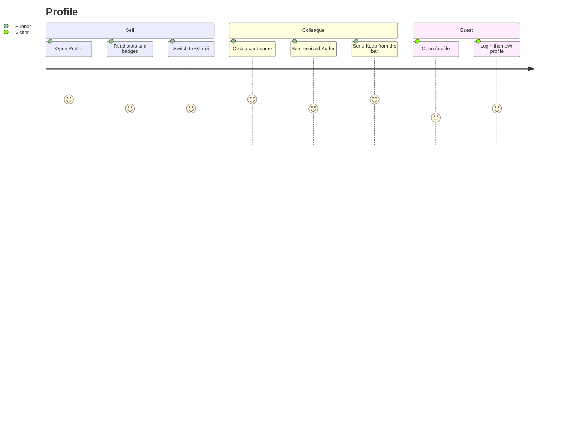

# Screens — Profile

## Screen List

| Screen Name | SCR### | What User Sees | What User Can Do |
|-------------|--------|----------------|------------------|
| Profile — self face | TBD (draft) | Keyvisual hero with avatar, gold name, department, tier badge plus stars; "Bộ sưu tập icon của tôi" with 6 locked badges; 5 personal counters and a disabled "Mở Secret Box"; KUDOS section with direction dropdown and a 10-per-page feed | Switch Đã nhận / Đã gửi, scroll for more, heart, click hashtag, copy link, open a colleague's profile, retry failed stats |
| Profile — other face | TBD (draft) | Same hero; "Bộ sưu tập icon" with 6 locked badges; write-Kudo bar "Gửi lời cám ơn và ghi nhận đến {name}"; static label "Đã nhận" and received feed, no counts | Open compose with the Sunner preselected, scroll, heart, click hashtag, copy link |
| Profile — not found | part of both specs | "Không tìm thấy hồ sơ" and link "Về trang chủ" | Go home |

Detailed layout, states and a11y: `screens/SCR-profile-self/spec.md`, `screens/SCR-profile-other/spec.md`.

Adjacent screens:

| Screen | Relation | Behavior in this task |
|--------|----------|-----------------------|
| Kudos live board (SCR007) | Card name/avatar links open `/profile?id=`; hashtag click returns to `/kudos?hashtag=` | Card links added for non-anonymous people; anonymous unchanged |
| Viết Kudo dialog (SCR008) | Opened by the other-face bar | Gains optional preselected recipient |
| Login | Guest target | `/login?next=%2Fprofile` |
| Homepage | Not-found link target | "Về trang chủ" |

## User Journey

1. A signed-in Sunner opens Profile from the menu; the self face loads.
2. They review stats and switch to Đã gửi to see their sent Kudos, anonymous ones chipped.
3. From the board they click a colleague on a card; the other face loads with Received only.
4. They click the write bar; the dialog opens with the colleague chosen; they send.
5. A guest hitting `/profile` goes to login and lands on their own profile after sign-in.

