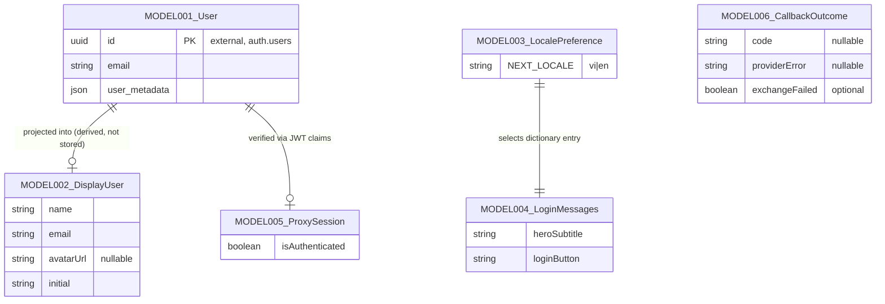

# Entities

**Project**: mock-aidd-kudo-app
**Generated**: 2026-10-19

> **Scope note**: No in-repo DB schema, ORM models, or migrations exist (`supabase/` holds only `config.toml`). Persistent identity lives in Supabase `auth.users` (external, not defined here). In-repo "models" are one cookie and TypeScript view-model types. Nothing below is invented; every entry cites source.

## Entity Relationship Diagram

## Entities

### MODEL001_User

**Description**: Supabase Auth user (`auth.users`), external and managed by Supabase. Populated by Google OAuth. Consumed in-repo as the `User` type from `@supabase/supabase-js`; no table or columns are defined in this repo. Only the fields the app reads are listed.
**Source**: `src/lib/auth/get-display-user.ts:1,30-36` (type import and field reads); `supabase/config.toml` (auth config only, no migrations).

| Attribute | Type | Constraints | Description |
|-----------|------|-------------|-------------|
| id | uuid | PK, NOT NULL (external) | Supabase user id; not read directly by app code |
| email | string \| null | external | Fallback for display name; `""` when null |
| user_metadata.full_name | string | optional | Preferred display name (Google) |
| user_metadata.name | string | optional | Second-choice display name |
| user_metadata.avatar_url | string (URL) | optional | Preferred avatar; accepted only if https and host ends `.googleusercontent.com` |
| user_metadata.picture | string (URL) | optional | Fallback avatar, same host rule |

**Relationships**:
- Projected zero-or-one (derived, never persisted) into MODEL002_DisplayUser.
- Session validity of the user is surfaced as MODEL005_ProxySession.

**Discriminator Fields**: None.

---

### MODEL002_DisplayUser

**Description**: TypeScript view-model of what `/todo` renders for the signed-in user. Derived on each request by `getDisplayUser(user)`; not stored.
**Source**: `src/lib/auth/get-display-user.ts:3-8`

| Attribute | Type | Constraints | Description |
|-----------|------|-------------|-------------|
| name | string | NOT NULL | `full_name` -> `name` -> email -> `"User"` (trimmed, non-empty) |
| email | string | NOT NULL | `user.email` or `""` |
| avatarUrl | string \| null | nullable | Validated Google-hosted https URL, else null |
| initial | string | NOT NULL | `name.charAt(0).toUpperCase()` |

**Relationships**:
- Derived from MODEL001_User.

**Discriminator Fields**: None.

---

### MODEL003_LocalePreference

**Description**: Per-browser language preference persisted in the `NEXT_LOCALE` cookie. Written only by `setLocaleAction`; read server-side by `getRequestLocale`. Client never reads it.
**Source**: `src/lib/i18n/locale.ts:1-18`, `src/lib/i18n/set-locale-action.ts:7-12`, `src/lib/i18n/get-request-locale.ts:5-8`

| Attribute | Type | Constraints | Description |
|-----------|------|-------------|-------------|
| NEXT_LOCALE (cookie) | `Locale` = `"vi" \| "en"` | whitelist; default `vi` | Stored language |
| cookie.path | string | `/` | Site-wide |
| cookie.maxAge | number | 31536000 s (365 d) | Lifetime |
| cookie.sameSite | string | `lax` | CSRF posture |
| cookie.httpOnly | boolean | `true` | Not readable from JS |

**Relationships**:
- Selects the MODEL004_LoginMessages entry via `getLoginMessages(locale)`.

**Discriminator Fields**:

| Field | DISC-### | Values | Description |
|-------|----------|--------|-------------|
| Locale (NEXT_LOCALE) | DISC-001 | vi, en | UI language; `vi` is default; any other/missing/non-string value resolves to `vi` |

---

### MODEL004_LoginMessages

**Description**: Per-locale copy for the login screen. `loginDictionary: Record<Locale, LoginMessages>` is a static in-code constant (no DB). EN copy is flagged in source as a dev draft pending PM review.
**Source**: `src/lib/i18n/login-dictionary.ts:3-33`

| Attribute | Type | Constraints | Description |
|-----------|------|-------------|-------------|
| heroSubtitle | string | NOT NULL | Hero subtitle |
| heroTagline | string | NOT NULL | Hero tagline |
| loginButton | string | NOT NULL | Button label (identical in vi/en: "LOGIN With Google") |
| loginError | string | NOT NULL | Shown on OAuth failure |
| footerCopyright | string | NOT NULL | Footer text |
| languageLabel | string | NOT NULL | aria-label of language selector |

**Relationships**:
- One entry per Locale (MODEL003_LocalePreference); key set is exhaustive via `Record<Locale, ...>`.

**Discriminator Fields**: None.

---

### MODEL005_ProxySession

**Description**: Per-request result of the Next.js proxy's session check. Holds the pass-through response (carrying refreshed Supabase cookies) and an auth flag. Transient; never persisted.
**Source**: `src/lib/supabase/update-session-in-proxy.ts:5-8,11-38`

| Attribute | Type | Constraints | Description |
|-----------|------|-------------|-------------|
| response | NextResponse | NOT NULL | Pass-through response carrying refreshed session cookies |
| isAuthenticated | boolean | NOT NULL | `true` only when `getClaims()` returns claims without error; any throw or error -> `false` |

**Relationships**:
- Derived from MODEL001_User's JWT claims; feeds `decideRouteRedirect(pathname, isAuthenticated)` (`src/lib/auth/decide-route-redirect.ts:5-15`).

**Discriminator Fields**: None.

**Business rule (no DISC code)**: the route guard branches on verified session presence. `/login` redirects to `/todo` when `isAuthenticated` is true; `/todo*` redirects to `/login` when it is false.

---

### MODEL006_CallbackOutcome

**Description**: Input record for the OAuth callback redirect decision. Transient; assembled in `src/app/auth/callback/route.ts`.
**Source**: `src/lib/auth/resolve-callback-redirect.ts:3-19`

| Attribute | Type | Constraints | Description |
|-----------|------|-------------|-------------|
| code | string \| null | NOT NULL in effect | OAuth authorization code; null -> failure |
| providerError | string \| null | | Provider-reported error; non-null -> failure |
| exchangeFailed | boolean | optional | Set after `exchangeCodeForSession` attempt |

**Relationships**:
- Standalone; result is a fixed redirect string (`/todo` or `/login?error=oauth`).

**Discriminator Fields**: None.

---

## Validation Rules

### User / DisplayUser

| Rule | Field | Constraint | Error Message |
|------|-------|------------|---------------|
| non-empty-string | user_metadata.* | string, trimmed, non-empty, else treated as absent | None (silent fallback) |
| avatar-host-allowlist | avatar_url, picture | `https:` and hostname ends `.googleusercontent.com`; unparsable -> null | None (silent drop; prevents next/image throw) |

### Locale preference

| Rule | Field | Constraint | Error Message |
|------|-------|------------|---------------|
| locale-whitelist (BR-003) | NEXT_LOCALE | must equal `vi` or `en`, else `vi` | None (silent default) |

### Callback outcome

| Rule | Field | Constraint | Error Message |
|------|-------|------------|---------------|
| callback-failure | code, providerError, exchangeFailed | `providerError` or missing `code` or `exchangeFailed` -> `/login?error=oauth` | `loginError` message (MODEL004) |

---

## Summary

- **Total Entities**: 6 (1 external reference, 1 cookie, 4 in-memory TS types)
- **Total Relationships**: 3 modeled in the ERD, plus 2 derivation/consumption links noted in prose (MODEL005 -> routing decision, MODEL006 -> redirect string)
- **Discriminators**: 1 (Locale)
- **Persistent app-owned storage**: none (cookie only)
