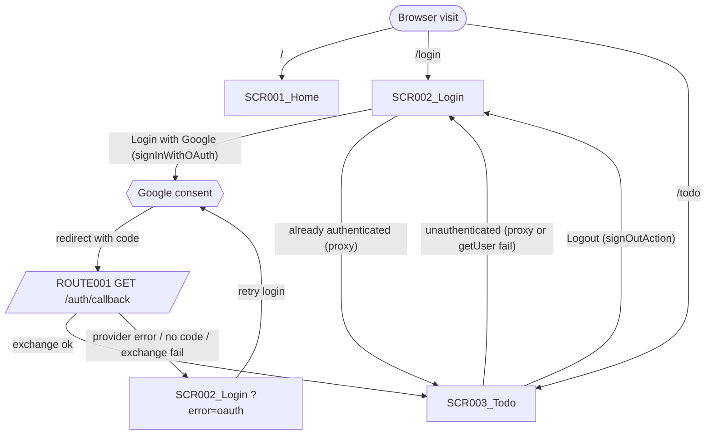
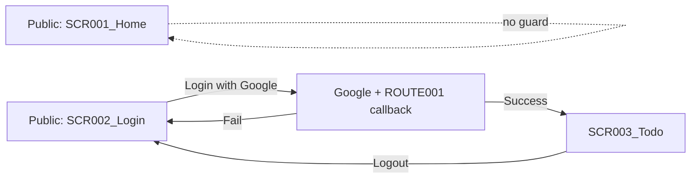

# Screen Flow

**Project**: kudo-scaffold (Next.js 16 App Router + Supabase auth)
**Generated**: 2026-10-19
**Analysis Scope**: route-view (web); SCR001-SCR003 from screen-list.md, ROUTE001 from route-list.md

**Code Format**: All SCR codes MUST follow `SCR###_NameSlug` format (e.g., SCR001_LoginForm, SCR002_Dashboard) | `SCR###/REG###` for region-scoped transitions

## Navigation Map



## Feature Entry Points

<!-- Feature Entry Points: run /tkm:rebuild-spec --feature-specs to populate -->

---

## Screen Access Paths

| From Screen | To Screen | Action/Trigger | Conditions | Region |
|-------------|-----------|----------------|------------|--------|
| (start) | SCR001_Home | Direct URL `/` | None (unguarded) | |
| (start) | SCR002_Login | Direct URL `/login` | Not authenticated (else proxy -> `/todo`) | |
| (start) | SCR003_Todo | Direct URL `/todo` | Authenticated (else proxy -> `/login`) | |
| SCR002_Login | Google (external) | Click "Login with Google" | `loading` false | |
| Google (external) | ROUTE001 /auth/callback | OAuth redirect with `code` or `error` | None | |
| ROUTE001 /auth/callback | SCR003_Todo | 307 redirect | `code` present, no provider error, exchange ok | |
| ROUTE001 /auth/callback | SCR002_Login | 307 redirect to `/login?error=oauth` | provider error OR no code OR exchange failed | |
| SCR002_Login | SCR003_Todo | Proxy redirect (visit `/login`) | Authenticated | |
| SCR003_Todo | SCR002_Login | Proxy redirect / `redirect(LOGIN_PATH)` | Unauthenticated or revoked session | |
| SCR003_Todo | SCR002_Login | Click "Logout" | `signOutAction` (redirects even if signOut errors) | |

## Screen Transitions

### SCR001_Home (Home)

**Entry Points**:
- Direct URL access `/`

**Exit Points**:
- External links only (vercel.com, nextjs.org); no in-app transitions

**Decision Points**:
- None

---

### SCR002_Login (Login)

**Entry Points**:
- Direct URL access `/login`
- From SCR003_Todo: Logout, or unauthenticated redirect
- From ROUTE001 /auth/callback: failure redirect `/login?error=oauth`
- Browser back from Google (bfcache restore resets loading via `pageshow`, `login-page-client.tsx:30`)

**Exit Points**:
- To Google OAuth: Login button (browser navigates away)
- To SCR003_Todo: proxy redirect when authenticated

**Decision Points**:
- `signInWithOAuth` returns error / throws: stay on page, `hasError=true`, show localized alert
- `?error=oauth` present (`hasLoginError`): show alert on load
- Authenticated on visit: `decideRouteRedirect("/login", true)` -> `/todo`

---

### SCR003_Todo (Todo)

**Entry Points**:
- ROUTE001 /auth/callback success redirect
- Direct URL `/todo` or `/todo/*`
- From SCR002_Login: proxy redirect when authenticated

**Exit Points**:
- To SCR002_Login: Logout, or no verified user

**Decision Points**:
- Proxy: `/todo(/*)` + unauthenticated -> `/login`
- Page: `getUser()` error or no user -> `redirect("/login")` (defense in depth, `todo/page.tsx:13`)

---

## Region Transitions

N/A — no composite screens (no REG### defined).

---

## Authentication Flow



| Screen | Authentication Required | Authorization Level |
|--------|------------------------|-------------------|
| SCR001_Home | No | Public |
| SCR002_Login | No (authenticated users bounced to `/todo`) | Public (guest-only) |
| SCR003_Todo | Yes | Authenticated user (no roles) |

---

## Error Handling Flows

| Screen | Error | Handling | Scope |
|--------|-------|----------|-------|
| SCR002_Login | OAuth start fails (`signInWithOAuth` error/throw) | `console.error`, reset loading, show localized `loginError` alert | screen |
| SCR002_Login | Callback failure (`?error=oauth`) | Show localized alert on load | screen |
| SCR002_Login | Locale persist fails (`setLocaleAction` throws) | `console.error`; UI locale already switched, cookie not saved | screen |
| SCR003_Todo | `getUser()` error / revoked session | Redirect to `/login` | screen |
| SCR003_Todo | `signOut` error | Log, still redirect to `/login` | screen |
| ROUTE001 /auth/callback | Code exchange throws | Caught, treated as failed -> `/login?error=oauth` | screen |
| (proxy) | Supabase unreachable | `getClaims` throw -> treated unauthenticated (no 500) | screen |

---

## Circular Dependencies Check

- [x] No circular dependencies detected (Login <-> Todo cycle is session-gated and terminates on state: each hop requires an auth-state change or user action)
- [x] All screens have valid entry/exit points
- [x] All navigation paths terminate

---

## Guard Logic

### GUARD-001 — Auth route guard on /login and /todo(/*)
**trigger:** `proxy` (Next 16 middleware replacement), matcher excludes static assets, `images/`, `/auth/callback`
**source:** `src/proxy.ts:8`, `src/lib/auth/decide-route-redirect.ts:5`
**logic:**
```pseudo
isAuthenticated = getClaims() verified (throw -> false)
if (path == /login && isAuthenticated) → redirect /todo
if ((path == /todo || path startsWith /todo/) && !isAuthenticated) → redirect /login
else pass through
```
**failure path:** unauthenticated `/todo*` -> `/login`; redirect keeps refreshed session cookies (`redirectWithCookies`, `update-session-in-proxy.ts:41`). `/` is never guarded.

### GUARD-002 — Page-level user re-check on /todo
**trigger:** server component `TodoContent`
**source:** `src/app/todo/page.tsx:11-13`
**logic:**
```pseudo
{data, error} = supabase.auth.getUser()
if (error || !data.user) → redirect /login
```
**failure path:** redirect `/login` (covers a session revoked after the proxy check)

### GUARD-003 — Callback redirect resolver on /auth/callback
**trigger:** route handler `GET` (not covered by proxy)
**source:** `src/app/auth/callback/route.ts:5`, `src/lib/auth/resolve-callback-redirect.ts:14`
**logic:**
```pseudo
if (providerError || !code || exchangeFailed) → /login?error=oauth
else → /todo   // fixed targets, never user-supplied (no open redirect)
```
**failure path:** `/login?error=oauth`

---

## Deep-Link State Restoration

### SCR002_Login
**URL pattern:** `/login?error=oauth`
**State restored:**

| Param | Restores | Default if missing |
|-------|----------|--------------------|
| error (`=oauth` exactly) | `hasError` -> localized error alert | false (no alert) |

**Failure mode:** any other `error` value or type is silently ignored (`has-login-error.ts:6`). Locale is restored from the locale cookie, not the URL.

---

## Unsaved-Changes Protection

N/A — no unsaved-changes guards detected.

---

## Extraction Signatures

### Guard Logic
Function/method definitions tied to a route: `beforeEnter|canActivate|middleware|loader|before_action|authenticate|authorize` — check if called from a router config or route registration.

### Deep-Link State Restoration
URL param reads at component mount synced to state: `useSearchParams|useQuery|router\.query|URLSearchParams|params\[|$route\.query` — look for these at top of component with corresponding `setState` or reactive assignment.

### Unsaved-Changes Protection
`beforeunload|onbeforeunload|usePrompt|useBeforeUnload|leaveGuard|isDirty|formState\.isDirty|data-turbo-confirm` — presence confirms protection; absence is a potential gap to flag.
