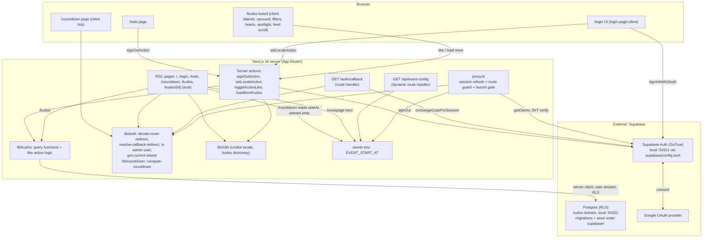
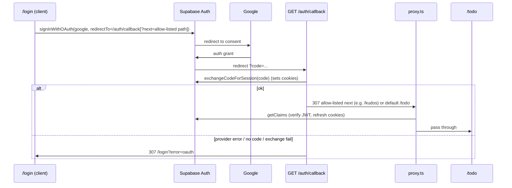
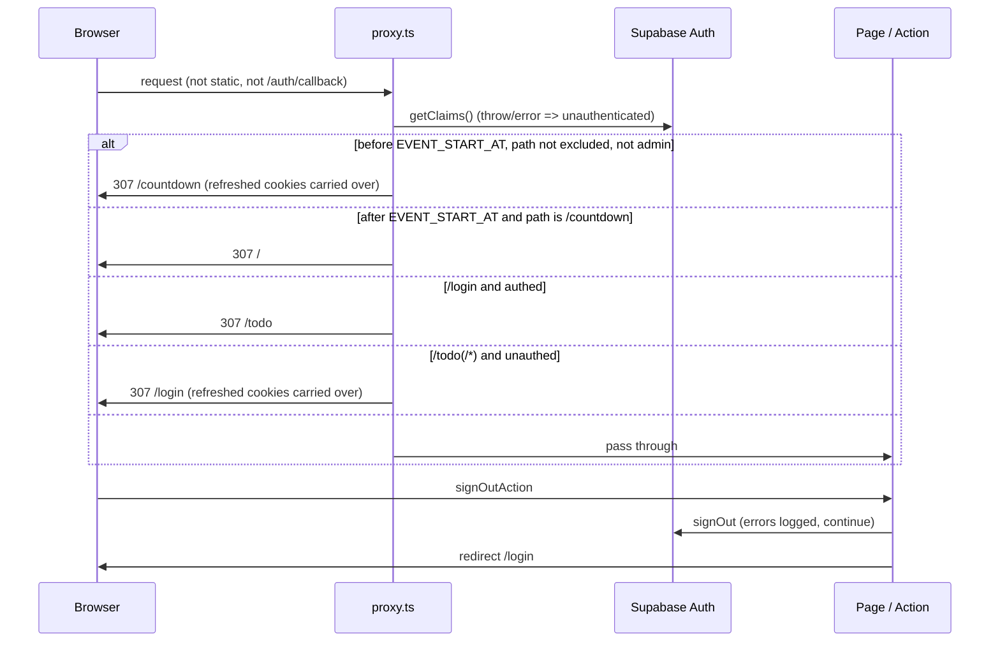
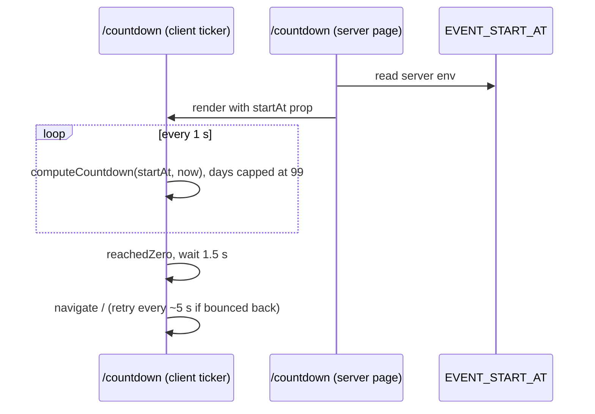
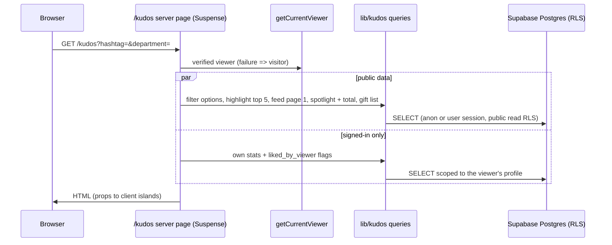
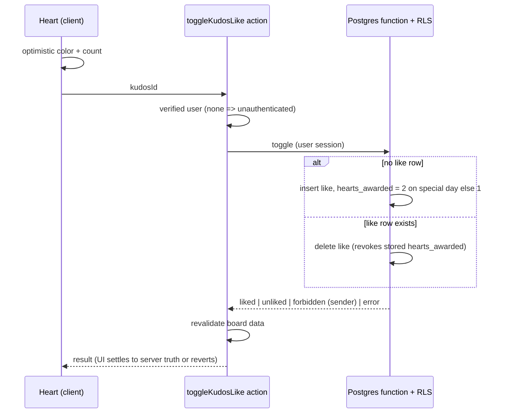
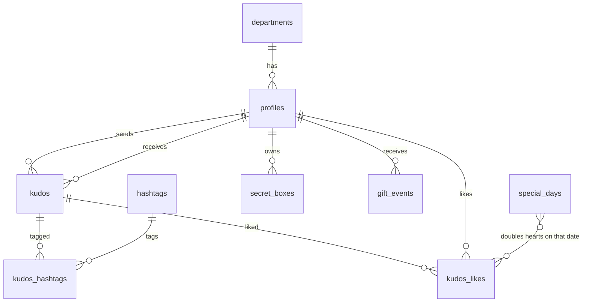

# Architecture

Single Next.js 16 App Router app. Auth delegated to Supabase (Google OAuth, PKCE code flow). With the Kudos live board the app gets its first real data store: the Supabase Postgres project holds the kudos domain (people, departments, hashtags, kudos, likes, gift events, Secret Box records, special days), read by server components through the Supabase server client under row-level security and written by server actions (like and unlike). App state: locale cookie. Launch time is a single server env, `EVENT_START_AT`, read by the proxy gate, the event-config route and the homepage. No cache layer, queue or Realtime subscription.

## System Architecture

## Tech Stack

| Layer | Technology | Version |
|-------|------------|---------|
| Frontend | Next.js (App Router, `cacheComponents`, `partialPrefetching`, Turbopack), React, Tailwind CSS; spotlight is hand-rolled SVG (no new dependency) | next 16.4.2, react 19.3.0, tailwindcss ^4 |
| Backend | Next.js route handlers (`/auth/callback`, `/api/event-config`) + server actions (sign-out, locale, like, load more) + `proxy.ts`; no separate API | - |
| Auth | Supabase Auth via `@supabase/ssr` + `@supabase/supabase-js`, Google provider | ssr ^0.12.7, js ^2.118.0 |
| Database | Supabase Postgres (local stack :54322). Kudos domain schema delivered as migrations plus seed under `supabase/`; RLS on every table; a database function performs the like toggle | - |
| Cache | None; `/api/event-config` explicitly uncached; board data is dynamic per request and revalidated after a like | - |
| Queue | None | - |
| Realtime | None (no subscription; deferred) | - |
| Language/Tooling | TypeScript, ESLint 9, Vitest, Supabase CLI | ts ^5, vitest ^5.0.5, supabase ^2.121.0 |
| Images | `next/image` remote patterns for `*.googleusercontent.com` (avatar); local images under `public/images/kudos/` | - |

## Module Layout

| Path | Role |
|------|------|
| `src/proxy.ts` | Entry guard: session refresh, then launch gate, then route redirect decision; unchanged by the kudos feature (`/kudos` is a normal public route) |
| `src/lib/supabase/` | Env, browser client, server client (cookies), `update-session-in-proxy`; the server client is the single data access path for kudos |
| `src/lib/auth/` | Pure decision functions (route guard, callback target with return-to allow-list), `is-admin-user`, `get-display-user`, `get-current-viewer` (verified viewer used for gating and stats) |
| `src/lib/kudos/` (planned) | Typed query functions (highlight, feed page, spotlight, stats, gift list, filter options) and the like action logic |
| `src/lib/countdown/` | Pure strict-ISO parse and countdown computation |
| `src/lib/i18n/` | Locale cookie, request locale, login / awards / prelaunch / kudos dictionaries (vi exact design copy, en draft), `setLocaleAction` |
| `src/app/` | `/`, `/login`, `/todo`, `/countdown`, `/auth/callback`, `/api/event-config`, `(site)/kudos` page, `/kudos/[id]` placeholder |
| `src/components/kudos/` | Presentational kudos components (banner, pill, carousel, cards, spotlight, sidebar) with typed props |
| `supabase/migrations/`, `supabase/seed.sql` (planned) | Schema, RLS policies, like function, view(s), seed data |
| `src/components/login/`, `src/components/prelaunch/` | Presentational login and countdown components |

## Data Flow

Google login (PKCE):

Route guard, launch gate and sign-out:

Countdown page:

Kudos board page load (`/kudos`):

Like / unlike (server action, optimistic):

Feed paging: a server action `loadMoreKudos(filters, cursor)` returns the next keyset page `(created_at, id)`; the client appends it as the user scrolls.

Data domain (design intent, names not yet migrated):

## Key Decisions (from source)

- Next 16 `proxy` is the guard/session-refresh layer; auth verified with `getClaims()`, never `getSession()`.
- DEC-001: guard `/login` (authed -> `/todo`) and `/todo/**` (unauthed -> `/login`). Roles only matter for the launch gate and the admin menu item. `/kudos` is public: the proxy is not changed; interaction gating happens in the page and the action.
- DEC-002: callback redirect target is resolved from an allow-list (no open redirect): a `next` query param accepted only if it is an exact internal allow-listed path (at least `/kudos`), default `/todo`; failure -> `/login?error=oauth`. The login page carries a valid `next` into the OAuth `redirectTo` for `/auth/callback`; the pure callback-target resolver validates it. Gated Kudos actions link to `/login?next=/kudos`.
- Fail-open: a missing or invalid `EVENT_START_AT` is treated as already launched.
- Launch gate evaluates first in `proxy.ts`; after launch the existing rules behave as today.
- Launch gate lives in `proxy.ts`; admin = `app_metadata.role === 'admin'` on verified claims.
- `GET /api/event-config` is dynamic and uncached.
- One env for the launch time: `EVENT_START_AT` (server-only).
- Supabase unreachable in proxy degrades to unauthenticated, not 500.
- `cacheComponents` forces cookie/searchParams reads inside `<Suspense>`; the `/kudos` page reads search params (filters) and the viewer inside Suspense.
- Kudos data is read in server components via the Supabase server client under RLS; no service-role key in the app runtime. Seed data is loaded with database privileges, not by the app.
- Like and unlike are one database function called from a server action with the user's session: atomic, race-safe through the unique (user, kudos) rule; exact revoke because the awarded hearts are stored on the like row and a sender's hearts are summed, never stored as a counter.
- `profiles` links to `auth.users` by a nullable unique `auth_user_id` (seeded Sunners have no auth account); a database trigger on auth user insert creates the profile on first sign-in. `secret_boxes` is seeded with owner-only select RLS.
- Display time and special-day dates use Asia/Ho_Chi_Minh; the tier label (New Hero, Rising, Super, Legend) is derived from the star count, not stored.
- Filters live in URL search params (shareable, server-rendered); the carousel index is client state reset on filter change.
- Spotlight is hand-rolled SVG with viewBox pan/zoom (no new dependency); layout is deterministic.
- No Supabase Realtime: updates on reload and revalidate after a like (deferred, not rejected).
- Locale is the only other app state: cookie set via whitelisted server action; kudos copy comes from a dictionary (vi exact design copy, en draft).

## Open Items

- Client clock drift can make `/countdown` redirect early; resolved with one redirect then a ~5 s retry.
- Email signup enabled in `supabase/config.toml` but no UI uses it.
- Production Supabase URL/redirect allow-list not in repo (only local `site_url` http://localhost:3000); production database migration rollout is not defined.
- Writers for kudos and `gift_events` arrive with the Viết Kudo task; until then the data is seeded only. There is no promotion event table (frame shows only the gift list).
- Special-day admin UI is deferred to the Admin screen task.
