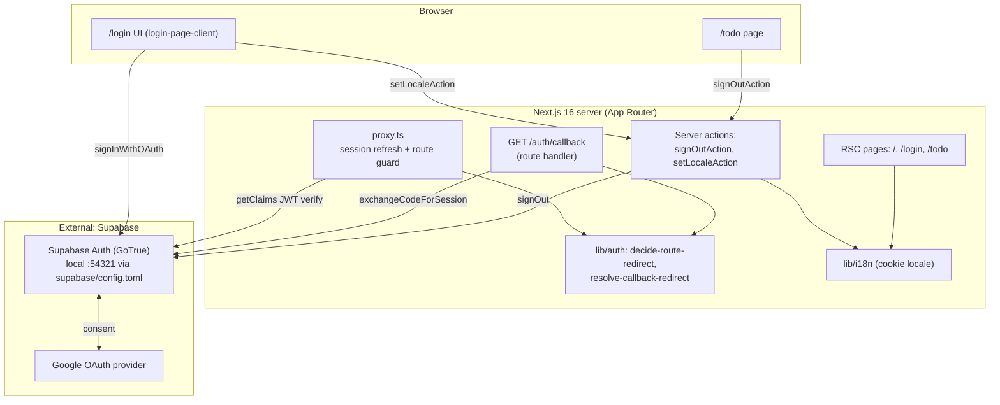
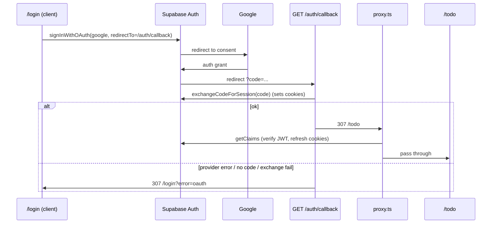
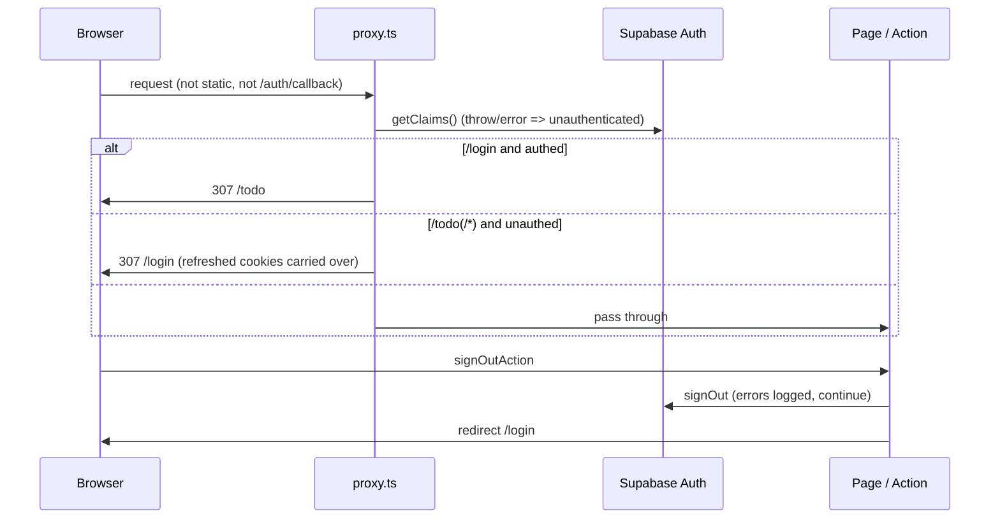

# Architecture

Single Next.js 16 App Router app. No custom backend, DB, cache, or queue. Auth delegated to Supabase (Google OAuth, PKCE code flow). Only app state: locale cookie.

## System Architecture

## Tech Stack

| Layer | Technology | Version |
|-------|------------|---------|
| Frontend | Next.js (App Router, `cacheComponents`, `partialPrefetching`, Turbopack), React, Tailwind CSS | next 16.4.2, react 19.3.0, tailwindcss ^4 |
| Backend | Next.js route handler + server actions + `proxy.ts` (replaces `middleware`); no separate API | - |
| Auth | Supabase Auth via `@supabase/ssr` + `@supabase/supabase-js`, Google provider | ssr ^0.12.7, js ^2.118.0 |
| Database | None in-repo (users in managed `auth.users`); Supabase local stack Postgres :54322 unused by app | - |
| Cache | None (locale cookie only) | - |
| Queue | None | - |
| Language/Tooling | TypeScript, ESLint 9, Vitest, Supabase CLI | ts ^5, vitest ^5.0.5, supabase ^2.121.0 |
| Images | `next/image` remote patterns for `*.googleusercontent.com` (avatar) | - |

## Module Layout

| Path | Role |
|------|------|
| `src/proxy.ts` | Entry guard: session refresh then redirect decision; matcher excludes static, images, `auth/callback` |
| `src/lib/supabase/` | Env, browser client, server client (cookies), `update-session-in-proxy` |
| `src/lib/auth/` | Pure decision functions (DEC-001 route guard, DEC-002 callback target), `get-display-user` |
| `src/lib/i18n/` | Locale cookie, request locale, login dictionary, `setLocaleAction` |
| `src/app/` | `/` (starter boilerplate), `/login`, `/todo`, `/auth/callback` |
| `src/components/login/` | Presentational login components (header, hero, footer, language selector, Google button) |

## Data Flow

Google login (PKCE):

Route guard and sign-out:

## Key Decisions (from source)

- Next 16 `proxy` is the guard/session-refresh layer; auth verified with `getClaims()`, never `getSession()`.
- DEC-001: guard only `/login` (authed -> `/todo`) and `/todo/**` (unauthed -> `/login`). No roles.
- DEC-002: callback redirect target is fixed (no open redirect); failure -> `/login?error=oauth`.
- Supabase unreachable in proxy degrades to unauthenticated, not 500.
- `cacheComponents` forces cookie/searchParams reads inside `<Suspense>` (login page).
- Locale is the only app state: cookie set via whitelisted server action.

## Open Items

- `/` is unmodified starter boilerplate, unguarded; intended behavior unknown.
- Email signup enabled in `supabase/config.toml` but no UI uses it.
- Production Supabase URL/redirect allow-list not in repo (only local `site_url` http://localhost:3000).
