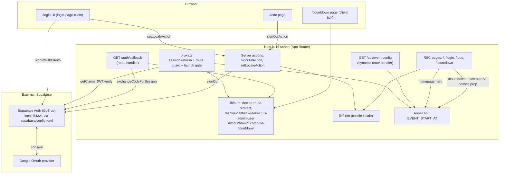
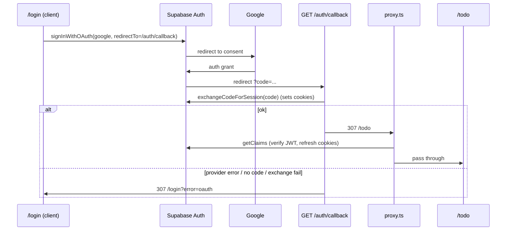
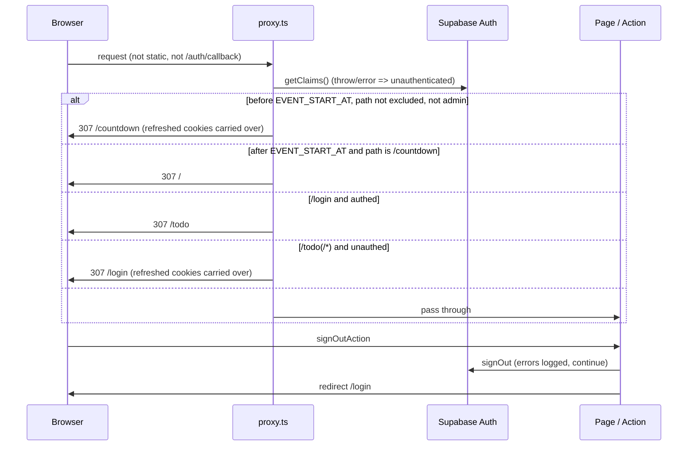
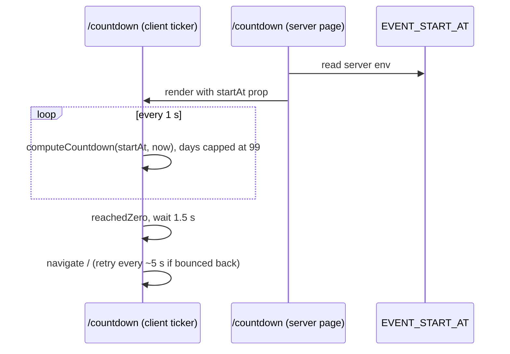

# Architecture

Single Next.js 16 App Router app. No custom backend, DB, cache, or queue. Auth delegated to Supabase (Google OAuth, PKCE code flow). App state: locale cookie. Launch time is a single server env, `EVENT_START_AT`, read by the proxy gate, the event-config route and the homepage.

## System Architecture

## Tech Stack

| Layer | Technology | Version |
|-------|------------|---------|
| Frontend | Next.js (App Router, `cacheComponents`, `partialPrefetching`, Turbopack), React, Tailwind CSS | next 16.4.2, react 19.3.0, tailwindcss ^4 |
| Backend | Next.js route handlers (`/auth/callback`, `/api/event-config`) + server actions + `proxy.ts` (replaces `middleware`); no separate API | - |
| Auth | Supabase Auth via `@supabase/ssr` + `@supabase/supabase-js`, Google provider | ssr ^0.12.7, js ^2.118.0 |
| Database | None in-repo (users in managed `auth.users`); Supabase local stack Postgres :54322 unused by app | - |
| Cache | None (locale cookie only); `/api/event-config` is explicitly uncached | - |
| Queue | None | - |
| Language/Tooling | TypeScript, ESLint 9, Vitest, Supabase CLI | ts ^5, vitest ^5.0.5, supabase ^2.121.0 |
| Images | `next/image` remote patterns for `*.googleusercontent.com` (avatar) | - |

## Module Layout

| Path | Role |
|------|------|
| `src/proxy.ts` | Entry guard: session refresh, then launch gate, then route redirect decision; matcher excludes static, images, `auth/callback` |
| `src/lib/supabase/` | Env, browser client, server client (cookies), `update-session-in-proxy` (also reports the admin marker from verified claims for the gate) |
| `src/lib/auth/` | Pure decision functions (route guard, callback target, launch gate), `is-admin-user`, `get-display-user` |
| `src/lib/countdown/` | Pure strict-ISO parse and countdown computation, shared by the hero and the prelaunch page |
| `src/lib/i18n/` | Locale cookie, request locale, login / awards / prelaunch dictionaries, `setLocaleAction` |
| `src/app/` | `/`, `/login`, `/todo`, `/countdown`, `/auth/callback`, `/api/event-config` |
| `src/components/login/` | Presentational login components |
| `src/components/prelaunch/` | Presentational countdown screen, LED unit and digit components |

## Data Flow

Google login (PKCE):

Route guard, launch gate and sign-out:

Countdown page:

## Key Decisions (from source)

- Next 16 `proxy` is the guard/session-refresh layer; auth verified with `getClaims()`, never `getSession()`.
- DEC-001: guard `/login` (authed -> `/todo`) and `/todo/**` (unauthed -> `/login`). Roles only matter for the launch gate and the admin menu item.
- DEC-002: callback redirect target is fixed (no open redirect); failure -> `/login?error=oauth`.
- Fail-open: a missing or invalid `EVENT_START_AT` is treated as already launched (no gate, `/countdown` redirects to `/`).
- Launch gate evaluates first in `proxy.ts`, ahead of the existing `/login` and `/todo` rules; after launch those rules behave as today.
- `/countdown` is a server component reading `EVENT_START_AT` directly and passing `startAt` to the client ticker; `/api/event-config` serves external or other clients.
- Launch gate lives in `proxy.ts`, not in pages: before `EVENT_START_AT`, non-admin traffic outside `/countdown`, `/login`, `/auth/*`, `/api/*` and static assets goes to `/countdown`; after it, `/countdown` goes to `/`. Admin = `app_metadata.role === 'admin'` on verified claims.
- `GET /api/event-config` returns `{startAt}` from the server env and must be dynamic (no static optimization, no caching) so an env change is never masked by a stale response.
- One env for the launch time: `EVENT_START_AT` (server-only). `NEXT_PUBLIC_EVENT_START_AT` is removed; the homepage server component reads the server env and passes the value to the hero as a prop. `.env.example` is updated.
- Supabase unreachable in proxy degrades to unauthenticated, not 500 (before launch the user is then gated).
- `cacheComponents` forces cookie/searchParams reads inside `<Suspense>` (login page); any request-time read of the env or cookies on `/` and `/countdown` must respect the same rule.
- Locale is the only app state: cookie set via whitelisted server action.

## Open Items

- Client clock drift can make `/countdown` redirect early; the proxy uses server time. Resolved: the page auto-redirects to `/` once, then retries about every 5 s while the proxy bounces it back.
- Email signup enabled in `supabase/config.toml` but no UI uses it.
- Production Supabase URL/redirect allow-list not in repo (only local `site_url` http://localhost:3000).
