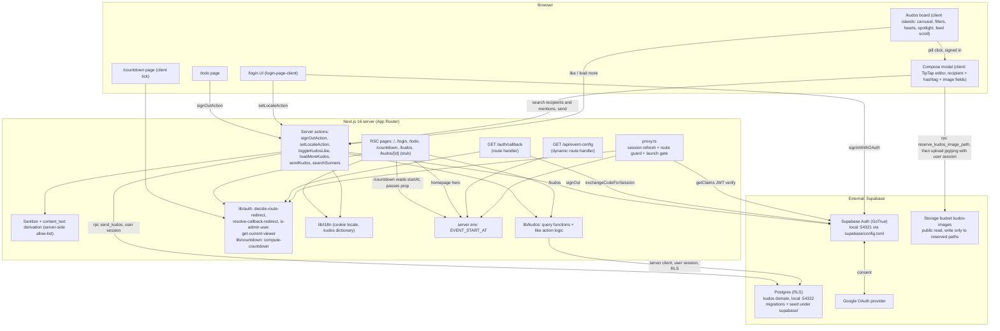
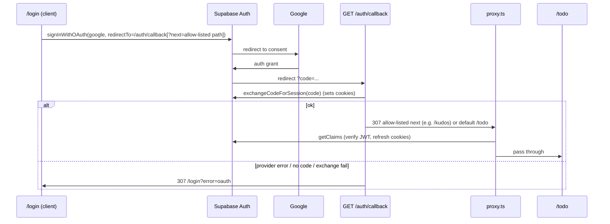
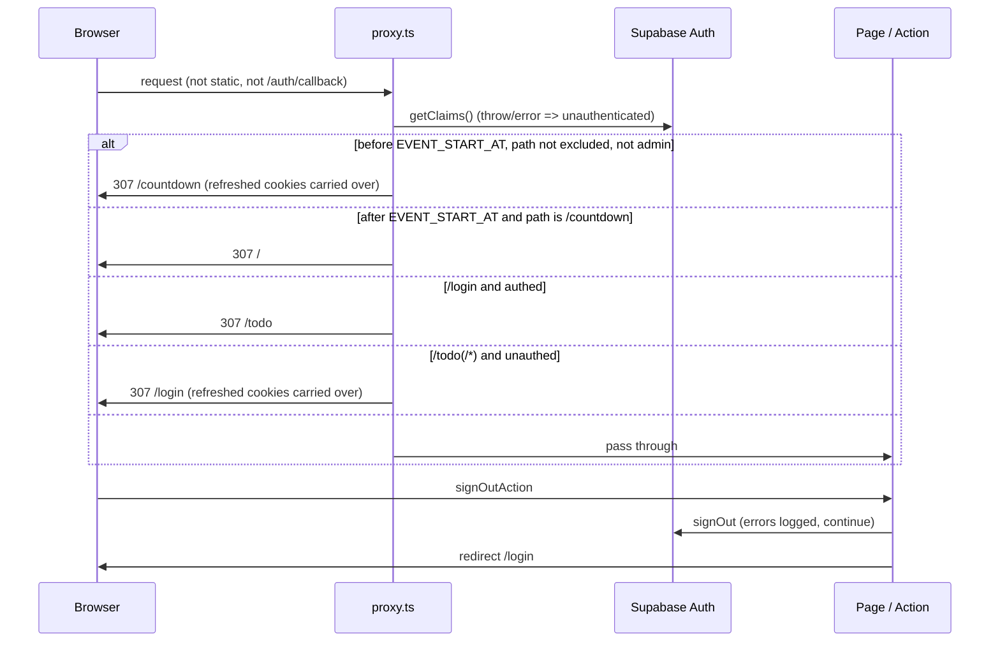
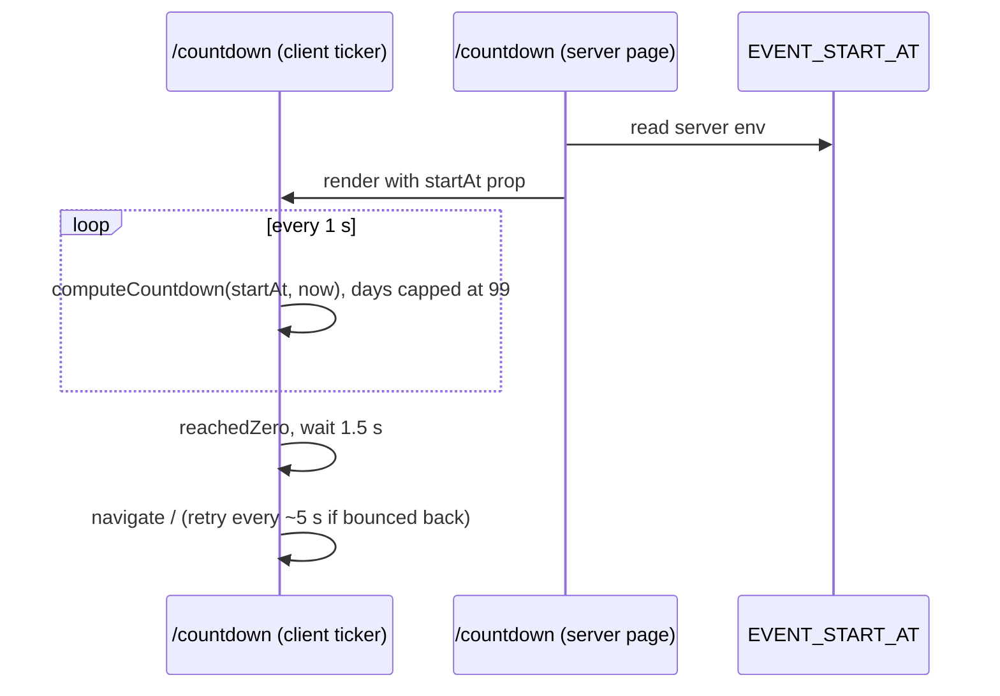
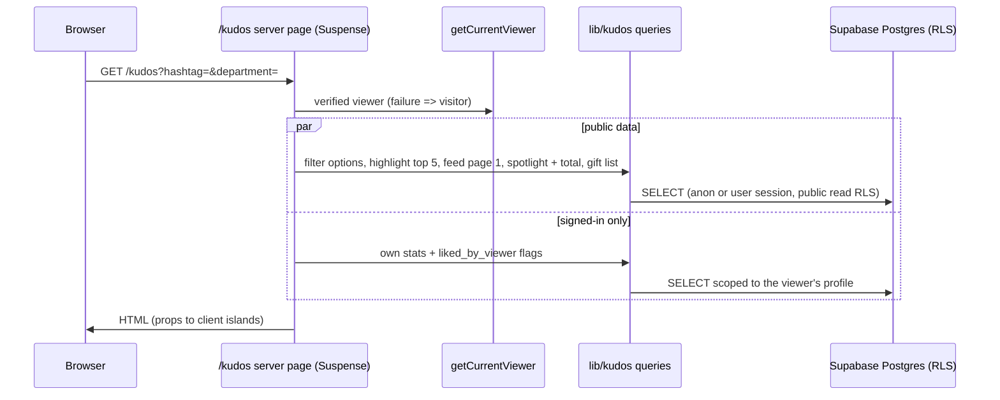
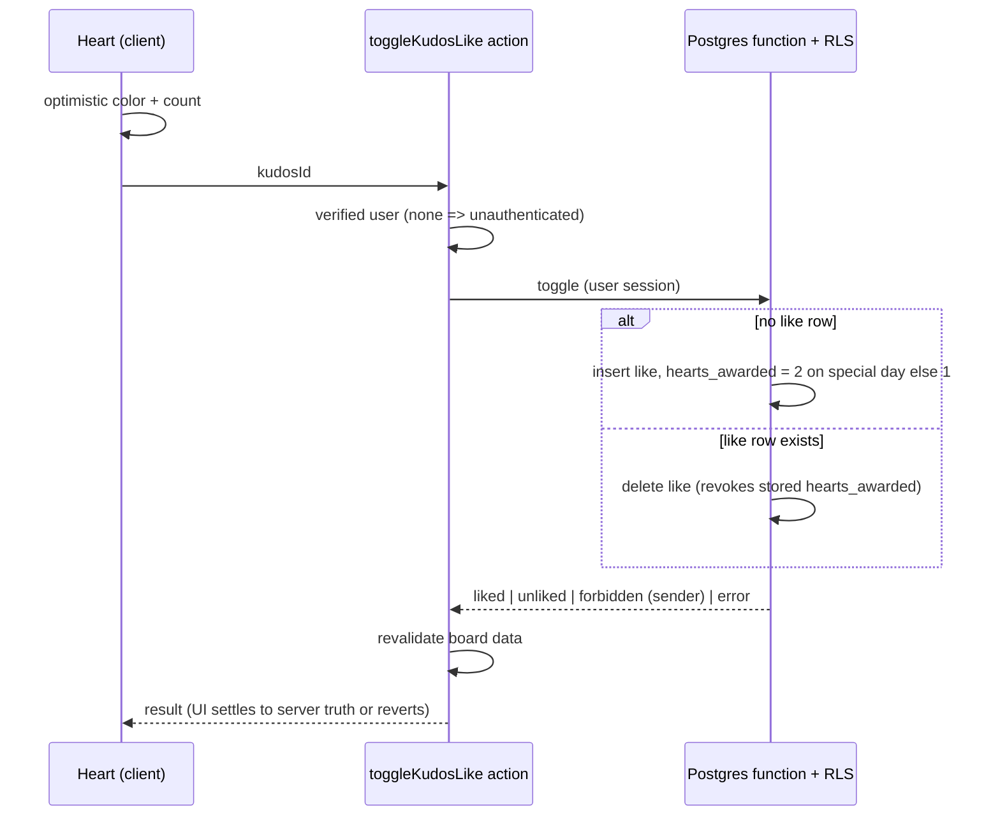
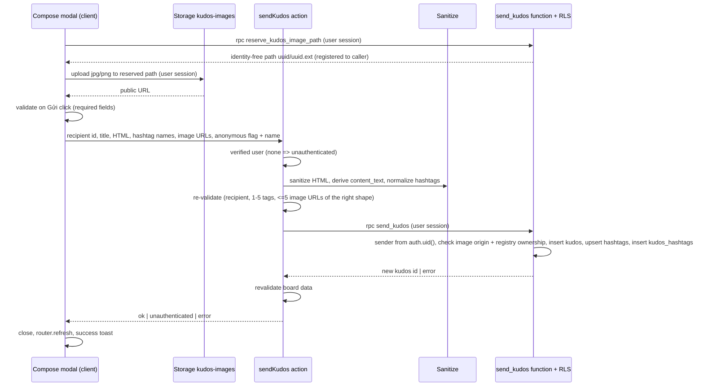
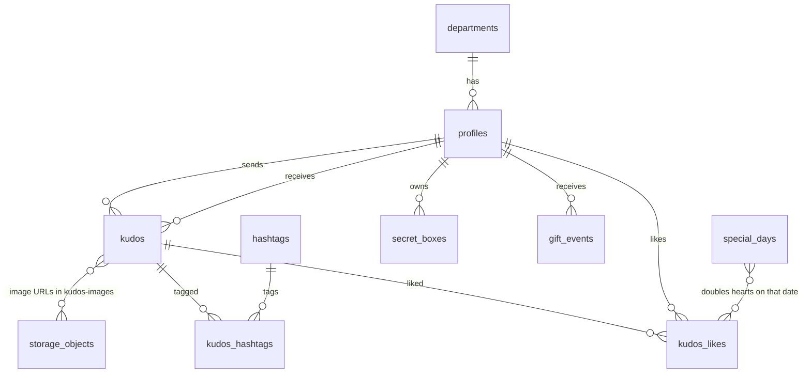

# Architecture

Single Next.js 16 App Router app. Auth delegated to Supabase (Google OAuth, PKCE code flow). With the Kudos live board the app gets its first real data store: the Supabase Postgres project holds the kudos domain (people, departments, hashtags, kudos, likes, gift events, Secret Box records, special days), read by server components through the Supabase server client under row-level security and written by server actions (like and unlike). App state: locale cookie. Launch time is a single server env, `EVENT_START_AT`, read by the proxy gate, the event-config route and the homepage. With the Viết Kudo send dialog the app gets its first write path for kudos data and its first Supabase Storage use: a signed-in Sunner composes a kudos in a client modal (TipTap editor), images go straight from the browser to the Storage bucket `kudos-images`, and a server action sanitizes the content and persists the kudos through one database function. Anonymous kudos are masked inside the database views, so no public read path exposes the sender. No cache layer, queue or Realtime subscription.

## System Architecture

## Tech Stack

| Layer | Technology | Version |
|-------|------------|---------|
| Frontend | Next.js (App Router, `cacheComponents`, `partialPrefetching`, Turbopack), React, Tailwind CSS; spotlight is hand-rolled SVG; compose modal uses TipTap (new dependency: core, starter-kit subset, strike, ordered list, link, blockquote, mention, placeholder) | next 16.4.2, react 19.3.0, tailwindcss ^4 |
| Backend | Next.js route handlers (`/auth/callback`, `/api/event-config`) + server actions (sign-out, locale, like, load more, send kudos, search Sunners) + `proxy.ts`; no separate API | - |
| Auth | Supabase Auth via `@supabase/ssr` + `@supabase/supabase-js`, Google provider | ssr ^0.12.7, js ^2.118.0 |
| Database | Supabase Postgres (local stack :54322). Kudos domain schema delivered as migrations plus seed under `supabase/`; RLS on every table; a database function performs the like toggle and another (`send_kudos`) performs the kudos write; board views mask anonymous senders; a new migration adds `kudos.title`, `kudos.content_text`, `kudos.is_anonymous`, `kudos.anonymous_name` | - |
| Cache | None; `/api/event-config` explicitly uncached; board data is dynamic per request and revalidated after a like | - |
| Storage | Supabase Storage bucket `kudos-images` (new, first use): public read, authenticated write inside `<auth user id>/`, jpg and png only, 5 MB per object; `kudos.images` stores public URLs | - |
| Sanitizer | Server-side HTML allow-list sanitizer `sanitize-html` (second new dependency, matches the TipTap marks) | - |
| Queue | None | - |
| Realtime | None (no subscription; deferred) | - |
| Language/Tooling | TypeScript, ESLint 9, Vitest, Supabase CLI | ts ^5, vitest ^5.0.5, supabase ^2.121.0 |
| Images | `next/image` remote patterns for `*.googleusercontent.com` (avatar); local images under `public/images/kudos/` | - |

## Module Layout

| Path | Role |
|------|------|
| `src/proxy.ts` | Entry guard: session refresh, then launch gate, then route redirect decision; unchanged by the kudos feature (`/kudos` is a normal public route) |
| `src/lib/supabase/` | Env, browser client, server client (cookies), `update-session-in-proxy`; the server client is the single data access path for kudos |
| `src/lib/auth/` | Pure decision functions (route guard, callback target with return-to allow-list), `is-admin-user`, `get-display-user`, `get-current-viewer` (verified viewer used for gating and stats) |
| `src/lib/kudos/` | Typed query functions (highlight, feed page, spotlight, stats, gift list, filter options), and the like action logic; `kudos-viewer.ts` reads the signed-in profile through the `viewer_profile` view; row mappers read `content_text`, `title` and the masked anonymous fields |
| `src/lib/profile/` | F008 profile layer: `?id`/`?dir` resolution, header and feed queries (Received via `kudos_feed`, own Sent via `own_sent_kudos`), infinite-scroll page action; page loaders in `src/app/(site)/profile/` |
| `src/lib/countdown/` | Pure strict-ISO parse and countdown computation |
| `src/lib/i18n/` | Locale cookie, request locale, login / awards / prelaunch / kudos dictionaries (vi exact design copy, en draft), `setLocaleAction` |
| `src/app/` | `/`, `/login`, `/todo`, `/countdown`, `/auth/callback`, `/api/event-config`, `(site)/kudos` page, `/kudos/[id]` placeholder |
| `src/components/kudos/` | Presentational kudos components (banner, pill, carousel, cards, spotlight, sidebar) with typed props; the pill opens the compose modal when signed in and cards render the title line and the anonymous alias |
| `src/lib/kudos-compose/` | Send-kudos pieces: `sendKudos` and `searchSunners` server actions, input parse and form validation, hashtag normalization, server-only `sanitize-html` derivation of HTML and `content_text`, image URL shape check, browser image upload (reserve then upload), shared limits |
| `src/components/kudos-compose/` | Compose modal components (title, recipient, editor shell, hashtag, image, anonymous, footer) with typed props; the TipTap editor plugs into the editor slot |
| `supabase/migrations/`, `supabase/seed.sql` | Schema, RLS policies, like function, view(s), seed data; the Viết Kudo migrations (`20261022000001` to `4`) add columns and hashtag index, the masked definer views with column-level grants (incl. `viewer_profile`), `app_settings` + `kudos_image_uploads` + `send_kudos`, and the Storage bucket with `reserve_kudos_image_path` and its insert policy; `20261027000001` adds the `own_sent_kudos` definer view (F008) |
| `src/components/login/`, `src/components/prelaunch/` | Presentational login and countdown components |

## Data Flow

Google login (PKCE):

Route guard, launch gate and sign-out:

Countdown page:

Kudos board page load (`/kudos`):

Like / unlike (server action, optimistic):

Compose and send kudos (server action, then database function):

Recipient and `@` mention lookups call the `searchSunners` server action over `profiles` (trimmed query, own profile excluded). Board reads go through views that mask anonymous senders (alias, null sender fields, default avatar applied by the mapper, and a session-derived `viewer_is_sender` flag).

Feed paging: a server action `loadMoreKudos(filters, cursor)` returns the next keyset page `(created_at, id)`; the client appends it as the user scrolls.

Data domain (design intent, names not yet migrated):

## Key Decisions (from source)

- Next 16 `proxy` is the guard/session-refresh layer; auth verified with `getClaims()`, never `getSession()`.
- DEC-001: guard `/login` (authed -> `/todo`) and `/todo/**` (unauthed -> `/login`). Roles only matter for the launch gate and the admin menu item. `/kudos` is public: the proxy is not changed; interaction gating happens in the page and the action.
- DEC-003 (F008): `/profile` is guarded in `decideRouteRedirect` (guest -> `/login?next=%2Fprofile`, `/profile` exact in the return-to allow-list). The own-Sent feed reads `own_sent_kudos`: SECURITY DEFINER, scoped to `auth.uid()`, same 19 columns as `kudos_feed`, `authenticated` only, so anonymous kudos show real identity to their sender alone. The OTHER face reads Received only and shows no counts.
- DEC-004 (8b677e2): `getClaims()` validates the JWT locally and never reaches GoTrue, so a signed token can outlive its user (db reset, deleted/banned). On `/login` only, `updateSessionInProxy` additionally calls `getUser()`; on error it clears local session cookies and treats the request as a guest. Other routes keep claims-only checks to avoid a GoTrue call per request.
- DEC-002: callback redirect target is resolved from an allow-list (no open redirect): a `next` query param accepted only if it is an exact internal allow-listed path (at least `/kudos`), default `/todo`; failure -> `/login?error=oauth`. The login page carries a valid `next` into the OAuth `redirectTo` for `/auth/callback`; the pure callback-target resolver validates it. Gated Kudos actions link to `/login?next=/kudos`.
- Fail-open: a missing or invalid `EVENT_START_AT` is treated as already launched.
- Launch gate evaluates first in `proxy.ts`; after launch the existing rules behave as today.
- Launch gate lives in `proxy.ts`; admin = `app_metadata.role === 'admin'` on verified claims.
- `GET /api/event-config` is dynamic and uncached.
- One env for the launch time: `EVENT_START_AT` (server-only).
- Supabase unreachable in proxy degrades to unauthenticated, not 500.
- `cacheComponents` forces cookie/searchParams reads inside `<Suspense>`; the `/kudos` page reads search params (filters) and the viewer inside Suspense.
- Kudos data is read in server components via the Supabase server client under RLS; no service-role key in the app runtime. Seed data is loaded with database privileges, not by the app.
- Like and unlike are one database function called from a server action with the user's session: atomic, race-safe through the unique (user, kudos) rule; exact revoke because the awarded hearts are stored on the like row and a sender's hearts are summed, never stored as a counter.
- `profiles` links to `auth.users` by a nullable unique `auth_user_id` (seeded Sunners have no auth account); a database trigger on auth user insert creates the profile on first sign-in. `secret_boxes` is seeded with owner-only select RLS (authenticated only; the policy resolves the owner through the `viewer_profile` view). `auth_user_id` is revoked from anon and authenticated by column-level grants (the join key to `auth.users` must not be exposed); the signed-in user's own full row is served by the `viewer_profile` definer view, used for viewer lookup in `kudos-viewer.ts` and `sendKudos`.
- Display time and special-day dates use Asia/Ho_Chi_Minh; the tier label (New Hero, Rising, Super, Legend) is derived from the star count, not stored.
- Filters live in URL search params (shareable, server-rendered); the carousel index is client state reset on filter change.
- Spotlight is hand-rolled SVG with viewBox pan/zoom (no new dependency); layout is deterministic.
- Image upload is identity-free: the client calls `reserve_kudos_image_path` (definer, session-derived owner, 25 per user per hour), which records the owner in `kudos_image_uploads` and returns `<uuid>/<uuid>.<ext>`; the Storage insert policy asks a definer predicate (`is_reserved_kudos_image_path`) because the registry has no client grants. Paths carry no uid since anonymous kudos publish the URLs. `send_kudos` accepts an image only if it starts with `app_settings.storage_public_base` (per-environment origin, service-role managed), matches the path shape, is at most 500 characters and is registered to the caller; `p_content` is capped at 50,000 characters.
- Send path: client uploads images to Storage with the user session, then the `sendKudos` server action re-validates, sanitizes and calls the `send_kudos` database function with the user session; the sender is always `auth.uid()` inside the function. No service-role key in the app runtime.
- Content is stored twice: sanitized HTML in `kudos.content` (for the later detail screen) and tag-stripped `content_text` for board cards; existing rows are backfilled `content_text = content`.
- Anonymous masking lives in the database views (single read path; definer-executed views plus column-level revoke on `kudos.sender_id`): for `is_anonymous` rows the sender id, name, avatar, department and stars are not returned, the alias comes from `anonymous_name` (default "Ẩn danh"), and sender columns of `kudos` are withheld from anon and authenticated so the table cannot be queried around the views.
- Storage objects are never deleted by the app; orphans from cancelled or failed sends are an accepted risk (images upload at pick time, no cleanup job).
- `hashtags` gets a unique index on `lower(name)` in the new migration (after a seed check) so case-insensitive dedupe is enforced by the database.
- Public `profile_kudos_stats.kudos_sent` counts non-anonymous kudos only; the signed-in owner's sidebar count comes from an owner-only query that counts all kudos they sent.
- Limits enforced on the client and again in `sendKudos`: hashtag 30 (unicode letters, digits, underscore), title 60, anonymous name 30, content 5000 characters; `searchSunners` is debounced and capped at about 10 results.
- Hashtags created at send time are deduplicated case-insensitively; the first spelling wins.
- No Supabase Realtime: updates on reload and revalidate after a like (deferred, not rejected).
- Locale is the only other app state: cookie set via whitelisted server action; kudos copy comes from a dictionary (vi exact design copy, en draft).

## Open Items

- Client clock drift can make `/countdown` redirect early; resolved with one redirect then a ~5 s retry.
- Email signup enabled in `supabase/config.toml` but no UI uses it.
- Production Supabase URL/redirect allow-list not in repo (only local `site_url` http://localhost:3000); production database migration rollout is not defined.
- The kudos writer ships with the Viết Kudo task (`send_kudos`); `gift_events` writers remain deferred and that table stays seeded. There is no promotion event table (frame shows only the gift list).
- Open (draft): production Storage bucket provisioning and rollout; seed check for case-duplicate hashtags before the `lower(name)` unique index.
- Special-day admin UI is deferred to the Admin screen task.
