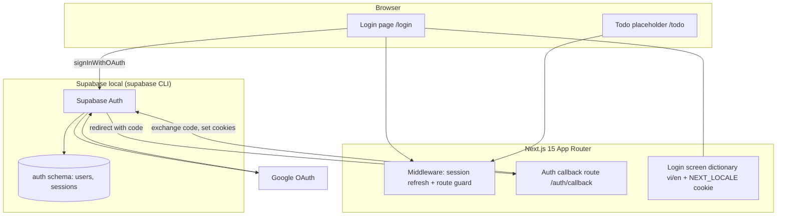
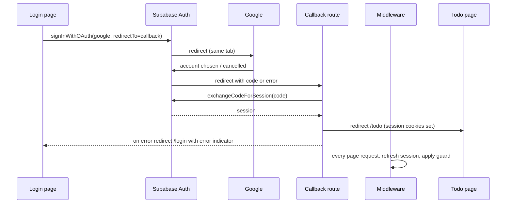

# Architecture

## System Architecture

Greenfield single-app architecture: a Next.js 15 App Router application talks directly to a local Supabase stack for authentication. There is no custom backend service; server-side logic lives in Next.js middleware and route handlers.

### Auth Callback Route

A route handler (proposed path `/auth/callback`, TBD (draft)) receives the post-Google redirect, exchanges the authorization code for a session through the server Supabase client, writes session cookies, and redirects to `/todo`. Any error, cancel, or missing code redirects to `/login` with an error indicator. The path must be excluded from the middleware guard and listed as an allowed redirect URL in the Supabase config.

### Middleware

One Next.js middleware runs on page requests (static assets excluded). It builds a server Supabase client over request/response cookies, refreshes the session, resolves the user, and applies the guard rules: `/login` with a session → `/todo`; `/todo` with no session → `/login`. Rules are detailed in [permissions.md](permissions.md).

### Localization (i18n)

No i18n library. A lightweight in-repo dictionary holds `vi` and `en` strings for the Login screen only. The active locale comes from the `NEXT_LOCALE` cookie (`vi` | `en`, default and fallback `vi`). The language selector writes the cookie and refreshes the page. Other screens are single-language.

### Configuration and Secrets

Supabase URL and public key come from env vars (names TBD (draft)). The Google provider is enabled in the local Supabase config with `GOOGLE_CLIENT_ID` and `GOOGLE_CLIENT_SECRET` read from env (user fills later). No secrets are committed; an `.env` example documents setup.

## Tech Stack

| Layer | Technology | Version |
|-------|------------|---------|
| Frontend | Next.js (App Router), React, TypeScript, Tailwind CSS | Next.js 15; others TBD (draft) |
| Backend | Next.js middleware + route handlers (no separate service) | TBD (draft) |
| Auth | Supabase Auth, `@supabase/supabase-js`, `@supabase/ssr`, Google provider | TBD (draft) |
| Database | PostgreSQL via Supabase local (auth schema only; no app tables) | TBD (draft) |
| Cache | N/A | — |
| Queue | N/A | — |

## Data Flow

