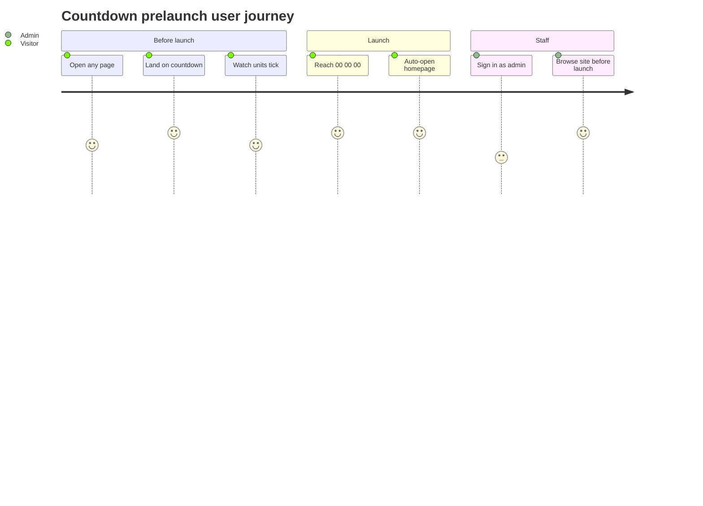

# Screens — CountdownPrelaunch

## Screen List

| Screen Name | SCR### | What User Sees | What User Can Do |
|-------------|--------|----------------|------------------|
| Countdown - Prelaunch | TBD (draft) | Full-screen dark organic multicolor background; centered title "Sự kiện sẽ bắt đầu sau" / "Event starts in"; three LED units, each two digits over an uppercase white label: DAYS, HOURS, MINUTES | Watch the numbers count down; wait for zero, after which the homepage opens by itself. No links or buttons; other pages are locked before launch |

Detailed layout, states and accessibility: `screens/SCR-countdown-prelaunch/spec.md`. The homepage it leads to is the existing Homepage SAA screen, not specified here.

## User Journey

1. A visitor requests any page before launch (direct link, bookmark or shared URL) and lands on the countdown screen.
2. The visitor reads the title and the three units; the numbers drop every second.
3. At zero all units read 00 and, 1.5 seconds later, the screen opens the homepage (if the server bounces the visitor back, it stays at 00 and retries about every 5 seconds).
4. A visitor who arrives after launch never sees this screen: it forwards to the homepage.
5. An admin signs in from the login page and bypasses this screen before launch.

