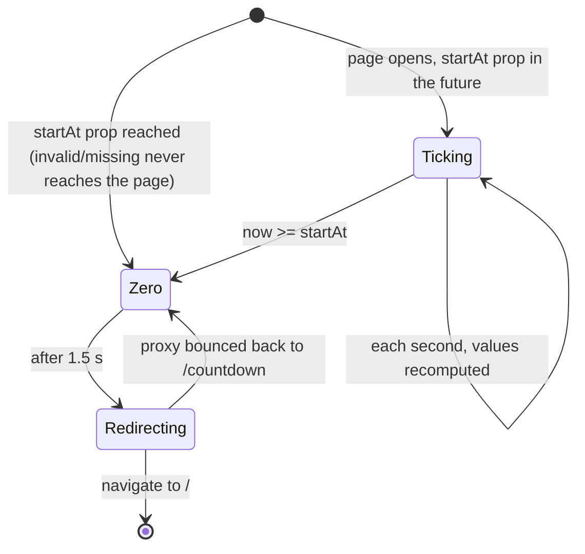

# F000_CountdownPrelaunch

**Priority**: P1
**Type**: ui + api
**Generated**: 2026-10-20

## Overview

A standalone `/countdown` page shows how long remains until the SAA 2025 event starts: a localized title (vi/en) and three LED-style units DAYS, HOURS, MINUTES, recomputed every second from a target datetime. The `/countdown` page is a server component that reads the server env `EVENT_START_AT` directly and passes `startAt` as a prop to the client ticker (no runtime fetch). The new `GET /api/event-config` route also returns `{startAt}` from the same env (dynamic, never cached) for external or other clients. A launch gate in `src/proxy.ts` makes the whole site pre-launch-only for admins: before the start time, visitors and signed-in non-admins are redirected to `/countdown` (exclusions: `/countdown`, `/login`, `/auth/*`, `/api/*`, static assets); users whose `app_metadata.role` is `admin` browse normally. When the countdown reaches zero the page shows `00 00 00` and auto-redirects to `/` after 1.5 seconds; once launched, the gate disappears and `/countdown` itself redirects to `/`. The date setting is unified on `EVENT_START_AT`; `NEXT_PUBLIC_EVENT_START_AT` is dropped and the homepage hero reads the server env directly. Build status: the presentational UI (Track A) is built; the API route, gate, i18n dictionary, tick logic and env migration are planned.

## Polymorphic Behavior

N/A — no discriminator fields in Key Entities.

Behavior varies by viewer role and by launch phase (see DEC-001), not by a stored discriminator.

## Cross-Cutting Logic

### Requirements

| Code | Description | Endpoint/Handler | Verifiable |
|------|-------------|------------------|------------|
| FR-001 | `/countdown` shows the localized title and three LED units (DAYS, HOURS, MINUTES), each two digits with an uppercase white label | PAGE `/countdown` | yes |
| FR-002 | Units update automatically every second; each value is zero-padded to two digits; a value outside its range (hours not 0-23, minutes not 0-59) or invalid shows `00`; days below 1 show `00`; days above 99 are capped at 99 for display (two LED boxes, format 00-99) | PAGE `/countdown` | yes |
| FR-003 | At or past the target all three units show `00`; the page then redirects to `/` after 1.5 seconds. The auto-redirect fires at most once; if the proxy (server clock) bounces back to `/countdown`, the page keeps showing `00` and retries the redirect every ~5 seconds until it sticks | PAGE `/countdown` | yes |
| FR-004 | `GET /api/event-config` returns JSON `{startAt: string \| null}` taken from server env `EVENT_START_AT`; the response is never served from a cache. The countdown page itself does not call it: it reads the env server-side | ROUTE `GET /api/event-config` | yes |
| FR-005 | Before the start time, a request from a visitor or a signed-in non-admin to any route outside the exclusion list is redirected to `/countdown` | PROXY `src/proxy.ts` | yes |
| FR-006 | Before the start time, a signed-in user with `app_metadata.role === 'admin'` is never redirected to `/countdown` | PROXY `src/proxy.ts` | yes |
| FR-007 | From the start time on, no request is gated, and a request to `/countdown` is redirected to `/` | PROXY `src/proxy.ts` | yes |
| FR-008 | `EVENT_START_AT` replaces `NEXT_PUBLIC_EVENT_START_AT`; the homepage hero reads it server-side and passes the value down; `.env.example` is updated | PAGE `/` | yes |
| FR-009 | Title and unit labels come from a prelaunch dictionary keyed by the `NEXT_LOCALE` cookie locale (vi default); title is "Sự kiện sẽ bắt đầu sau" (vi) / "Event starts in" (en); labels DAYS/HOURS/MINUTES stay English uppercase in both locales; the page metadata title is localized from the same dictionary (en draft: "Countdown \| Sun* Annual Awards 2025") | PAGE `/countdown` | yes |

### Business Rules

#### BR-001_GateExclusions
**Linked FR:** FR-005
**Applies to:** PROXY `src/proxy.ts`
**Rule:** Gating never applies to `/countdown`, `/login`, `/auth/*`, `/api/*`, `_next/static` assets, favicon and `/images/*`. `/login` and `/auth/*` stay reachable so an admin can sign in; `/api/*` stays open so the page can fetch `/api/event-config`.

**Pseudocode:**
```text
isExcluded(path) = path == "/countdown" or startsWith(path, "/login", "/auth/", "/api/")
                   or static asset (matcher already skips _next, favicon, images)
```

#### BR-002_AdminBypassFromServerMetadata
**Linked FR:** FR-006
**Applies to:** PROXY `src/proxy.ts`
**Rule:** Admin is decided only by `app_metadata.role === 'admin'` on the verified session claims (same rule as the existing admin helper); `user_metadata` is never consulted. A Supabase failure degrades to unauthenticated, so the user is gated (deny by default).

#### BR-003_UnconfiguredLaunchTimeIsOpen
**Linked FR:** FR-004, FR-007
**Applies to:** PROXY, PAGE `/countdown`
**Rule:** Fail-open (resolved). When `EVENT_START_AT` is missing or not a valid ISO datetime with offset, the site is treated as already launched: no gate, and `/countdown` redirects to `/`. A misconfiguration never locks the whole site.

### Decision Logic

#### DEC-001_LaunchGateDecision
**subtype:** routing
**Triggers in:** `SCR-countdown-prelaunch` (draft) and every other route, on each proxy request
**Involved entities:** Launch time, request path, viewer role
**user_visible_outcome:** decides whether the visitor sees the requested page or `/countdown` (or `/` after launch).

```pseudo
launched = startAt invalid/missing or now >= startAt   // fail-open, BR-003
if launched:
  path == "/countdown" → redirect "/"
  else → pass through (existing login/todo rules apply exactly as today)
else:
  if isExcluded(path) → pass through
  else if viewer is admin → pass through
  else → redirect "/countdown"
```

The gate runs after the session refresh so refreshed cookies are carried on the redirect. Precedence (resolved): the launch gate evaluates FIRST. Before launch, a non-admin on a non-excluded route short-circuits to `/countdown` before any other rule runs. After launch, the existing route-guard rules (`/login` when signed in, `/todo` when signed out) behave exactly as today.

### State Machines

#### SM-001_CountdownPage
**kind:** ui
**Linked FR:** FR-002, FR-003
**States:** Ticking, Zero, Redirecting



| From | To | Guard | Side effect |
|------|----|-------|-------------|
| (open) | Ticking | `startAt` prop valid and now < startAt | start 1 s interval |
| (open) | Zero | `startAt` already reached | show `00 00 00` |
| Ticking | Zero | now >= startAt | stop interval, show `00 00 00` |
| Zero | Redirecting | 1.5 s elapsed (first time) | navigate to `/` |
| Redirecting | Zero | still on `/countdown` ~5 s later (server clock not yet launched) | stay at `00`, retry navigation every ~5 s until it sticks |

### Algorithms

#### ALG-001_CountdownComputation
**Linked FR:** FR-002, FR-003
**Input:** target datetime (ISO with offset, Asia/Ho_Chi_Minh = UTC+7), current time
**Output:** `{days, hours, minutes}` two-digit strings plus a reached-zero flag
**File Schema**: N/A — not a file-exchange type
**Complexity:** O(1)
**Description:** Reuses the existing pure countdown computation: parse the strict ISO datetime, take the whole-minute difference, clamp at zero, split into days/hours/minutes and zero-pad. Display change: days are clamped to 99 at display level (the shared computation currently renders three digits beyond 99 days). An unparseable target never reaches the page (fail-open, BR-003). The client recomputes every second from its own clock; because the target is an offset-based instant, only client clock drift can skew the display (see edge-cases.md).

**Pseudocode:**
```text
diff = startAt - now
if diff <= 0 → 00/00/00, reachedZero
else minutes = floor(diff / 60s); days = min(99, minutes / 1440); hours = (minutes % 1440) / 60; mins = minutes % 60
```

### External Integrations

None. The route reads a server env var; no third-party call is added. Session verification continues to use the existing Supabase auth integration inside the proxy.

### Verification

- **SC-001** — `GET /api/event-config` returns `{startAt}` equal to the configured env value, and a changed env is reflected on the next request without rebuild caching (covers FR-004)
- **SC-002** — Before launch, a signed-out visitor requesting `/`, `/awards` or `/todo` is redirected to `/countdown`; `/login`, `/auth/callback`, `/api/event-config` and static assets are not (covers FR-005, BR-001)
- **SC-003** — Before launch, a signed-in admin opens `/` normally; a signed-in non-admin is redirected to `/countdown` (covers FR-005, FR-006, BR-002)
- **SC-004** — After launch, `/countdown` redirects to `/` and other routes are untouched (covers FR-007)
- **SC-005** — Units tick every second, are zero-padded, days cap at 99, all show `00` at zero, then the page leaves for `/` after 1.5 s (covers FR-002, FR-003)

---

**Client behavior:** see
[`behavior-logic.md`](../../docs/system/behavior-logic.md) (client-side patterns — per-second polling/tick),
[`permissions.md`](../system/permissions.md) (draft: pre-launch gate and admin bypass),
[`architecture.md`](../system/architecture.md) (draft: event-config route, proxy launch gate, env unification).

## User Stories

### US001_ViewCountdown — Visitor watches the time until launch (Priority: P1)

**What happens:** A visitor opens `/countdown` and sees the dark background, the title "Sự kiện sẽ bắt đầu sau" (or "Event starts in") and three LED units (DAYS, HOURS, MINUTES) that count down every second.
**Why this priority:** The only purpose of the page.
**Independent Test:** Set `EVENT_START_AT` a few minutes ahead, open `/countdown`, watch minutes and hours change correctly.
**Endpoints**: PAGE `/countdown`, ROUTE `GET /api/event-config`

**Acceptance Scenarios:**

1. **Given** launch is in the future, **When** the page loads, **Then** three units show two-digit zero-padded values and update every second.
2. **Given** less than one day remains, **When** the page renders, **Then** DAYS shows `00`.
3. **Given** the locale cookie is `en`, **When** the page renders, **Then** the title reads "Event starts in".
4. **Given** a computed hours or minutes value is outside its range or invalid, **When** it renders, **Then** that unit shows `00`.

**Requirements fulfilled:**
- **FR-001** Title and three labelled LED units — PAGE `/countdown`
- **FR-002** Per-second update, zero-pad, clamp invalid to `00` — PAGE `/countdown`
- **FR-009** Localized title and labels — PAGE `/countdown`

**Rules enforced:** ALG-001 (see Cross-Cutting Logic)

**Verification:**
- **SC-005** (see Cross-Cutting Logic)

---

### US002_AutoLeaveAtZero — Page moves on when the event starts (Priority: P1)

**What happens:** When the target is reached the units show `00 00 00`, and 1.5 seconds later the browser goes to `/`. If the server clock has not yet opened the gate and bounces the visitor back, the page keeps showing `00` and retries every ~5 seconds.
**Why this priority:** Without it the visitor is stuck on the page after launch.
**Independent Test:** Set `EVENT_START_AT` about 10 seconds ahead and watch the page reach zero and open `/`.
**Endpoints**: PAGE `/countdown`

**Acceptance Scenarios:**

1. **Given** the countdown is running, **When** now reaches the target, **Then** all units show `00` and the page redirects to `/` after 1.5 seconds.
2. **Given** the proxy sends the visitor back to `/countdown` after that redirect (client clock ahead of server), **When** the page is shown again, **Then** it stays at `00` and retries the redirect about every 5 seconds until it sticks.
3. **Given** the target is already in the past, **When** `/countdown` is opened, **Then** the visitor ends up on `/` (proxy redirect, or page redirect if the proxy was bypassed).

**Requirements fulfilled:**
- **FR-003** Zero display and delayed redirect — PAGE `/countdown`
- **FR-007** After launch `/countdown` redirects to `/` — PROXY

**Rules enforced:** DEC-001, SM-001 (see Cross-Cutting Logic)

**Verification:**
- **SC-004**, **SC-005** (see Cross-Cutting Logic)

---

### US003_BlockedBeforeLaunch — Non-admin visitors are held on the countdown (Priority: P1)

**What happens:** Before the start time, a visitor or signed-in non-admin who requests any normal page lands on `/countdown`. They can still reach the login page and sign-in return step.
**Why this priority:** The countdown is a pre-launch lock; without the gate it is only a banner.
**Independent Test:** Signed out, with a future `EVENT_START_AT`, request `/awards` and confirm the redirect to `/countdown`.
**Endpoints**: PROXY `src/proxy.ts`

**Acceptance Scenarios:**

1. **Given** launch is in the future and the visitor is signed out, **When** they request `/` or `/awards`, **Then** they are redirected to `/countdown`.
2. **Given** launch is in the future and the user is signed in but not admin, **When** they request any non-excluded route, **Then** they are redirected to `/countdown`.
3. **Given** launch is in the future, **When** anyone requests `/login`, `/auth/callback` or `/api/event-config`, **Then** the request is not redirected.
4. **Given** launch has passed, **When** anyone requests any route, **Then** no gate redirect occurs.

**Requirements fulfilled:**
- **FR-005** Pre-launch redirect for non-admins — PROXY
- **FR-007** Gate disappears after launch — PROXY

**Rules enforced:** BR-001, DEC-001 (see Cross-Cutting Logic)

**Verification:**
- **SC-002** (see Cross-Cutting Logic)

---

### US004_AdminBrowsesBeforeLaunch — Admin previews the site before launch (Priority: P1)

**What happens:** An admin signs in through `/login` and then browses the full site while everyone else still sees the countdown.
**Why this priority:** The team must verify the site before the public launch.
**Independent Test:** Sign in as a user whose app metadata role is admin, with a future `EVENT_START_AT`; open `/` and `/awards` with no redirect.
**Endpoints**: PROXY `src/proxy.ts`

**Acceptance Scenarios:**

1. **Given** launch is in the future and the user is an admin, **When** they request `/`, **Then** the homepage renders.
2. **Given** a user whose role marker is missing or not `admin`, **When** they request `/`, **Then** they are redirected to `/countdown`.
3. **Given** the sign-in service is unreachable, **When** any user requests `/` before launch, **Then** they are treated as not signed in and redirected to `/countdown`.

**Requirements fulfilled:**
- **FR-006** Admin bypass — PROXY

**Rules enforced:** BR-002 (see Cross-Cutting Logic)

**Verification:**
- **SC-003** (see Cross-Cutting Logic)

---

### US005_ConfigureLaunchTime — Operator sets one launch time for the whole app (Priority: P2)

**What happens:** The operator sets `EVENT_START_AT` once in the server environment; the proxy gate, `GET /api/event-config` and the homepage hero countdown all read that one value.
**Why this priority:** Removes the duplicate public variable and keeps the gate and the hero consistent.
**Independent Test:** Change `EVENT_START_AT`, restart, and confirm the hero, the countdown page and the gate all follow the new time.
**Endpoints**: ROUTE `GET /api/event-config`, PAGE `/`

**Acceptance Scenarios:**

1. **Given** `EVENT_START_AT` is set, **When** `/api/event-config` is called, **Then** it returns `{startAt}` with that value.
2. **Given** `EVENT_START_AT` is unset, **When** `/api/event-config` is called, **Then** it returns `{startAt: null}`.
3. **Given** the migration is done, **When** the repo is searched, **Then** `NEXT_PUBLIC_EVENT_START_AT` appears nowhere.

**Requirements fulfilled:**
- **FR-004** Event-config route — ROUTE `GET /api/event-config`
- **FR-008** Env unification, homepage reads server env — PAGE `/`

**Rules enforced:** BR-003 (see Cross-Cutting Logic)

**Verification:**
- **SC-001** (see Cross-Cutting Logic)

---

### Edge Cases

See edge-cases.md.

## Key Entities

No database tables are read or written by this feature (draft intent).

| Entity | Table | Key Columns | Purpose |
|--------|-------|-------------|---------|
| Event config | N/A (server env `EVENT_START_AT`) | startAt (ISO-8601 with offset, Asia/Ho_Chi_Minh) | read-only: single launch-time source for gate, countdown page (server-side prop), API route and homepage hero |
| Prelaunch messages | N/A (static dictionary in code, vi and en) | title, DAYS/HOURS/MINUTES labels | read-only: locale-driven wording |
| Locale preference | N/A (cookie) | NEXT_LOCALE | read-only here (written by the existing language switcher) |
| Session claims | N/A (managed `auth.users` via Supabase) | app_metadata.role | read-only: admin bypass decision |

## Artifact References

| Artifact | File | Codes Used | Reviewed |
|----------|------|------------|----------|
| System Overview | [system-overview.md](../../docs/system/system-overview.md) | — | [ ] |
| Architecture | [architecture.md](../system/architecture.md) | TBD (draft) | [ ] |
| Feature List | [feature-list.md](../../docs/generated/feature-list.md) | F### TBD (draft) | [ ] |
| API Map | [api-map.md](../../docs/generated/api-map.md) | TBD (draft) | [ ] |
| Entities | [entities.md](../../docs/generated/entities.md) | TBD (draft) | [ ] |
| Screens | [screens.md](screens.md) | SCR### TBD (draft) | [ ] |
| Behavior Logic | [behavior-logic.md](../../docs/system/behavior-logic.md) | TBD (draft) | [ ] |
| Permissions | [permissions.md](../system/permissions.md) | TBD (draft) | [ ] |
| Permissions Matrix | [permissions-matrix.md](../../docs/generated/permissions-matrix.md) | TBD (draft) | [ ] |
| User Stories | [user-stories.md](../../docs/generated/user-stories.md) | TBD (draft) | [ ] |

System-doc forward-drafts: `plans/261020-1656-countdown-prelaunch-implementation/spec/system/permissions.md` and `.../spec/system/architecture.md` (the feature adds a route, a proxy gate and a role-based access rule).

## Assumptions

- Source of truth is the MoMorph screen "Countdown - Prelaunch" (screen id 8PJQswPZmU) plus the recorded clarifications; the frame is in design status.
- The design has three units only (no seconds), but the tick cadence is one second.
- Timezone is Asia/Ho_Chi_Minh (UTC+7); the env value is an ISO datetime with explicit offset, so math is offset-based and independent of the server or client zone.
- The spec row note "before 0, all navigation locked" is realised as the site-wide proxy gate, not as in-page link locking (clarification).
- The MoMorph "access control unspecified" test cases are resolved by the gate model: everyone may see `/countdown` before launch; non-admins stay gated; `/login` stays reachable for expired sessions.
- The Track A UI (`PrelaunchScreen`, props `values`, `title`, `labels`) is presentational and receives mock values until the tick logic is wired.
- The MoMorph TODO "design an API endpoint for target datetime" is closed by `GET /api/event-config`, kept for external or other clients; the countdown page itself reads the env server-side and passes `startAt` to the client ticker, so it has no fetch-failure state.

## Source Code References

No new source code is written yet for the API route, gate, dictionary or tick logic. Existing code the plan builds on, by name only: the pure countdown computation under `src/lib/countdown/`, the proxy and its session helper under `src/proxy.ts` and `src/lib/supabase/`, the admin-role helper under `src/lib/auth/`, the locale and dictionary layer under `src/lib/i18n/`, the presentational prelaunch components under `src/components/prelaunch/` with the page at `src/app/countdown/`, and the homepage hero consumer of the old env var in `src/app/(site)/page.tsx`. The session helper currently reports only an authenticated flag, so the gate needs it to also expose the admin marker from the verified claims.

## Unresolved Questions

Resolved (recorded in clarifications):

1. **Invalid or missing `EVENT_START_AT`**: fail-open, treated as already launched (BR-003).
2. **Gate vs existing guards**: the launch gate runs first in the proxy (DEC-001).
3. **Unit labels**: DAYS/HOURS/MINUTES stay English uppercase in both locales, matching the frame.
4. **Start time on the page**: read server-side and passed as a prop; no client fetch, so no fetch-failure state.
5. **Days above 99**: display capped at 99; requires a display-level clamp on days in the countdown computation.
6. **Redirect delay at zero**: 1.5 s; the redirect fires once, then retries every ~5 s if the proxy bounces back.
7. **Page metadata title**: localized from the prelaunch dictionary.

Still open for PM review:

1. **English copy**: the English title, unit-label treatment and "Countdown | Sun* Annual Awards 2025" metadata title are developer drafts pending PM review.

## Source Walkthrough

1. **File:** `src/lib/countdown/compute-countdown.ts` — start here: the pure parse and countdown math reused for every tick.
2. **File:** `src/proxy.ts` — the entry guard where the launch gate is added.
3. **File:** `src/app/countdown/page.tsx` — the server page that reads the env and passes `startAt` to the client ticker.
4. **File:** `src/components/prelaunch/prelaunch-screen.tsx` — the presentational screen fed by `values`, `title`, `labels`.

### Call Hierarchy

```text
Request -> proxy.ts -> updateSessionInProxy -> launch gate (DEC-001) -> redirect or pass
/countdown server page -> read EVENT_START_AT -> startAt prop -> client ticker: computeCountdown (1 s tick) -> PrelaunchScreen
reachedZero -> wait 1.5 s -> navigate "/" (retry every ~5 s if bounced back)
GET /api/event-config -> {startAt} (external/other clients only)
```

**Related files:** see `## Source Code References` above.

## DB Impact per Event

N/A — read-only feature, no DB writes.
