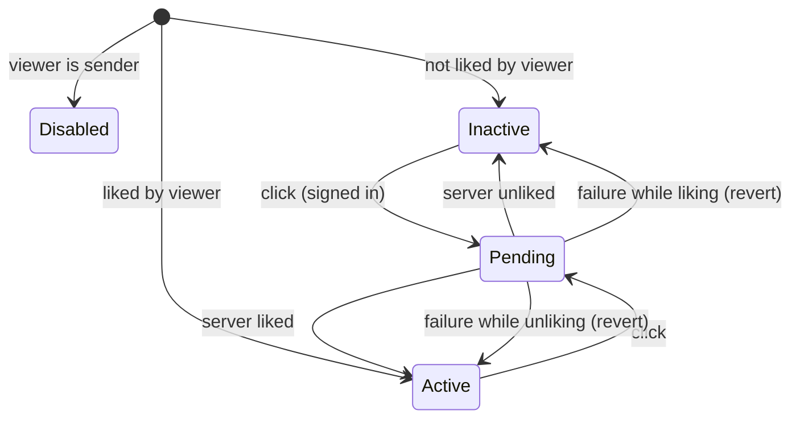

# KudosLiveBoard (F### TBD (draft))

**Priority**: P1
**Type**: ui + api + data
**Generated**: 2026-10-21

## Overview

The `/kudos` page becomes the SAA 2025 "Sun* Kudos - Live board" (MoMorph screen MaZUn5xHXZ). It is publicly viewable and shows: a banner, an input pill (opens a stub send dialog), a HIGHLIGHT carousel of the top-5 kudos by like count, Hashtag and Phòng ban filters shared by the highlight carousel and the feed, a SPOTLIGHT word cloud of recipient names (hand-rolled SVG, pan/zoom, tooltip, search highlight), an ALL KUDOS infinite-scroll feed, and a right sidebar (personal stats for signed-in viewers only, a "Mở quà" button, one seeded gift leaderboard). The page is a server component reading a new Supabase Postgres schema (first real DB schema in the app) through the existing server client; like and unlike run as server actions with optimistic UI. Like rules: one like per user per kudos, the sender cannot like their own kudos, a like gives the kudos sender 1 heart (2 on an admin-configured special day), and an unlike revokes exactly what that like awarded. Interactions that need identity (like, input pill, "Mở quà", profile and detail navigation) send visitors to `/login?next=...`, and after sign-in the user returns to the board through an allow-listed return-to path (default stays `/todo`). There is no Realtime subscription. Adjacent screens (send dialog, kudo detail, profile, Secret Box dialog, hover preview) are stubs built in their own later tasks. Build status: Track A presentational components exist with mock data; schema, queries, actions, filters, spotlight logic, dictionary and gating are planned.

## Polymorphic Behavior

N/A — no discriminator fields in Key Entities.

Behavior varies by viewer state (visitor, signed-in non-sender, signed-in sender of a given kudos) and by whether the like happens on a special day, not by a stored discriminator.

## Cross-Cutting Logic

### Requirements

| Code | Description | Endpoint/Handler | Verifiable |
|------|-------------|------------------|------------|
| FR-001 | `/kudos` renders for visitors and signed-in users: banner, input pill, HIGHLIGHT, SPOTLIGHT, ALL KUDOS, right sidebar. Viewing needs no sign-in | PAGE `/kudos` | yes |
| FR-002 | Banner shows title "Hệ thống ghi nhận lời cảm ơn" and the SAA 2025 KUDOS logo graphic; read-only | PAGE `/kudos` | yes |
| FR-003 | Input pill shows pencil icon and placeholder "Hôm nay, bạn muốn gửi lời cảm ơn và ghi nhận đến ai?". Signed-in click opens the send-dialog stub; signed-out click goes to `/login` | PAGE `/kudos` | yes |
| FR-004 | HIGHLIGHT shows up to 5 kudos ranked by like count (see BR-006), center card prominent, side cards faded and non-interactive, pagination "n/m", prev disabled on first slide, next disabled on last slide | PAGE `/kudos` | yes |
| FR-005 | Hashtag and Phòng ban dropdown options are read from the database; the active option shows an active state; a clear affordance returns to unfiltered | PAGE `/kudos` | yes |
| FR-006 | The selected hashtag and department apply to BOTH HIGHLIGHT and ALL KUDOS (AND-combined); any filter change resets the carousel to slide 1 | PAGE `/kudos` | yes |
| FR-007 | Clicking a hashtag on a card sets the Hashtag filter to that tag | PAGE `/kudos` | yes |
| FR-008 | Highlight card shows sender and receiver blocks (avatar, name, department, star count), arrow icon, time formatted `HH:mm - MM/DD/YYYY`, content clamped to 3 lines with "...", up to 5 hashtags on one line with "...", heart with count, Copy Link and "Xem chi tiết" | PAGE `/kudos` | yes |
| FR-009 | Feed card (C.3) shows the same blocks, content clamped to 5 lines with "...", a gallery of up to 5 square thumbnails (click opens full size), all hashtags (clickable), heart with count and Copy Link; it has NO "Xem chi tiết" | PAGE `/kudos` | yes |
| FR-010 | ALL KUDOS loads newest first in pages and loads the next page as the user scrolls to the end; the last page ends loading | PAGE `/kudos`, ACTION `loadMoreKudos` | yes |
| FR-011 | Empty highlight or feed shows "Hiện tại chưa có Kudos nào." | PAGE `/kudos` | yes |
| FR-012 | Star count (hoa thị) is derived from kudos received: 10 → 1 star, 20 → 2, 50 → 3, below 10 → 0; tooltips use the design's exact Vietnamese copy | PAGE `/kudos` | yes |
| FR-013 | Heart toggles gray (not liked) to red (liked) with count change of 1 per like, applied optimistically; the server result is authoritative and a failure reverts the UI | ACTION `toggleKudosLike` | yes |
| FR-014 | Like requires sign-in; a visitor clicking the heart goes to `/login` without any write | PAGE `/kudos`, ACTION `toggleKudosLike` | yes |
| FR-015 | The sender of a kudos cannot like it: the heart is disabled in the UI and the write is rejected by the server | ACTION `toggleKudosLike`, DB policy | yes |
| FR-016 | A user has at most one like per kudos | DB constraint | yes |
| FR-017 | A like stores `hearts_awarded` = 2 when the like happens on a special day, else 1; unlike deletes the like so exactly the stored amount is revoked | ACTION `toggleKudosLike`, DB function | yes |
| FR-018 | Copy Link (all card variants) copies the absolute `/kudos/[id]` URL to the clipboard and shows the toast "Link copied — ready to share!"; available to visitors | PAGE `/kudos` | yes |
| FR-019 | "Xem chi tiết" and a spotlight node click open `/kudos/[id]` (placeholder page); avatar or name click opens the person's profile (placeholder); all require sign-in, else `/login` | PAGE `/kudos`, PAGE `/kudos/[id]` | yes |
| FR-020 | SPOTLIGHT shows the total kudos count from the database (unfiltered) and an SVG word cloud of recipient names sized by kudos received, with loading, empty and interactive states | PAGE `/kudos` | yes |
| FR-021 | A Pan/Zoom toggle icon button with tooltip switches the cloud interaction mode; pan and zoom are implemented by transforming the SVG viewBox | PAGE `/kudos` | yes |
| FR-022 | Hovering a node shows a tooltip with the person's name and the time they last received a kudos; clicking a node opens the detail stub (FR-019) | PAGE `/kudos` | yes |
| FR-023 | The spotlight search (placeholder "Tìm kiếm", max 100 chars) highlights matching nodes and dims the rest; empty input is a no-op | PAGE `/kudos` | yes |
| FR-024 | Sidebar personal stats (kudos received, kudos sent, hearts received, Secret Boxes opened, unopened) render only for a signed-in viewer and only for that viewer's own data | PAGE `/kudos` | yes |
| FR-025 | "Mở quà" opens the Secret Box dialog stub for signed-in users, `/login` for visitors; may be disabled when the viewer is not eligible (rule TBD (draft)) | PAGE `/kudos` | yes |
| FR-026 | Sidebar shows ONE list of 10 from seeded gift events: "10 SUNNER NHẬN QUÀ MỚI NHẤT", newest first, each row with avatar, gold name and a description; public to visitors; empty list shows "Chưa có dữ liệu"; the sidebar scrolls independently. **Spec-CSV deviation (for PM):** the spec rows list a second list "10 SUNNER CÓ SỰ THĂNG HẠNG MỚI NHẤT"; the Figma frame draws only the gift list, so the frame wins (precedent F004) and the promotion list and its table are dropped | PAGE `/kudos` | yes |
| FR-027 | The schema, RLS and seed data for the kudos domain ship as Supabase migrations and seed; public reads, authenticated own-like writes only | DB migrations | yes |
| FR-028 | Interface copy comes from a kudos dictionary keyed by the locale cookie (vi default); `vi` carries the exact design copy, `en` is a developer draft | PAGE `/kudos` | yes |
| FR-029 | No Supabase Realtime subscription: new data appears on reload; a like revalidates the page data | PAGE `/kudos` | yes |
| FR-030 | Every gated action sends a visitor to `/login?next=<path>`; `next` is honored only if it is an exact member of an internal allow-list (at least `/kudos`); the login page forwards a valid `next` to the sign-in return step, which resolves it after sign-in; missing, invalid or external `next` falls back to `/todo` (no open redirect) | PAGE `/login`, ROUTE `GET /auth/callback` | yes |
| FR-031 | A person block shows stars and a tier label derived from stars: 0 = New Hero, 1 = Rising, 2 = Super, 3 = Legend (matches the four Figma hover frames) | PAGE `/kudos` | yes |

### Business Rules

#### BR-001_LikeOnePerUserPerKudos
**Linked FR:** FR-016
**Applies to:** DB table `kudos_likes`, ACTION `toggleKudosLike`
**Rule:** The pair (user, kudos) is unique. A second like is never inserted; the toggle treats an existing like as "unlike".

#### BR-002_SenderCannotLikeOwnKudos
**Linked FR:** FR-015
**Applies to:** DB policy on `kudos_likes`, ACTION, UI heart
**Rule:** A like whose liker equals the kudos sender is rejected. The UI disables the heart for the sender; the server enforces it independently.

#### BR-003_HeartsAwardedBySpecialDay
**Linked FR:** FR-017
**Applies to:** DB function behind `toggleKudosLike`
**Rule:** `hearts_awarded` is 2 if the like's calendar date (Asia/Ho_Chi_Minh, the server time at insert) exists in `special_days`, else 1. The value is stored on the like row and never recomputed. The kudos sender's heart total is the sum of `hearts_awarded` over likes on their kudos, so deleting a like revokes exactly what it awarded.

#### BR-004_LikeRequiresSignIn
**Linked FR:** FR-014
**Applies to:** ACTION `toggleKudosLike`, UI
**Rule:** The server identity comes from the verified session (same verified-user approach as the existing viewer helper), never from client input. No identity → no write and the client goes to `/login`.

#### BR-005_PersonalStatsOwnerOnly
**Linked FR:** FR-024
**Applies to:** PAGE `/kudos` sidebar
**Rule:** Stats are computed for the signed-in viewer's own profile only; nothing in the request selects another person. Visitors receive no stats payload.

#### BR-006_HighlightRanking
**Linked FR:** FR-004
**Applies to:** HIGHLIGHT query
**Rule:** Highlight is the 5 kudos with the highest like count among those matching the active filters; ties broken by newest first. Ranking metric = like count, the number shown on the card (resolved). The special-day doubling affects only the sender's received hearts, not ranking.

#### BR-007_StarMilestones
**Linked FR:** FR-012
**Applies to:** profile display
**Rule:** stars = 3 if received ≥ 50, 2 if ≥ 20, 1 if ≥ 10, else 0, where received = count of kudos with that person as receiver. Derived in a view, not stored. Tier label derived from stars: 0 = New Hero, 1 = Rising, 2 = Super, 3 = Legend (FR-031).

### Decision Logic

#### DEC-001_LikeClickDecision
**subtype:** routing
**Triggers in:** `SCR-kudos-live-board` (draft), heart click
**Involved entities:** viewer, kudos, kudos_likes
**user_visible_outcome:** decides whether the heart toggles, is inert, or sends the visitor to login.

```pseudo
if viewer is signed out → navigate /login
else if viewer is kudos sender → inert (heart disabled)
else → optimistic toggle, call toggleKudosLike(kudosId)
        server: no identity → {unauthenticated} → revert, go /login
                sender == liker → {forbidden} → revert
                like exists → delete like → {liked:false}
                else → insert like with hearts_awarded (BR-003) → {liked:true}
```

#### DEC-002_GatedNavigation
**subtype:** routing
**Triggers in:** `SCR-kudos-live-board` (draft), input pill, "Mở quà", avatar/name, "Xem chi tiết", spotlight node, leaderboard row
**Involved entities:** viewer
**user_visible_outcome:** signed-in goes to the stub target; visitor goes to `/login`.

```pseudo
target = stub for the clicked element
signed in → go target / open dialog stub
signed out → go /login?next=<current board path, allow-listed>   // FR-030
```

The page passes `signedIn` down once; no per-element server call. After sign-in the callback resolves `next` against the allow-list (exact internal paths only, at least `/kudos`) and defaults to `/todo`. An already signed-in user opening `/login?next=` being sent to the allow-listed `next` instead of `/todo` is TBD (draft). Touches the callback target resolution and the login page, not the proxy launch gate.

#### DEC-003_FilterState
**subtype:** state
**Triggers in:** `SCR-kudos-live-board` (draft), dropdown choose, hashtag-tag click, clear
**Involved entities:** hashtags, departments
**user_visible_outcome:** both HIGHLIGHT and ALL KUDOS refresh to the same filter and the carousel returns to slide 1.

Filter state lives in URL search params (`hashtag`, `department`) so the server component re-queries and the view is shareable; the spotlight is not filtered. Reading search params respects the app's Suspense rule for cache components.

### State Machines

#### SM-001_HeartToggle
**kind:** ui
**Linked FR:** FR-013, FR-014, FR-015
**States:** Inactive, Active, Pending, Disabled



| From | To | Guard | Side effect |
|------|----|-------|-------------|
| Inactive | Pending | signed in, not sender | show red, count +1, call action |
| Active | Pending | signed in | show gray, count -1, call action |
| Pending | Active / Inactive | server result | settle to server truth, revalidate |
| Pending | previous | failure | revert color and count, error toast |

#### SM-002_Carousel
**kind:** ui
**Linked FR:** FR-004, FR-006
**States:** Slide(1..m), Empty

| From | To | Guard | Side effect |
|------|----|-------|-------------|
| Slide(i) | Slide(i+1) | next clicked, i < m | pagination "i+1/m" |
| Slide(i) | Slide(i-1) | prev clicked, i > 1 | pagination "i-1/m" |
| any | Slide(1) | filter changed | reset |
| any | Empty | zero kudos | empty copy, no controls |

#### SM-003_SpotlightView
**kind:** ui
**Linked FR:** FR-020, FR-021, FR-023
**States:** Loading, Empty, Interactive(pan|zoom)

| From | To | Guard | Side effect |
|------|----|-------|-------------|
| Loading | Interactive | data present | layout computed (ALG-001) |
| Loading | Empty | zero recipients | empty state |
| Interactive(pan) | Interactive(zoom) | toggle clicked | mode icon and tooltip update |
| Interactive | Interactive | search text changes | matching nodes highlighted |

### Algorithms

#### ALG-001_WordCloudLayout
**Linked FR:** FR-020, FR-022
**Input:** list of {name, receivedCount, lastReceivedAt, kudosId}
**Output:** node positions and font sizes inside a fixed SVG viewBox
**File Schema**: N/A — not a file-exchange type
**Complexity:** O(n²) worst case for collision checks; n is capped (cap TBD (draft))
**Description:** Hand-rolled, no new dependency. Font size scales with received count between a min and max (values TBD (draft)). Nodes are placed in descending size along an outward spiral from the center; a node is accepted at the first spiral position whose bounding box collides with no placed node. Output is deterministic for a given input so reloads do not reshuffle. Pan and zoom change only the SVG viewBox.

**Pseudocode:**
```text
sort nodes by size desc
for node: for t in spiral(center): if !collides(box(node,t), placed) { place; break }
```

#### ALG-002_SpecialDayHeartAward
**Linked FR:** FR-017
**Input:** like time, `special_days`
**Output:** hearts_awarded in {1, 2}
**File Schema**: N/A — not a file-exchange type
**Complexity:** O(1) indexed lookup
**Description:** BR-003 evaluated inside the database function so the stored value and the write are one atomic step.

**Pseudocode:**
```text
day = date(now at Asia/Ho_Chi_Minh)
hearts = special_days has day ? 2 : 1
```

#### ALG-003_FeedKeysetPaging
**Linked FR:** FR-010
**Input:** filters, cursor (created_at, id) or none, page size (TBD (draft), default 10)
**Output:** page of kudos plus next cursor or end flag
**File Schema**: N/A — not a file-exchange type
**Complexity:** O(page) with an index on (created_at, id)
**Description:** Keyset paging keeps loaded cards stable when new kudos arrive. A returned page shorter than the page size sets the end flag.

**Pseudocode:**
```text
select ... where filters and (created_at, id) < cursor order by created_at desc, id desc limit size
```

### External Integrations

#### INT-001_SupabaseAuthAndPostgres
**Linked FR:** FR-014, FR-027
**Provider:** Supabase (existing Auth integration plus the project's Postgres)
**Purpose:** verified identity for gating and the like action; persistent kudos data
**Contract:** reads through the existing server client under RLS; likes through a database function called by a server action with the user's session. No secrets in code or specs; no service-role key in the app runtime.
**Failure behavior:** auth failure degrades to visitor; a data failure leaves the affected section in its empty or error state and never crashes the page.

### Verification

- **SC-001** — Visitor opens `/kudos`: all sections render, personal stats hidden, no redirect (covers FR-001, FR-024; TC-71b3ef43 view part)
- **SC-002** — Visitor clicks heart, input pill, "Mở quà", avatar, "Xem chi tiết" or a node: lands on `/login?next=/kudos`, no write occurs (covers FR-003, FR-014, FR-019, FR-025; TC-71b3ef43)
- **SC-015** — Signing in from `/login?next=/kudos` returns to `/kudos`; an external or non-allow-listed `next` falls back to `/todo`; no `next` stays `/todo` (covers FR-030)
- **SC-003** — Signed-in non-sender likes then unlikes: heart gray→red→gray, count +1/-1, database row created then removed (covers FR-013, FR-016)
- **SC-004** — Sender's heart is disabled and a forged like is rejected; a second like by the same user leaves one row (covers FR-015, FR-016, BR-001, BR-002)
- **SC-005** — Like on the seeded special day stores 2 hearts; unlike removes exactly 2; sender's heart total follows (covers FR-017, BR-003)
- **SC-006** — Choosing a hashtag or department filters both highlight and feed, resets carousel to slide 1; tag click sets the hashtag filter; clear restores all (covers FR-005, FR-006, FR-007)
- **SC-007** — Carousel arrows disabled at both ends, pagination "n/m", only center card interactive (covers FR-004)
- **SC-008** — Feed pages load on scroll, end cleanly, empty state copy shown with no data (covers FR-010, FR-011)
- **SC-009** — Spotlight: loading, empty and interactive states; hover tooltip; node click goes to detail stub; pan/zoom toggle; search of 100 chars accepted, 101st rejected, empty input no-op (covers FR-020 to FR-023; **deviation TC-9e689933**)
- **SC-010** — Copy Link writes the URL and shows "Link copied — ready to share!" (covers FR-018)
- **SC-011** — Sidebar stats equal the signed-in user's seeded counts; the gift list shows seeded rows or "Chưa có dữ liệu" (covers FR-024, FR-026)
- **SC-012** — "Mở quà" opens the stub (**deviation TC 43b54c29**); send-dialog TCs (**deferred f183a3e4, ca8f60b3**) are not run here (covers FR-003, FR-025)
- **SC-013** — Row-level security: anonymous can read public tables, cannot write; authenticated can write only own non-sender like (covers FR-027)
- **SC-014** — Locale `vi` shows exact design copy; `en` shows the draft dictionary (covers FR-028)

**Client behavior:** see behavior-logic.md, permissions.md, screen-flow.md

## User Stories

### US001_BrowseBoard — Anyone reads the live board (Priority: P1)

**What happens:** A visitor or Sunner opens `/kudos` and sees the banner, input pill, highlight carousel, spotlight, feed and sidebar populated from the database.
**Why this priority:** The board is the feature; public viewing is the core promise.
**Independent Test:** With seed data, open `/kudos` signed out and verify every section shows seeded content.
**Endpoints**: PAGE `/kudos`

**Acceptance Scenarios:**

1. **Given** seed data, **When** a visitor opens `/kudos`, **Then** all sections render and the personal stats box is not shown.
2. **Given** no kudos exist, **When** the page loads, **Then** highlight and feed show "Hiện tại chưa có Kudos nào.".
3. **Given** locale `vi`, **When** the page renders, **Then** all fixed copy matches the design exactly.

**Requirements fulfilled:**
- **FR-001** Public render — PAGE `/kudos`
- **FR-002** Banner — PAGE `/kudos`
- **FR-011** Empty copy — PAGE `/kudos`
- **FR-012** Star milestones — PAGE `/kudos`
- **FR-031** Tier label from stars — PAGE `/kudos`
- **FR-027** Schema, RLS, seed — DB migrations
- **FR-028** Dictionary — PAGE `/kudos`
- **FR-029** No Realtime — PAGE `/kudos`

**Rules enforced:** BR-007

**Verification:**
- **SC-001**, **SC-013**, **SC-014**

---

### US002_FilterAndHighlight — Narrow the board and page the top kudos (Priority: P1)

**What happens:** The visitor picks a hashtag and/or department; the highlight carousel (top 5) and feed follow; the carousel pages with arrows.
**Why this priority:** Main discovery path across the board.
**Independent Test:** Choose a department, confirm both sections change and the carousel is on slide 1.
**Endpoints**: PAGE `/kudos`

**Acceptance Scenarios:**

1. **Given** the board is unfiltered, **When** the visitor chooses a hashtag, **Then** highlight and feed show only kudos with that hashtag and the carousel is at 1/m.
2. **Given** slide 3, **When** a filter changes, **Then** the carousel returns to slide 1.
3. **Given** slide 1, **Then** previous is disabled; **Given** the last slide, **Then** next is disabled.
4. **Given** a card, **When** a hashtag is clicked, **Then** that hashtag becomes the active filter.

**Requirements fulfilled:**
- **FR-004** Carousel — PAGE `/kudos`
- **FR-005** DB-sourced dropdowns with active state — PAGE `/kudos`
- **FR-006** Shared filters and reset — PAGE `/kudos`
- **FR-007** Tag click — PAGE `/kudos`
- **FR-008** Highlight card contents — PAGE `/kudos`

**Rules enforced:** BR-006, DEC-003, SM-002

**Verification:**
- **SC-006**, **SC-007**

---

### US003_LikeKudos — Signed-in Sunner hearts a kudos (Priority: P1)

**What happens:** A signed-in non-sender taps the heart; it turns red and the count rises at once; tapping again undoes it. The kudos sender earns 1 heart (2 on a special day); unlike revokes exactly that amount.
**Why this priority:** The core interaction and the only write on this screen.
**Independent Test:** Sign in as a non-sender, like and unlike; inspect `kudos_likes` and the sender's heart total.
**Endpoints**: ACTION `toggleKudosLike`

**Acceptance Scenarios:**

1. **Given** a signed-in non-sender, **When** they like, **Then** UI is red with count +1 immediately and one like row exists.
2. **Given** a liked kudos, **When** they unlike, **Then** the row is deleted and count -1.
3. **Given** the viewer is the sender, **Then** the heart is disabled and any forged write is rejected.
4. **Given** a special day, **When** a like is added, **Then** `hearts_awarded` is 2 and unlike removes 2.
5. **Given** a visitor, **When** they click the heart, **Then** they land on `/login` and nothing is written.
6. **Given** the action fails, **Then** color and count revert.

**Requirements fulfilled:**
- **FR-013** Toggle and optimistic UI — ACTION `toggleKudosLike`
- **FR-014** Sign-in required — ACTION `toggleKudosLike`
- **FR-015** No self-like — DB policy
- **FR-016** One like per user per kudos — DB constraint
- **FR-017** Hearts by special day, exact revoke — DB function

**Rules enforced:** BR-001, BR-002, BR-003, BR-004, DEC-001, SM-001, ALG-002

**Verification:**
- **SC-003**, **SC-004**, **SC-005**

---

### US004_ExploreSpotlight — Explore who was thanked (Priority: P2)

**What happens:** The visitor sees the total kudos count and a word cloud of recipients; pans or zooms it, hovers a name for a tooltip, searches to highlight names, clicks a name to open that kudos (placeholder).
**Why this priority:** Distinctive visual element, but the board works without it.
**Independent Test:** Search a seeded name and confirm it is highlighted; hover shows name and time.
**Endpoints**: PAGE `/kudos`

**Acceptance Scenarios:**

1. **Given** seed data, **When** the board loads, **Then** the cloud shows recipients sized by kudos received and the total count from the database.
2. **Given** a node, **When** hovered, **Then** a tooltip shows name and received time.
3. **Given** search text, **When** typed, **Then** matching nodes are highlighted and others dimmed; 100 chars max.
4. **Given** empty search, **Then** nothing changes.
5. **Given** the pan/zoom toggle, **When** clicked, **Then** the mode switches and pan or zoom works.
6. **Given** a node click, **Then** a signed-in user opens `/kudos/[id]` stub and a visitor `/login`.

**Requirements fulfilled:**
- **FR-020** Total and cloud states — PAGE `/kudos`
- **FR-021** Pan/zoom toggle — PAGE `/kudos`
- **FR-022** Tooltip and node click — PAGE `/kudos`
- **FR-023** Search highlight — PAGE `/kudos`
- **FR-019** Detail navigation (stub) — PAGE `/kudos/[id]`

**Rules enforced:** ALG-001, SM-003, DEC-002

**Verification:**
- **SC-009**

---

### US005_ScrollFeed — Scroll all kudos (Priority: P1)

**What happens:** The visitor scrolls the feed and more kudos load; each card shows sender, receiver, time, clamped content, thumbnails, hashtags, heart and Copy Link.
**Why this priority:** Primary content surface.
**Independent Test:** With more than one page of seed kudos, scroll to the end and confirm all load once.
**Endpoints**: ACTION `loadMoreKudos`

**Acceptance Scenarios:**

1. **Given** more than one page, **When** the user nears the end, **Then** the next page appends.
2. **Given** the last page loaded, **Then** no more requests occur.
3. **Given** a thumbnail, **When** clicked, **Then** the full-size image opens.
4. **Given** Copy Link, **When** clicked, **Then** the link is copied and the toast shows.

**Requirements fulfilled:**
- **FR-009** Feed card — PAGE `/kudos`
- **FR-010** Infinite scroll — ACTION `loadMoreKudos`
- **FR-018** Copy Link — PAGE `/kudos`

**Rules enforced:** ALG-003

**Verification:**
- **SC-008**, **SC-010**

---

### US006_ReadSidebar — Personal stats and leaderboards (Priority: P2)

**What happens:** A signed-in Sunner sees their own totals and a "Mở quà" button; everyone sees the gift list.
**Why this priority:** Supporting context; personal stats are the only owner-private data.
**Independent Test:** Signed in, compare stats with seeded rows; signed out, confirm no stats.
**Endpoints**: PAGE `/kudos`

**Acceptance Scenarios:**

1. **Given** a signed-in user, **Then** six stat rows show that user's counts.
2. **Given** a visitor, **Then** the stats box is not shown.
3. **Given** seeded gift events, **Then** the list shows the 10 newest rows.
4. **Given** no events, **Then** the list shows "Chưa có dữ liệu".
5. **Given** a visitor, **Then** the gift list is shown and "Mở quà" is visible (click goes to `/login`).
6. **Given** "Mở quà" is pressed, **Then** a signed-in user sees the Secret Box stub and a visitor goes to `/login?next=/kudos`.

**Requirements fulfilled:**
- **FR-024** Owner-only stats — PAGE `/kudos`
- **FR-025** "Mở quà" — PAGE `/kudos`
- **FR-026** Gift list — PAGE `/kudos`
- **FR-030** Return-to after sign-in — PAGE `/login`, ROUTE `GET /auth/callback`
- **FR-003** Input pill (gated stub) — PAGE `/kudos`

**Rules enforced:** BR-005, DEC-002

**Verification:**
- **SC-011**, **SC-012**, **SC-002**

---

### Edge Cases

See edge-cases.md.

## Key Entities

Intended data model (Supabase Postgres, `public` schema; names are design intent, not yet migrated).

| Entity | Table | Key Columns | Purpose |
|--------|-------|-------------|---------|
| Department | `departments` | id, code (e.g. CEVC10), name | filter options and person display |
| Profile (Sunner) | `profiles` | id, auth_user_id (nullable, unique, links to auth user), display_name, avatar_url, department_id | people shown as sender, receiver, gift-list row; stars and tier derived; a row is created on first sign-in by a database trigger on auth user insert |
| Hashtag | `hashtags` | id, name (unique) | filter options and card tags |
| Kudos | `kudos` | id, sender_id, receiver_id, content, images (text array), created_at (no title column: "IDOL GIỚI TRẺ" is a hashtag) | the thank-you notes; writes belong to the later Viết Kudo task |
| Kudos hashtag | `kudos_hashtags` | kudos_id, hashtag_id (composite key) | many-to-many tags |
| Kudos like | `kudos_likes` | id, kudos_id, user_id (profile), hearts_awarded (1 or 2), created_at; unique (user_id, kudos_id) | like state and exact heart revoke |
| Special day | `special_days` | day (date, Asia/Ho_Chi_Minh), multiplier (2) | days when a like awards 2 hearts; 1 seeded; admin UI deferred |
| Gift event | `gift_events` | id, profile_id, description, created_at | source of the single "nhận quà" sidebar list (seeded) |
| Secret box | `secret_boxes` | profile_id, opened_at (null = unopened) | source of Secret Box opened/unopened stats; seeded; owner-only select |
| Profile stats | view `profile_kudos_stats` | profile_id, kudos_received, kudos_sent, hearts_received, stars | derived: received/sent counts, hearts = sum of hearts_awarded on the person's kudos, stars per BR-007 |
| Kudos feed rows | view or query | kudos plus sender, receiver, department, hashtags, like_count, liked_by_viewer | read model for highlight and feed |
| Total kudos | query | count of `kudos` | SPOTLIGHT total |
| Dictionary | N/A (static in code, vi and en) | kudos copy | locale-driven wording |
| Locale preference | N/A (cookie) | NEXT_LOCALE | existing |
| Session | N/A (Supabase Auth) | verified user id | gating, like identity |

RLS intent: public select on every table above except `secret_boxes` (owner-only select); insert and delete on `kudos_likes` for an authenticated user acting on their own profile and not the kudos sender; no client write policies elsewhere (seed runs with database privileges).

## Artifact References

| Artifact | File | Codes Used | Reviewed |
|----------|------|------------|----------|
| System Overview | [system-overview.md](../../docs/system/system-overview.md) | — | [ ] |
| Architecture | [architecture.md](../system/architecture.md) | TBD (draft) | [ ] |
| Feature List | [feature-list.md](../../docs/generated/feature-list.md) | F### TBD (draft) | [ ] |
| API Map | [api-map.md](../../docs/generated/api-map.md) | TBD (draft) | [ ] |
| Entities | [entities.md](../../docs/generated/entities.md) | TBD (draft) | [ ] |
| Screens | [screens.md](screens.md) | SCR### TBD (draft) | [ ] |
| Behavior Logic | [behavior-logic.md](../../docs/system/behavior-logic.md) | TBD (draft) | [ ] |
| Permissions | [permissions.md](../system/permissions.md) | TBD (draft) | [ ] |
| Permissions Matrix | [permissions-matrix.md](../../docs/generated/permissions-matrix.md) | TBD (draft) | [ ] |
| User Stories | [user-stories.md](../../docs/generated/user-stories.md) | TBD (draft) | [ ] |

System-doc forward-drafts: `plans/261021-2221-kudos-live-board-implementation/spec/system/architecture.md` and `.../spec/system/permissions.md` (first real DB schema and server actions; interaction gating on a public page).

## Assumptions

- Source of truth is the MoMorph screen "Sun* Kudos - Live board" (screen id MaZUn5xHXZ, 64 spec rows, 41 test cases; design status in progress) plus `clarifications.md`.
- Most design copy is Vietnamese and is used verbatim for `vi`; English strings are developer drafts pending PM review.
- "Live" means fresh on load and after a like; no Realtime subscription (clarified).
- Time display is `HH:mm - MM/DD/YYYY` in Asia/Ho_Chi_Minh for both locales (follows design sample; zone is an assumption).
- Highlight ranks by like count, the number displayed on the card (resolved).
- Heart total shown in stats ("Số tim bạn nhận được") is the sum of `hearts_awarded` over likes on kudos the viewer sent.
- Copy Link, full-size image view and viewing are available to visitors; only the actions listed in the clarification are gated.
- Public read of like rows is accepted (needed for counts); like rows carry profile ids, not emails.
- Spotlight shows all receivers, node size by kudos received; the tooltip time is the latest kudos received; a node click opens the detail stub of that person's latest kudos (resolved).
- Seeded Sunners have no Supabase auth account; signed-in users link to a profile through nullable unique `auth_user_id`, created by a database trigger on auth user insert (resolved).
- Time zone for special days and displayed `HH:mm - MM/DD/YYYY` is Asia/Ho_Chi_Minh (resolved).
- Filter clear is a "Tất cả" option at the top of each dropdown (resolved).
- Signed-out sidebar: personal stats box hidden; "Mở quà" stays visible and goes to `/login`; the gift list is public (resolved).
- Track A integration: Track A built `src/components/kudos/**` (22 files, presentational, props-driven). Mock data lives in `kudos-mock-data.ts` and is replaced by query results; copy lives in `kudos-copy.ts` and is replaced by the kudos dictionary. `KudosUser` already carries `heroTier` of "new" | "rising" | "super" | "legend", which matches the star-derived tier (FR-031). The mock `title` field is dropped and the second sidebar list (promotion) is removed to follow the frame.
- Event writes for `gift_events` belong to the later Viết Kudo task; here the table is seeded only. `title_events` is dropped (frame has no promotion list).
- The launch gate and route guards in the proxy need no change: `/kudos` stays a normal route, public after launch.

## Source Code References

No source code is written yet for the schema, queries, actions, spotlight logic or dictionary. Existing code the plan builds on, by name only: the placeholder page under `src/app/(site)/kudos/`, the Track A presentational components and mock data under `src/components/kudos/`, the verified-viewer helper under `src/lib/auth/`, the server client under `src/lib/supabase/`, the locale and dictionary layer under `src/lib/i18n/`, the (site) layout with shared header and footer, the local Supabase project config under `supabase/` (no migrations yet), and the test-user fixtures under `e2e/`.

## Unresolved Questions

Resolved (recorded in clarifications):

1. **Scope**: live board only; send dialog, detail, profile, Secret Box dialog and hover preview are stubs.
2. **Data layer**: real Supabase migrations, RLS and seed; server queries.
3. **Live updates**: optimistic like plus revalidate; no Realtime.
4. **Access**: public viewing; interactions gated to `/login`; personal stats only when signed in.
5. **Like rules**: full logic with stored `hearts_awarded`, `special_days` and one seeded day; admin UI deferred.
6. **Spotlight**: hand-rolled SVG, viewBox pan/zoom, tooltip, click to stub detail.
7. **Sidebar list**: single gift list from seeded `gift_events`; `title_events` dropped (frame wins over spec CSV); writers deferred.
8. **Spotlight search**: filter/highlight, empty no-op, 100 max; TC-9e689933 deviation recorded for PM.

Known test-case deviations (for PM): TC-9e689933 (empty search required error vs no-op); f183a3e4 and ca8f60b3 (send-dialog required-field and save, deferred to Viết Kudo); 43b54c29 ("Mở quà" opens the real dialog, here a stub).

Resolved in the follow-up clarification round (profile-to-auth link and trigger, Secret Box table, highlight ranking, spotlight nodes and click, tier from stars, no title column, return-to allow-list, time zone, "Tất cả" clear option, signed-out sidebar, single gift list). Deviation for PM: spec CSV lists two sidebar lists, the frame draws one.

Still open (draft):

1. **English copy** pending PM review.
2. **Spec-CSV deviation** (single gift list instead of two) and the three test-case deviations await PM confirmation.
3. Unspecified UI details: error toasts, clipboard-failure feedback, pan/zoom bounds, spotlight node cap and size range, "Mở quà" eligibility, full-size image viewer, whether an already signed-in user opening `/login?next=` follows `next`.

## Source Walkthrough

1. **File:** `supabase/migrations` (to be created) — start here: schema, RLS, like function, seed.
2. **File:** `src/app/(site)/kudos/page.tsx` — the server page that reads filters and queries the board.
3. **File:** `src/lib/auth/get-current-viewer.ts` — reused to decide gating and stats.
4. **File:** `src/components/kudos/` — presentational components fed by query results.

### Call Hierarchy

```text
GET /kudos?hashtag&department -> page (Suspense) -> getCurrentViewer + supabase server client -> queries (highlight, feed page 1, spotlight, sidebar) -> components
heart click -> optimistic UI -> toggleKudosLike action -> verified user -> DB function (insert or delete like) -> revalidate
scroll end -> loadMoreKudos action -> keyset query -> append cards
gated click (signed out) -> /login
```

**Related files:** see `## Source Code References` above.

## DB Impact per Event

| Event/Endpoint | Table | Columns | Operation | Value Derivation | Source |
|-----------------|-------|---------|-----------|-------------------|--------|
| ACTION `toggleKudosLike` (like) | `kudos_likes` | kudos_id, user_id, hearts_awarded | INSERT | user_id from verified session profile; hearts_awarded 2 if today's date is in `special_days` else 1 | TBD (draft) |
| ACTION `toggleKudosLike` (unlike) | `kudos_likes` | — | DELETE | row for (user, kudos); removed hearts equal the stored hearts_awarded | TBD (draft) |
| PAGE `/kudos`, ACTION `loadMoreKudos` | all kudos-domain tables | — | SELECT | filters from URL params; keyset cursor | TBD (draft) |
