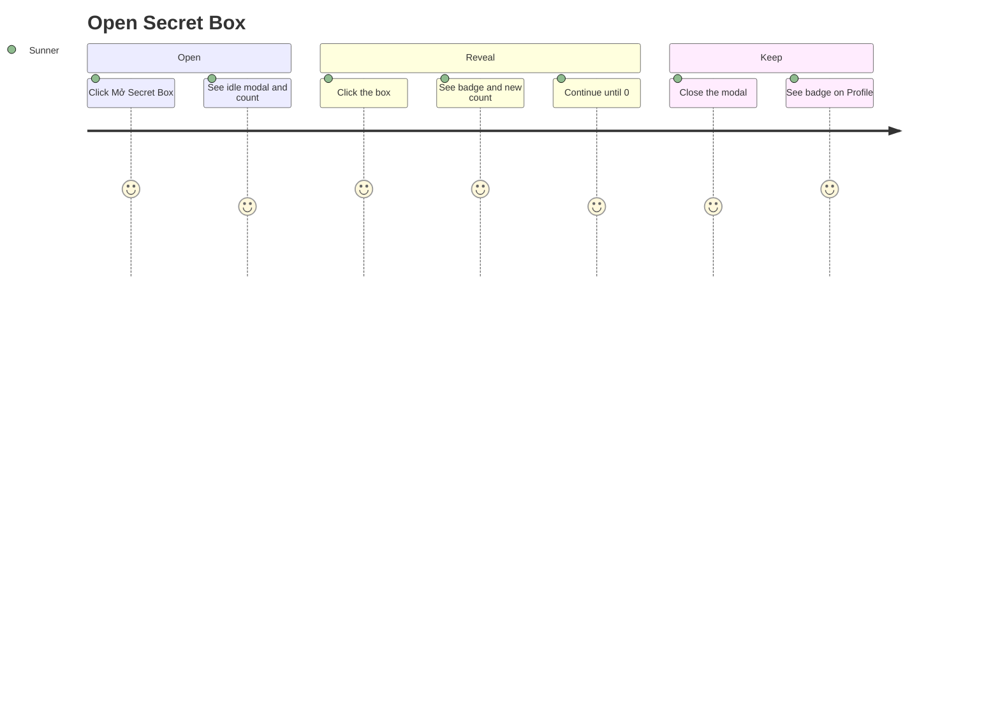

# Screens — Open Secret Box

## Screen List

| Screen Name | SCR### | What User Sees | What User Can Do |
|-------------|--------|----------------|------------------|
| Open Secret Box modal | TBD (draft) | Idle: title "KHÁM PHÁ SECRET BOX CỦA BẠN", instruction, centered gift box, "Secretbox chưa mở" with a yellow count, X. Success: title "MỞ SECRET BOX THÀNH CÔNG", badge inside the box, count, continue instruction (hidden at 0) | Click the box to open, close with X / Esc / backdrop |

Detailed layout, states and a11y: `screens/SCR-open-secret-box/spec.md`.

Adjacent screens:

| Screen | Relation | Behavior in this task |
|--------|----------|-----------------------|
| Kudos live board (SCR007) | Sidebar stats box button opens the modal | Placeholder dialog replaced by the modal; guests still go to login |
| Profile — self face | Stats block button opens the modal; badge collection reflects opened badges | Button enabled when unopened above 0; slots unlock |
| Login | Guest target from the board button | Unchanged |

## User Journey

1. A signed-in Sunner sees "Số Secret Box chưa mở" above 0 and clicks "Mở Secret Box".
2. The modal opens in the idle phase with the count.
3. They click the box; the badge appears and the count drops.
4. They keep clicking until the count is 0, then close.
5. On Profile, the earned badges are lit in "Bộ sưu tập icon của tôi".

